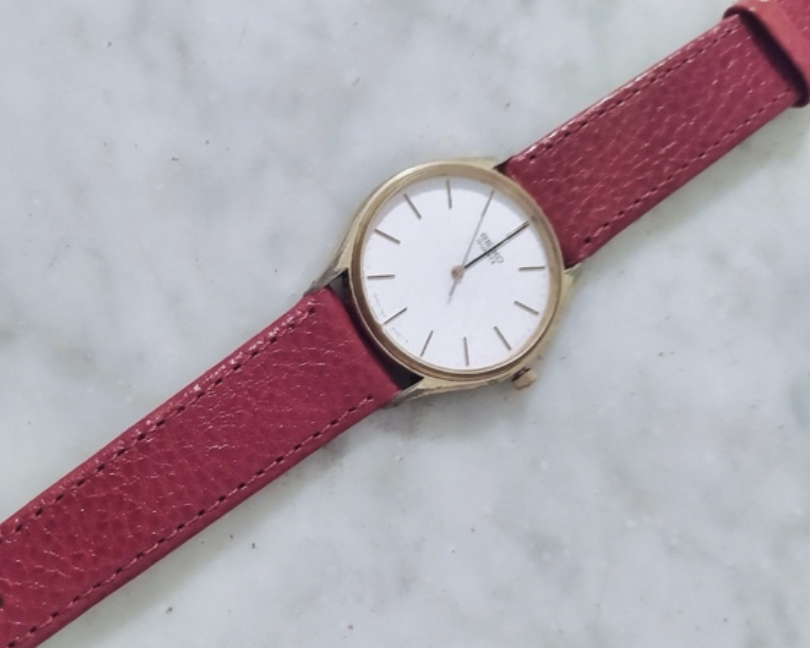
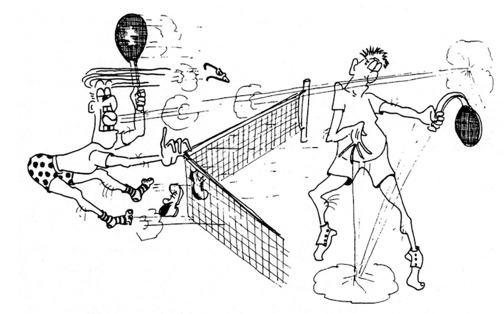

## Napoletani, esuberanti

Nell’ufficio in cui lavoravo, grazie alle persone che vi erano,
tutte giovani, si era creato un ambiente sereno e piacevole. Tra
noi c’era affiatamento: ciascuno svolgeva il proprio lavoro con
impegno ma trovava anche il tempo di scherzare, di scambiare
battute e consigli. Un giorno Ezio, senza un preciso motivo, salì
in piedi su una scrivania situata al centro dell’ufficio open
space. In quel momento arrivò il nostro capo che non ebbe
alcuna reazione. Ezio si pentì immediatamente di quel gesto ma
ormai la frittata era fatta. Si rivolse a me, sconsolato,
chiedendomi cosa fare: fare finta di niente o giustificarsi col
capo?

Gli consigliai di parlarne, cercando il momento giusto, magari
dicendo che voleva controllare il flusso d’aria del
condizionatore, che a volte era troppo freddo e fastidioso.
Vicino a noi c’era anche Maurizio, ingegnere napoletano, e Ezio
volle consultarsi anche con lui, sperando in un consiglio più
fantasioso.

Maurizio cercò di tranquillizzare Ezio minimizzando l’accaduto
e aggiungendo che il capo, che aveva grossi problemi di vista,
forse non l’aveva nemmeno notato. Ezio, temendo di perdere
l’aumento che aspettava da parecchio tempo, decise di parlare
col capo. Entrò nel suo ufficio e lo vedemmo parlare e
gesticolare senza però sentire cosa si dicessero. Dopo alcuni
minuti, Ezio uscì con aria più rilassata. “Che t’ha detto”, chiese
subito Maurizio. Ezio, con un sorriso appena accennato,
rispose: “Esuberanti questi napoletani!”, lasciando intendere a
Maurizio che ci fosse stato uno scambio di persona. Non era
vero, naturalmente ma Maurizio ebbe una reazione
improvvisa: “Eh no! Non ci sto! Vado subito a dire che non ero
io!”. Maurizio fu fermato in tempo e la cosa finì lì, tra le nostre
risate di ilarità. Eh sì, la percezione di un fatto può cambiare a
seconda che…

## Il comitato dell’ora esatta

Da qualche tempo erano in commercio i primi orologi al
quarzo. Ezio fu il primo nel nostro ufficio ad acquistarne uno
della nota marca giapponese Seiko. Io ho due passioni a cui
faccio fatica a resistere, gli orologi e le penne stilografiche.
L’orologio di Ezio mi piaceva molto e, con il permesso di mia
moglie e l’aiuto di mia suocera, ne acquistai uno uguale per il
mio compleanno.

Io ed Ezio, con quei preziosi oggetti al polso, ce la tiravamo non
poco con i colleghi. Il nostro amico Marco non poteva restare
indietro e volle un modello uguale, ma con il quadrante color
oro, per distinguersi.

I tre orologi erano proprio belli, raffinati e straordinariamente
precisi. Ogni giorno controllavamo l’orario tra noi, compiaciuti
dell’acquisto.

Fu così che dopo poco tempo ci autoproclamammo “Comitato
dell’ora esatta”. Il comitato non aveva alcuna funzione, nessuna
utilità se non quella di pavoneggiarci e suscitare un po’ di
invidia tra i colleghi.

Ogni giorno alle 12:00, il comitato si riuniva, scandiva il conto
alla rovescia: 3, 2, 1, e dava l’ora all’unisono. Il rituale durò per
un po’ finché, un giorno, l’orologio di Marco cominciò a
sbagliare, mentre il mio e quello di Ezio andavano
perfettamente sincronizzati.

Marco era sempre fuori tempo, a volte in anticipo, a volte in
ritardo, seppur di poco.

Il motivo? Io ed Ezio ci eravamo messi d’accordo per
modificare l’orario sui nostri orologi, in modo da restare
sempre allineati.

Marco impazziva. Cercammo di giustificare scientificamente la
cosa: il nostro quadrante bianco rifletteva molta luce solare,
mentre il suo, color oro e quindi più scuro, assorbiva più calore,
alterando la dilatazione termica delle lancette.

E così: “Se vuoi, puoi cambiare il quadrante e metterne uno
bianco come il nostro”, gli suggerimmo.

Marco tornò dall’orologiaio che, dopo aver osservato l’orologio
per giorni, assicurò che non aveva difetti.

Dopo un po’, noi due confessammo il trucco e il comitato tornò
a scandire l’ora, perfettamente sincronizzato.

## La scommessa

Marco rientrò da una breve trasferta in Arabia Saudita, dove la
nostra società aveva uffici. Raccontava ai colleghi delle cose
viste, quando il discorso cadde sulle sigarette Camel, che un
tecnico locale fumava regolarmente.

Secondo Marco, sul logo delle sigarette c’era una scritta
nascosta, visibile solo agli occhi esperti.

Non ricordo il contenuto della scritta, ma a noi sembrava una
sciocchezza. Marco, che non fuma, non poteva aver avuto modo
di vedere bene la confezione.

Sorprendeva la sua insistenza sulla cosa.

“Scommettiamo?” propose. Io e altri due colleghi accettammo,
puntando mille lire a testa.

Il giorno dopo, Marco chiamò il tecnico in Arabia davanti a noi
per farsi confermare ciò che lui sosteneva. Durante la
telefonata, la sua espressione passò da sicura e spavalda a
preoccupata. Chiuse la cornetta e confessò sommessamente:
“Avevate ragione voi; mi sono sbagliato”. Marco saldò la
scommessa, ma nessuno volle prendergli i soldi, sarebbe stato
un atto meschino.

Dopo una rapida consultazione, decidemmo di acquistare dei
gettoni per la macchina del caffè così che anche gli altri colleghi
potessero beneficiare della “vincita”.

Mettemmo i gettoni in un vaso trasparente sopra un mobile in
open space, vicino alla scrivania di Marco, con un cartoncino:
“Servitevi pure, offre Marco”. Chi passava si sentiva in dovere di
ringraziare Marco e chiedere cosa si stesse festeggiando.

Non è il caso di riferire le risposte di Marco né le imprecazioni
che ci rivolse.

Se c’è una morale in questa storia è che, da allora, Marco
divenne fortemente avverso a qualsiasi scommessa.

## Torneo di tennis degli approvvigionamenti

A metà degli anni Ottanta, nella mia società mi si aprì una
nuova opportunità professionale: entrai a far parte del reparto
approvvigionamenti.

I miei nuovi colleghi, nel darmi il benvenuto, vollero subito
sapere se sapessi giocare a tennis. Inizialmente non capii il
senso della domanda, ma mi spiegarono che si stava
organizzando il torneo annuale di tennis, una competizione di
doppio con coppie miste formate da un giocatore della nostra
azienda e uno dei fornitori. Il torneo si concludeva con una cena
e con la premiazione delle coppie vincitrici.

La formula potrebbe suscitare qualche perplessità in chi veda
acquisti e vendite come parti con interessi contrapposti ma in
realtà, la formula era nata dall’idea di migliorare i rapporti con
i fornitori creando un clima di reciproco vantaggio. Questa
breve premessa spiega, il bel clima che si respirava
nell’ambiente di lavoro. Il tennis mi piaceva e il torneo
rappresentava l’occasione per riprendere a giocare. Entrai a far
parte del comitato organizzativo desideroso di contribuire al
successo della manifestazione. Uno dei primi incontri fu molto
divertente, con situazioni quasi fantozziane. Mi venne così
spontaneo scrivere un simpatico commento in rima,
prendendo in giro i protagonisti. La trovata piacque a tutti,
tanto che mi chiesero di scrivere una rima per ogni “Big Match”.

Si arrivò così all’incontro del capo, del direttore e non poteva
certo mancare un mio commento. Ecco il racconto, ripreso dai
documenti storici di allora:

<section class="poesia">

6° Torneo di Tennis News

– 11 maggio 1988 –

La partita del capo

<blockquote>
Nonostante i tuoni e i lampi, si è giocato su entrambi i campi. 
Delle due partite in atto, parleremo di una sola, 
cioè di quella col Gerola*; 
La contesa è singolare e la vogliamo raccontare. 
Si presentan tutti fieri i nostri quattro moschettieri. 
Sul campo 2 gioca dunque il capo, che da tutti è ammirato. 
Assiste anche la consorte. Il capo è in forma e gioca forte! 
Batte l’un, risponde l’altro; tira questo e poi quello 
e ad un tratto arriva il bello. 
Tira Enrico da dritto a manco e colpisce il capo al fianco. 
Sotto shock per la gran botta, questi subito borbotta: 
Ma che fà! Mi tira addosso? Non è mica ortodosso! 
E brandisce la racchetta in chiaro segno di vendetta. 
Resta fermo il suo compare che non sa più cosa fare. 
Fermo e rigido come pinocchio; ecco, pumm! Colpito all’occhio! 
Dopo un po’ va anche a terra, proprio come avviene in guerra. 
Gli avversari esterrefatti se la ridon come matti 
e si sa cos’hanno in mente: passiamo il turno, finalmente! 
Cadon dal cielo alcune gocce e i nostri eroi vanno alle docce.
</blockquote>
</section>

\* Gerola: fornitore (N.d.A.)
{: .note-small}

<section class="poesia">

Poesia al Poeta “Atto secondo”

(Ovvero la risposta del capo)

<blockquote>
Il poeta mai non mente, 
Tutto è vero e divertente. 
La vicenda dell’incontro 
si è risolta in uno scontro 
ed il bello è che avversari 
fur color ch’eran compari. 
Ma il poeta fu prudente, 
si domanda tanta gente, 
per aver un po’ tirato 
pei fondelli il proprio capo? 
Tutto ciò, da mane a sera, 
può costargli la carriera?
</blockquote>
</section>

A questa sottile minaccia del direttore risposi con un’altra rima
di cui riporto solo i versi iniziali:

<section class="poesia">
<blockquote>
“Anche quest’oggi non è sereno e 
e anche stavolta commenteremo. 
Si, perché l’arte ha da seguir le sue tracce, 
anche in presenza di velate minacce!…”
</blockquote>
</section>

Lo scambio di rime fu molto apprezzato, così come alcuni
scambi sul campo da tennis tra i giocatori.

Va detto che la mia carriera non subì contraccolpi nonostante
le rime simpaticamente impertinenti e nonostante la vittoria
del torneo, proprio contro il capo che seppe incassare il tutto
con grande sportività.

