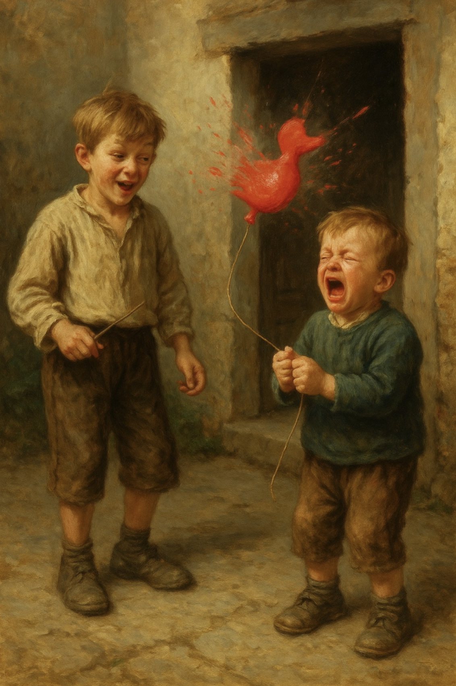

Sik frädèi, önä cä plinä dé gus, sòlete béghe, sgregnàde e tancc facc curiùs. Graziano, näsì én sétembär dèl 1941, Flavio én ägóst dèl 1943; Annamaria él pröm dèl an 1947; mé, Pierluigi, én sétembär dèl 1949; e ä lä fì Angiolino, él plö picinì, ignì äl mónt én mars dèl 1951. Fiöi dé Sandro e Ernestina, dò pärsùne ä lä ma,  cón ön sénso gaàrt dèlä fämiä.

Én chèste pàgene, plö ó mank, compäreróm töcc. Pärché lä nòsä enfànsiä l’érä ön mónt pesèn e én chèl mónt ognū él gàä él sò encàrek.

Pörtròp ék sarà miä Adelmina, lä prömä, che l’è mortä quànt lä gàä sèt agn, per önä polmonìte cöràdä mal, quànt mé sére gnamó näsì.

## Én fàse

Mé gò miä memóriä derètä dé chél che ciöntarò sö. I mé n’à parlà déärse òlte, cón chèl fà ön pò sério e ön pò deertì dé quànt és ciöntä sö le stòrie dèlä fämiä tramandàde ‘nd’èi tép. Gàe dömè pòk mis, ön fagotì fat sö ‘nd ‘èle fàse comiä dé özànsä ä chèi tépp. Sére stà äfedà pèr quàk momént äl mé frädèl Flavio, ch’èl gaä dömè sés agn, e ch’èl gaä dé ardam dré.

Dé segiūr, Flavio él mé ölíä bé ma l’érä ön pò stràmbo. Él gaä el vésio, fórse pèr zögà, fórse pèr säntis grant, dé tràm en ariä. ‘Nä òltä, ön’àträ e pó ämó. Sospändì pèr ariä, sgrégnae, fórse. Ma él zök l’è finì end’èlä mäniérä ché ‘spögliä spetàs. Ön momént dé dezätensiù e…su finì én tèrä. So miä se sé säntì ön bòt, se ‘m su mätì ä plànzär o se ò dét gnént pärché él mé ignìä miä él fla pèr él späènt.

Ä òlte ‘m domando: saràl miä stà chèl él moment ch’él mé gàbes segnà pèr tötä lä étä?

## Saltà l’äzìlo

Saltà l’äzilo ä quàtär agn? Chipo? L’é emposìbel. Äpūr…

Én chèi agn, él nòs päìs l’érä ön pòst èndo töcc i sé cognisìä. Fänzì e ‘lgiài i nàä ä s-ciölä dä pärsé, i träärsàä lé viè sénsä pòrä cón él sästilì délä märèndä trä le ma. Graziano él gaä sés agn, gnamó complì e Flavio él gaä quàtär agn. Töcc i dé i faä chèl chelòmetro dé viè ché gh’érä trä lä nòsä cä, én font al päis, én Ösnà, e l’äzìlo, trencò äl päis, én Cävril.

Chèl dé gliò però, quànt ié turnè ‘ndrè dòpo mesdé, lä màmä l’à nótà ärgót dé curiùs: iū dèi du sästilì l’èrä restà tälequàl e l’à domandà spiegäsiù. Graziano él sé défèndì defàt: él lä sò märèndä él l’aä mangiàdä. E Flavio? “Él sò miä, l’ò miä ist à l’äzilo”. Curiùs, pròpe curiùs.

Flavio l’è reà ä cä dòpo pòk, stöf e mòrt dä lä fam. Lä mamä él l’à ardà cón i öcc dé chèi che sa zä lä äretà. “Endó sit stà?”.

Dòpo ön pò dé endeceziù, Flavio l’à confäsà: l’érä miä nà ä l’äzilo. L’àä decidì dé ciapàs ön dé dé acànsä, äterà dä chèlä bèlä zornàdä dé sul. Ensèmä äl sò compàgn Aldo, l’érä nà ‘ndön prà égliò äpè e gliò l’érä stà bötà zö ‘ndél’èrbä empezolà sótä él cél.

“E dä mangià?” lä gà domandà lä mamä. Flavio l’à sbasà i öcc e cón on fil dé gus, quàzi én cùlpä, él gà räspondì:”ò mangiàde lé …märghärite”.

Entàt che sére dré ä scrìär stó fat che, ò pröà ä sércà én Internet öna parolä o ärgót dé defärént envése dä dì “saltà l’äzilo”, gò miä troà gnént dé compàgn: poà ‘l vocabolàrio délä rét äl s’é ärändì: ghè miä paròle pärché l’idéä che ön fänzi de quàtär agn él pödäs fal lä sömèä emposìbel. Fórse, ch’él dé gliò él fa part dél löbär déi récord. Récord che négiū, äl dé d’én ciö i pödärà bätì.

## Él balù

Ön dé, él nòs bobà l’éra stà ä Brèsä e él màä portà du regài, pròpe bèi: du balù rós ä fùrmä de òk. Iù pèr mé, l’àtär pèr Angiolino. Mé gàe sés agn, él quàtär. Äpénä gh’iòm vi én ma, sum corì fó dé cä a zögà.

Él mé balù él balàä legér trä i dì, ma enchèlä cón ön bòt, sénsä spetàslä, l’é s-ciopà. Él bòt l’é stà fòrte. Mé su stà ciapà dä önä mälenconìä profóndä. E l’envìdiä lä gà fat él rèst.

Mé ò ardà Angiolino ch’él strinzìä él so balù tälequàl. Ön pänsér velenùs malfedét él mé compärì endèlä mènt. Ék su nà äpé e gò fat pärì dé èsär ezältà dèlä contäntèsä:”Ghét säntì che bòt ch’èl ga fàt él mé balù? Dài, fóm s-ciopà pò él tò!”.

Él l’é rästà ön po' endesìs, Ma mé ò sequetà e ò sercà dé persoädìl. Ä lä fi, Angiolino él s’é convinsì. Mé gò ciapà ön bastùnsì, su na äpé äl balù e…BUUM!

“Ché bòt, eh?”. Gò dét cón önà bèlä cérä sforsàdä.

Ma Angiolino él sgregnàä miä. I öcc i ghé s’é emplenì dé làgreme e l’é s-ciopà zö ä plànzär despärà. Lä mamä l’é reàdä pòk dòpo späentàdä dälé gus. Ém regòrdo miä bé comià l’è nàdä ä finì lä zornàdä. Ma önä ròbä la sò: chèl fat égliò, sée pesèn, él mé brūsä tré amó enciö. Elsée rìo enfínä ä sgregnàk-sùrä, ma cón ön vél dé remòrso ché l’é mài spärì dèl töt.

## Él prémio pèr lä s-ciölä)

Annamaria lä fàä lé elementàri e lä gàä fàt ön concórs orgänezä dèlä socetà Càffaro, èndo él laoràä él bobà Sandro, pèr i fiöi dèi depändäncc. Ém regòrdo miä che pröä l’érä, ön témä, fórse o ön desègn. Lä bèlä notìsiä l’è stàdä che lä gàä insì e tochè i gàä spedì ä cä ön pak cón tré tancc ärtìcoi pèr lä s-ciölä: mätite, pène, göme pèr scäncelà, quädèrni, colùr. Pròpe töcc bèi. Che sodesfäsiù pèr lä nòsä fämiä, pèr Annamaria, perché lä egnìa prémiadä l’ùnecä fèmenä dèlä fämiä, pèr él bobà Sandro che él gaä resiì i compleméncc dèi sò sòci dé laorà. Poà mé, Angiolino, Graziano e Flavio séräm tant contécc dé chèl prémio che lä gàä ì Annamaria.

Ma… él dé dòpo él bobà Sandro él gà ì önä lèträ dèlä socetà. Endèlä lèträ i ghé spiegaä che, pörtròp, gh’érä stà ön erùr ‘ndèl fa lä cläsìfecä dèi vinsìdùr e dé consäguènsä l’àä mìä insì él prémio. Lä socetà l’érä despläzidä, rencresidä i s’è scözaä tant,ma i éra öbläghè ä domandà endré él prémio pèr dàl ä ‘lgiàl o lä ‘lgiàlä che l’àä insì. Ef dék miä lä reäsiù ch’èl gà ì él bobà. Ém regòrdo plö o mank chèste paròle:”compèrte ‘s fa ä domandà ‘n dré él regàl ä önä fänzìnä? L’è mìä posìbel! Plötòst ch’èi mé domandès dé pagàl, che i mé tegnès zó dä lä būstä pàgä, ma èi pöl mìä domandàm dé fàgäl dà ‘ndré ä lä mé fiölä! Ém farò säntì  dèl mé càpo e parlarò poà cól deretùr! L’è önä robä orèndä! Lä mamä Ernestinä lä ga miä dét önä paròla pèr miä rändì l’ariä ämò piö gréä. Mé e Angiolino fàäm sito. E Graziano e Flavio? Ié reè tré dèl’aträ stànsä e i s’é mätì ä guzà: “ L’è stà ön schèrs! È ‘vlóm fadä. Lä lèträ l’óm scriìdä noàtre”. Pó ié scämpè fó dé cä defelàdä pèr lä pòrä dé ciapàle däl bobà. Él ghè ölì ön bèl po' de tep pröma che i mätiäs i pé én cä.

## Él giornàl ràdio

Séräm ‘nd’èl 1956 e él nòs bobà, Sandro, ch’él gàä le sò convisiù polìteche, äbonà fedél äl “Avanti!” èl fàä part dèlä giùntä én cömù, cognisì e respetà én päìs. Él pärdìä miä ocäziù dé spärtì cón i compàgn, ä l’ostäria, trä önä pärtidä ä càrte e l’àträ, lä sò sempätìä pèr lé edèe sociälìste.

Graziano e Flavio i nàä à s-ciölä dèi sälesiàni, ä Törì. Graziano él fàä él genàzio e Flavio lä s-ciölä tènicä dé eletrotènico. I érä ä cä én acànsä quànt éi gà ì ön’edèä – mé su pärsöàs che l’è stàdä dé Graziano – dé fa ön schèrs äl bobà Sandro. Flavio, sénsä  fas idì, entàt ché él bobà l’érä ä laorà, él s’éra mätì ä träfecà cón l’aràdio dé cä e cól tälèfono dèlä socetà che él bobà él dorvàä pèr telefonàde dé särvìsio e quànt gh’érä dä entärvignì söla lìniä elétrekä. Ä lä fì, aràdio e tälèfono i érä tächè. Graziano él s’é ciapà él còmpito dé cörà lä part “leteràriä“ dèl schèrs.

Él bobà, dömè na ä ignì däl laorà, l’àä (él gàä) empesàdä l’aràdio. Ä ön sèrt momènt i gà entärompì lä träsmesiù pèr dà önä notìsiä dè grandä emportànsä: “ä töcc ch’éi che ié dré ä scoltà, góm dä comenegà che enciö l’onoréol Pietro Nenni, segretàrio dèl Pärtito Sociälistä Italiàno, él ga ì l’encàräk däl Präsedènt dèlä Repūblecä dé fa él goèrno. L’onoreól Pietro Nenni él sarà él nöf Preäsedènt dèl Consìglio dèi minìstri. Fóm i nòs compleméncc pèr l’encaräk e ghé engiöróm bu laorà ecc. ecc…”

Chèst l’érä, plö o mank, äl sénso dé chèl che i gàä träsmätì ä l’aràdio. Fegūràs lä contäntèsä dé Sandro. “Ché notisiä! Fenàlmènt! L’érä ùrä! Ädés sé, lé ròbe lé cambiàrà! E vìä cozétä… L’érä sé émosionà che lä mamä Ernesta l’à miä pödì empedìc dé nà fó dé cä à dà lä notisiä äi so compàgn I compàgn però i érä defedécc, i stäntàä ä crezìc.

Negiū dé èi i gàä sentìdä lä notisiä e i gà tacà ä fac ön sak dé domande: “Sandro, sit segiūr? Chéi che t’là dét? Lä par miä irä”. E él bobà: ”V’él segiūro. I l’à iöstä dét ä l’aràdio! L’ò sentidä mé dé pärsùnä ä l’aràdio. Crezìm! Ä lä fì, poä i plö defedécc i gà ciapàdä pèr bùnä lä notìsiä. Dòpo töt, él bobà l’érä cognisì bé én päis e él gàä önä bùnä reputàsiù. Reputàsiù che però lä res-ciàä dé balangà dòpo chèlä notìsiä encredìbel. Dömè quak ùrä dòpo, trä lé sgregnàde dé Graziano e Flavio, él bobà él él s’è rändì ciūnt dé lä äretà. Ghé ölì quak dé pröma che Sandro él reàäs ä encasà él cólp, ma él fàä lestès bèlä cérä, contét töte le òlte che él ghé ignìä én ment él cólp dé génio dèi sò fiöi e, én cä, él schèrs dél giornàl è lä aràdio l’é deäntadä còsä curiùzä.

