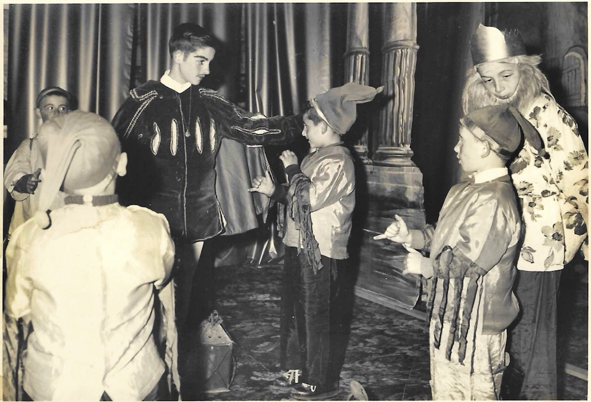

Lé elementàri i-é stàde fórse él tèp plö bèl dèle s-ciöle che ò fàde mé. Mé nàe ontérä ä s-ciölä pärché tànte òlte gh’érä poà dé deertìs. Él mäèstro dèi pröm du agn l’érä él sìndäk dèl päìs, Giuliano Fusi. Brao fés ä ensegnà e tant dür ’ndèl dà i vóti. Pèr mé, i gàä dàdä ä èl lä mé clas pärché l’érä plìnä dé repetèncc che i érä mìä lädì dä gestì. Ärgiü i gàä äderetürä tri agn plö dé mé.

## Lé orènde spése

Noàtre scolàri séräm sänté-zö ä du ä du, én bank  dé lègn. Lä s-ciölä lä scomänsàä él pröm dé otùär, tèp dé cästégne, tochè. Lé cästégne, empèrte és sà, i-é bùne fés e, quànt t’én mange tante, lé fa l’efét dé svelöpà gas che és rìä mìä sémpär ä tignì. Gianni èl gà tacà ä remenàs. S’él säntìä ä brontolà e ä dì ärgót ä Giuseppe, él compàgn dé bank denàcc äl sò. I du i sé fàä dèi sègn cón lé ma  äl punt che él mäèstro èl s’é näcorzì e èl gà ön pò braà-dré. “Chèl dré ä cäpetà?”, èl gà domandà. Gianni l’é leà-sö én pé e, entàt ch’èl sé stopàä él nas, èl gà räspondì: “Giuseppe èl continuä ä patonà e mé ék lä fò mìä ä rezistì. Él mäèstro èl ghé na äpé äi du e èl s’é rändì ciünt che Gianni èl gàä mìä töcc i tòrcc ä lamantàs. “Gnént dé gròs”, èl gà dét. “Resolvòm él problémä”.

Èl gà mandà-è i du, èl gà ciapà önä bositìnä, èl ne gà sparnagà ön pò söl sedìl dé Giuseppe e èl gà dàt fök. Lä flamä l’é dörada pòk säcóncc e lä s’é smorsàdä. “Bé ’lgiài!”, èl gà dét. Él bank l’é dezenfetà, pödì na ä säntàf-zö e pödóm sequetà cón lä lesiù. Cón bèlä cérä, èl gà räcomandà ä Giuseppe dé na äbelàze cón lé cästégne. Giuseppe, poòr-crìsto, l’ärés ölì spärì, deläguàs endèl’àriä, comià él gas che l’érä mìä reà ä tignì.

## Él calamàr

Fàe lä tèrsä elementàr. Comiä ò za dét, ’ndélä clas séräm sänté-zö ä du ä du, én bank dé lägn. Comiä és sa, ä chèi tèp, dälä säcónda clas, ennàcc, és scriìä cón l’enciòstär blö o nìghär, e és droàä lä pènä cól pinì.

I bank i gàä tochè i calamàr, éndo és bagnàä-zö él pinì, che lä bedèlä l’emplenìä töcc i dé. Mé sére säntà-zö, äpé ä Clemente, ön repetènt sempàtek e zaclà fés. Ön dé, entàt che èl temperàä lä mätitä, bózie i-é finìde ’nd’él sò calamär e lé stàä ä gàlä e l’érä complecà bagnà él pinì. Clemente, pèr terà-fó lé bózie, èl gà pänsà bé dé na äpé äl calamàr e soplà fòrt e dé conäguènsä l’enciòstär l’é  saltà däpärtöt: söl bank, söi quädèrni e sùrä töt söl sò mostàs che l’érä deäntà önä pälètä dé zàcle nìgre. Fegörìf che sgregnàde che góm fàde noàtre!

## Él ca luf

Có c’enträl pó ön ca luf cón lä s-ciölä? V’él spiégo. Mé fàe lä quàrtä elementàr. Lä nòsä mäèsträ, sénsä spetàslä, lä gàä ì ön malèsär e gh’érä mìä stà él tèp dé cambiàlä defàt. Cozétä él mäèstro dèlä clas äpé, én plö äi sò scolàri, ògne tàt, èl gàä dä ardàm-dré pò ä che noàtre, pèr idì che ’sfàäs mìä tròp cäzì. Èl controlàä che éc fös mìä tròpä confuziù e èl nàä amó ’ndèlä sò clas. Dòpo ön pèr dé dé, mé ém sére nacorzì che él dòpo mesdé èl controlàä mìä ch’èi che i-érä én clas e tochè és pögliä saltà lä s-ciölä sénsä res-cià. Gh’nò parlà él mé compàgn Mario e, sénsä bezögn dé tacc descórs, sum sté d’entìs defàt: él dé dòpo gärésäm saltàdä lä s-ciölä. E cozétä l’é stà. Dòpo mesdé, és sum mìä prezänté e sum né end’ön pra gliò äpé ä lä s-ciölä. Góm scäalcà él fil spenà dèl sarài e és sum bötä-zö énd’él’èrbä. Ceciäràäm, scrötonàäm e és godìäm él sul dé prömäérä.

Én chèlä, dedré dé noàtre, l’é compärì ön ca-luf gròs fés ch’èl ga tacà ä sbacàs. Späenté, góm sercà dä scampà e dä scäalcà él sarài, ma quànt gò tentà dä saltà, su biöscà e cón önä gambä su finì söl fil spenà e ’m su fat ön sberlèk lunk e fónt, däi pé äl caàl däle bràghe. E ädés? Gh’érä pòk dä fa. Miàä na ä cä e fam medegà, ciöntà-sö töt ä lä mamä e sperà én ön pò dé comprensiù. Lä mamä l’é mìä stàdä tròp sevérä, pèr fortünä. Dé segiür l’érä pänsärùzä e spaantàdä dèlä miè ferìdä. Él dé dòpo su na ä s-ciölä e, cón gran sodesfäsiù, gò säì che él mäèstro èl gàä mìä fat l’äpèl.

## Él mé scampä dé na ä pesà

Èl pöl cäpetà ä töcc dé ik bezögn dä corì él cèso én frèsä. L’é nätöràl. Però sé ärgiü i té pröebés dä nak… Séräm én quartä elementàr, lä mäèsträ l’érä dré ä spiegà ä lä lavàgnä quànt Osvaldo èl ga alsà-sö lä ma pèr domandà él pärmès dä na äl cèso. Lä mäèsträ però lä ga dét dä spetà che lä finìäs dä spiegà. Osvaldo l’érä stà quét pèr ön pò, ma pó, l’à alsàdä-sö amó lä ma pèr domandà dä pödì na äl céso. Lé paròle dé önä sempàtekä cänsù, “Mi scappa la pipì”,  lé dà l’edèä  dé chèl che l’é sücedì ä Osvaldo chèl dé gliò ”mi scappa la pipì, mi scappa la pipì! Non ne posso proprio più, io la faccio qui!”. È L’é chèl ch’èl gà fat Osvaldo cón àriä dé sfédä.

Dòpo él säcónt no dèlä mäèsträ, ön sègn èl gà comincià ä scödì vèrs lä lavàgnä e, ä lä fì, lä mäèsträ lä ghé finìdä-tré cói pé.

Lä clas l’érä fàdä dömè dé mas-cc e entùrän ä chèlä setöäsiù ghè mìä stà tant ciàs e l’é mìä deäntàdä ön scàndol.

## Atùr

Fàe lä quàrtä elementàr e ärgiüne mäèstre cón ä càpo lä vìce dèl deretùr, mäèsträ Giulia, ém regòrdo mìä bé én ocäziù dé che fèstä, lé gà orgänezà ön teàtro cón noàtre scolari che gàäm dä fa i atùr, särnì-fó trä lé defärénti clas. Mé, domändìm mìä perché, s’ére stà selesionà pèr lä part plö ’mportàntä, él prìncipe. Matilde, dèlä tèrsä, l’érä stàdä selesionàdä pèr fa lä principèsä. Èl pöl das che sìäs stà pärché töcc du nàäm bé ä s-ciölä e, tochè, äresäm pödì saltà quàk lesiù pèr lé pröe dèl teàtro sénsä ìk consäguènse sö lé mätérie dèlä s-ciölä.

Matilde l’érä önä bèlä ’lgiàlä e él fat che recetàäs cón elè l’àä creà ön pò dé envìdiä trä i mé compàgn dé clas. Ém regòrdo mìä bé lä stòriä, ma l’é lädìnä dä fegörà: ön prìncipe, önä principésä, ön sìto encantà, emplenì dé ömäsì e viä cozétä; ön bèl fenàl e…i-é iì contécc pèr tötä lä étä. Lä stòriä l’érä plötòst lungä è emparà lä part dä recetà l’é stà empegnätìf.

Ä lä fì, lä recetasiù lä ghè stàdä e l’é pläzìdä fés, pròpe fés. Él teatro l’érä plì ras e, sö domàndä dé chèi che i gàä mìä pödì äsestì, lä recetasiù l’é stàdä repetìdä lä sätämànä dòpo. Teatro amó plì ras. Ém regòrdo che gàe lä féär e ön grant frädùr, ma, sé sa, i atùr i pöl mìä fa dà-zö i bras ä lä so zét. “The show must go on” i dis chèi che i blàsä ön pò l’englès.

