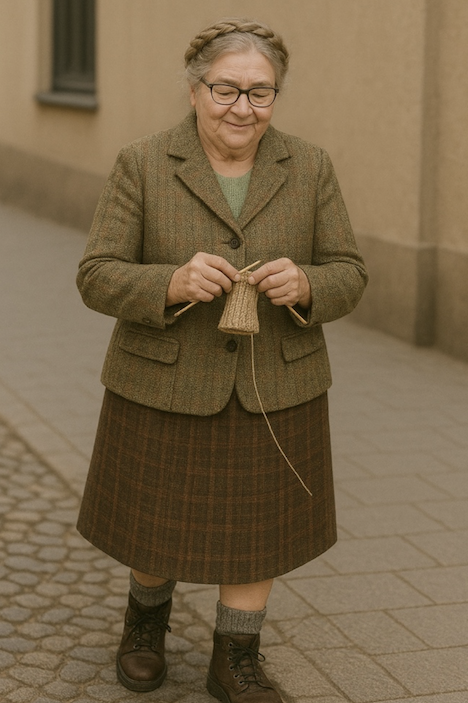

## Lä profesorèsä Ginevra

Ön caràtär, ön modèl däbù oregenàl. L’érä önä siùrä che l’àä pasà i sinquàntä e che én päìs i cognisìä töcc. L’érä dé fämìä siòrä e cognisìdä dä lä zét dèl päìs. Töcc i agn, d’està, ensämä èi sò frädèi lä ignìä ä Bagolì ä pasà lé acànse e lä ’s fàä notà. Él dèt “scàrpe gròse, särvèl fì”, èl pödiä èsär stà fat-sö dä elè. Sémpär istìdä én fòzä stràmbä cón gòlfini, cälsätù dé lànä gròsä e scärpù dé mut, lä träärsàä töcc i dé él päìs e entàt lä envociàä e lä déziä-sö dèi vèrs o dèle oräsiù.

Laureàdä én giöresprödènsä, lä ensegnàä derìto canònek ä l’onivärsità dé Sassari. Lä gà ì trä i sò stödéncc l’ex präsedènt Francesco Cossiga. L’é trä i mé regòrcc pärché, quànt gàe ùndes agn, i mé genetùr i gà ì dé cambià cä e él mé bobà äl s’é revolgì ä lä profesorèsä ìst che lä so fämiä lä gàä önä cä én més äl päis sfétä dä ön bèl pò dé agn. Lä profesorèsä Ginevra lä s’é dàdä dä fa defàt pèr säntì i sò frädèi, ma lä gà fat säì che lä särés mìä stàdä ön’empréza lädìnä convincìi ä fetà lä cä pärché i gàä én mènt dèi àtär progécc. I frädèi i vivìä ä Melà e i tèp pèr säntìi i-é sté lunk pärché miàä pasä pèr fòrsä dèlä pòstä che l’érä l’ünek més pèr säntis cón chèi dälùns. Pèr lä mé mamä signì cambià cä dòpo tacc agn, l’érä comià ik vì ’nä desgràsiä e lä profesorèsä Ginevra lä sé n’érä rändìdä ciünt quànt lä gàä i l’ocäziù dé parlà cón elè. L’é stà cozétä che lä profesorèsä Ginevra entàt che lä spetàä lé respòste däi so frädèi, lä gà i l’edèä dä dì önä noénä pèr ìk lä gràsiä. Pèr nöf dé dé filä, lä s’é präzäntàdä ’nd’èlä nòsä cä, él dòpo mesdé, pèr dì-sö lé oräsiù, särnìde ƒó dä elè, e lä teràä-tré töcc chèi che sé troàä én cä ä chèl’ùrä gliò. Mé gò sercà dä èsär sémpär temporì e, ä lä fì, lé oräsiù i-é stàde contäntàde: dé gliò ä pòk tèp és pögliä tacà ä orgänezà él sanmärtì. Finìde lé oräsiù, lä profesorèsä Ginevra lä stàä gliò ontérä ä fa ’nä ceciaràdä cón nóatre e l’é comenciàdä önä bèlä reläsiù cón lä nosä fämiä. Sé lä fodès mìä stàdä ä lä fì dèlä acànsä, su segiür che lä gärés orgänezà poà önä noénä dé rengräsiämént pèr lä bùnä consäguènsä dèle sò oräsiù.

## L’óm nìghär

Dä quàk tèp gàäm cambià cä. Séräm marcià dèlä cä èciä e s’éräm né ä stà én önä cä én més äl päìs. Önä cä bèlä fés, dèle stanse grande e spasiùze. L’érä fäbrecàdä-sö du pla e lä gàä poà ön solär bèl grant éndo és mätìä lä lägnä pèr l’envèrän e gh’érä spasio poà pèr mòbei vècc, magàre sgängäré, ma ch’èi pögliä sémpär ignì bu. Él sito giöst éndo, ’nd’èlä miè emmägenäsiù dé ’lgiälèt, i pögliä scondìs óm cätìf, móstri späentùs dé chèi che és gàä dä ìk pòrä.

Ön bèl dé, séräm dré ä dösnà quànt él bobà l’é stà ävezà che gh’érä stàdä önä rotürä sö lä lìniä elétrekä e tochè äl gàä dä entärvignì. Äl plöìä che Dio ’l lä mandàä. L’érä ön continuo dé dälfì  e tu. Iü dé chèi fòrti tämporài che ghè én montagnä.

Én cä, ensèmä äi genetùr, séräm mé, Angiolino e Annamaria. Él bobà Sandro èl gà domandà chèi che és lä säntiä dä na söl solär ä tök él tabàr pèr na-fó. Mé ém su ofrì e ém su säntì grant e speretùs. Su na söl solär e gò troà él tabàr e gàe dömè dä portàl-zö.

L’érä ön pastràno empärmeàbel nighär, grant, ch’èl pesàä fés e l’embregàä, cón ön gròs cäpèl rotónt. Él sestémä plö pràtek pèr portàl-zö l’é stà chèl dé mätìmel endòs:pastràno söle spàle e cäpél söl cò, gò tacà ä na-zö dèle scàle vèrs él säcónt pla. Én quèlä, Annamaria lä ignìä-sö däl pla desótä pèr na äl cèso. Lä gà dàdä ön’öciàdä énsö vèrs l’alt e lä s’é troàdä denàcc lä mé sàgomä nìgrä, spropozetàdä pèr viä dèl pastràno che gàe-sö e, späentàdä lä gà lanciàdä önä gusàdä desömànä. Mé pärsöàs che lä gàäs vist ärgiü dedré dé mé, gò tacà ä corì-zö e ä guzà ä mé òltä. Annamaria, nèl vidì che l’óm nighär èl ghé corìä-dré, lä gà sequetà ä guzà deplö cól späènt ch’èl cresìä. Là consäguènsä l’é stàdä che sum reé ensèmä ’nd’èlä sàlä éndo ’s dösnàä späenté, biànk comià dò cändìle, cól ciör én gùlä. Cóle gàmbe che l’ém trämàä, gò dàt él pastrano äl bobä, pó, ém su säntà-zö én poltrùnä. Ghé ölì ön bèl pò dé tèp prömä che mé e Annamaria ciapàsäm él colùr normàl.

## Nóm ä pascà

Él bobà èl gàä pasàdä ä noàtre fiöi lä pasiù pèr pascà lé trüte. L’érä na-zö ’ndèl Càfär, che él part dälé falde dèl Blumù e èl vé-zö dré ä lä àl o l’érä na-sö dré iü dèi ré che i và ä finì ’ndèl Càfär. L’érä està e Graziano e Flavio i èrä ignì däl colégio dèi säleziani pèr pasà ön pò dèle pòche acànse che i ghe concedìä.

Ön dé góm decedì dé na töcc ä pascà. Poà Angiolino èl vögliä ignì. Èl ghé tegnìä fés e, ist che meàä leà-sö prèst, l’àä ölì na ä dormì prèst pèr èsär pärècc e én gambä lä domà. Mé, Graziano e Flavio envése góm olì na äl cìnemä pärché pèr noàtre l’érä mìä ön problémä leà-sö ä bonùrä. Sum vignì ä cä däl cìnemä plötòst tàrde e góm troà Angiolino endormäntà. Dormiäm töcc ’ndèlä stèsä stànsä e, con-töt che ghèsäm sercà dé fa mìä ciàs, góm mìä pödì fa ä mank che Angiolino ’l sé desädàäs. Èl s’é desädà, èl s’é fregà i öcc, èl gà iscc noàtre tri frädèi, én pé e istì e ’l gà domandà: “sif za pärècc?”.

Chèlä domandä gliò lä gà segnàdä lä sò condànä ä deäntà él barsài d’ön schèrs. Noàtre tri góm räspondì quàzi ensèmä dé sé e, aderetürä, góm dét: “sìrcä dé fa én frèsä ä lià-sö! Té sé che dòpo önä sèrt’urä lé trüte lé bocä mìä plö”. Angiolino l’é lià-sö e l’é na äl ceso. Entàt noàtre és sum cäè-fó i vistì e és sum enfelé sotä i länsöi, ognü ’ndèl nós lèt. Él poór frädelì, él plö pesèn dé noàtre, l’é ignì én càmärä e èl gà ist che séräm töcc ’ndèl lèt e fàäm äpòstä dé dormì. L’érä confondì, smatorì e fórse èl gà poà pensà ch’èl serä ensomià. Lä domà, quànt és sum desädé nèl säntì lä svèliä, pèr na ä pascà, góm domandà ä Angiolino s’él vögliä amó ignì ä pascà cón noàtre. Lä respòstä l’é stàdä ciàrä: “Nì ä faf benedì!”. Èl s’érä rändì ciünt che ’l s’érä mìä ensomià ma che gàäm fat ön bèl schèrs.

## Lä s-ciölä mediä

Däl 1962 (melenöfsentsesantädù), gràsie ä lä refórmä dèlä s-ciölä, poà äl nòs päìs óm pödì tacà ä na ä lä s-ciölä médiä önefegàdä. Prömä dé egliùrä, pèr chèi che ögliä na ennàcc ä stödià dòpo lä s-ciölä elementàr, l’ünekä posebeletà l’érä na én ön päìs äpé, dälùns trèntä chelòmetri. Tròp dälùns pèr pödì nak töcc i dé cón lä pòstä, én pärtecolàr sö önä viè dé mut, tötä ä cürve.

Cozétä, end’èl spätà che lä s-ciölä mediä lä scomänsàäs, gò fat lä sèstä elementàr, ön pò comiä önä s-ciölä profesionàl. Chèl an egliò gò troà entärès pèr mäterie nöe comià fräncés, desègn tènico e, plö dé töt, él laboratorio dé marangù.

Ä lä fì lé s-ciöle médie i-é scomänsàde e dé chèle ciöntarò-sö quàk fat.

## Genàstecä

Amó enciö, dòpo plö dé més sècol, rìo mìä ä spiegàm compèrte lä’m fös stàdä destenàdä lä profesorèsä dé genàstecä. Pròpe tèt lä spète mìä.

Önä siùrä däl fòrte äcènto tarù, l’érä mìä bàsä, ma cón ön bèl pò dé chili én plö, és fa pèr dì, e töcc és domandàäm có lä c’entràä cón lä sò mäteriä, genàstecä. Pòk o gnént.

Ä demostrasiù dé chèst, lä gà olì ciärì defàt che lä m’äres mìä fat fa gnént defò dälä clas, ’ndèlä sò ùrä, almànk fì ä lä fì dèlä prömäérä; én pòke paròle, gnént córse, gnént moemènt, gnént pärtìde ä balù. Äl post dé chèste ròbe che lä m’ärés ensegnà edocasiù cìvicä, edocasiù stradàl. Pasàäm lä plö pàrt dèl tèp ä dezegnà e ä colorà cärtèi strädài. L’é ciàr che sé stofàäm e che séräm mìä quét. Parlàäm trä noàtre stödéncc cón lä gus àltä, ’ndèl nòs deälèt e lä profesorèsä lä cäpìä mìä gnént.

Èl pöl dàs ch’èl sìäs stàdä chèstä lä càözä che lä gà portà lä profesorèsä ä revolgìs ä noàtre stödéncc én mäniérä screänsàdä e dèle òlte lä reàä äderetürä ä sfasà-zö. “Sif dèi sap. Fì sìto! Sif gròs!”. Chèstä önä dèle märäèe che lä droàä za dèle pröme lesiù. Önä òltä, do òlte fìnä che iü dé noàtre èl gà reägì. Flaviano l’é leà-sö én pé e, cól tòno dé chèl che ’l gàä mìä plö entensiù dé soportà chèi sprès, èl gà dét én mäniérä derétä: “Sap lä sarà elè!”. Pó ghè stà ön scambio dé bätìde trä lä profesorèsä e Flaviano, curt, ma dür. Negiü dé noàtre äl fladàä.

Lä profesorèsä l’é rästàdä dé prédä e l’é s-ciopàda-zö ä plànzär. L’é nàdä-fó dèlä s-ciölä e lé nàdä vèrs lä segreterìä. L’ocor mìä ciöntà-sö empèrte l’é stàdä ämenestràdä lä setöäsiù söl momént e dä chi. Él prèsede, ’nd’èle ùre dòpo, l’é egnì én clas e èl gà dét  che lä profesorèsä lä sé scözàä cón lä clàs. Scüze ciapàde e encedént sarà. Lé lesiù dé edocasiù cìvicä e stradàl i-é nàde ennàcc regolarmènt.

## Ön bèl cästìk

Äle médie, él profesùr Tonoli l’érä él nòs profesùr dé äretmétecä. Ön pencänù màgär, màgär. L’érä brào ä ensegnà lä sò mäteriä. Äl gàä comprensiù vèrs dé noàtre e noàtre ék stàäm sempàtek ä èl. Però èl sàä èsär sevéro e l’érä bù dé fàs respetà. Ön bèl dé, l’ültemä ùrä prömä dèl entärvàl dèl dösnà, séräm mìä sté tròp quét. Séräm én prömäéra, äpé ä lä fì dèl an dèlä s-ciölä, è séräm töcc stöf e fàäm fädigä ä mäntignì lä consenträsiù.

Él profesùr, dòpo ch’èl màä fat osärvasiù ön bèl pò dé òlte, èl gà perdì lä päsiénsä e, poà sé lä cämpänèlä l’érä za sonàdä, èl gàä stäbilì dé tignìm én clas dé plö däl l’oràrio normàl. “Ànsi”, èl gà dét, “Gärì mìä dä möìf finä quànt v’él derö mé” e ’l sé anvià vèrs lä segretrìä pèr consegnà él regìstro dé clas. Óm obledì töcc e negiü dé noàtre èl s’é möì. Päsé ärgiü mänücc, él profesùr èl dàä mìä sègn, egliùrä él capoclàs l’é na én segretériä ä idì chèl ch’èl cäpetàä. “’lgiai, lä segreterìä l’é saràdä-fó e ghè negiü”, èl gà dét él nòs compàgn”.

Có góme dä fa? Én pòk säcóncc sum sté töcc entìs dé na ä cä ä doznà, tornà endré dé casàdä ä s-ciölä comià sé fodèsäm mài nä lä. Prömä dä tacà lä lesiù dèl dòpo mesdé, ognü l’érä säntà-zö äl sò pòst. Mài sté tat temporì. Quànt l’é ignì-tré én clas él profesùr che ’l gàä dä tignì lä lesiù, èl gà mìä fat én tèp ä reà ä lä càtedrä che góm comincià ä revolgìk i nòs spiàns: profesùr, noàtre sum che dä städomà e góm amó dä dösnà. Söl momént él profesur l’érä defedét. Èl pänsàä che schersàäm. Però pó èl s’é pärsoàs che déziäm lä äretà. Él profesùr èl gà domandà ä lä segreterìä e äl prèsede e i gà dà ’l pärmès dé na ä cä ä dösnà. Noàtre però séräm za pli. Él profesùr èl mé gà räcomandà dé na äbelàze, cón càlmä e dà fa tantä ätensiù che i cäpetàäs mìä encedéncc. I mé ga dat ön pärmés speciàl e i mé gà despensà dä presäntàs ä lé lesiù däl dòpo mesdé. Gàäm ì él dòpo mesdé töt entrék libär. Sum né äl cap dé balù dèl orätòrio e góm zögà önä dèle plö bèle pärtìde trä dé noàtre.

L’é mallädì desmontägàs lä cérä dèl profesùr dé äretmétecä quànt, entàt che séräm né ä fa lä spasazàdä dèlä fì dèl an dé s-ciölä, góm ciöntà-sö i resvòlt dé chèl che gàäm combenà. Él profesùr én ön pröm momént èl lä gà mìä ciapàdä bé fés, pó però, poà èl l’à sgregnà deertì. È noàtre? És sum säntì plö legér, dòpo ì tö-è ön bèl pis dèlä cosiénsä.

