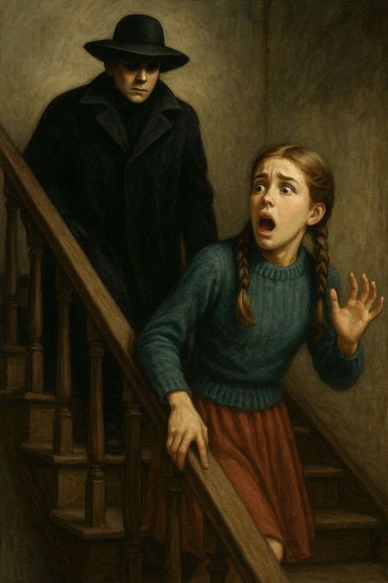

## Lä profesorèsä Ginevra

Ön caràtär, ön modèl däbù oregenàl. L’érä önä siùrä che lè gaä pasà i sinquàntä e che én päìs i cognisìä töcc. L’érä dé fämìä siòrä e cognisìdä dä lä zèt dèl päìs. Töcc i agn, d’està, ensämä èi sò frädèi lä ignìä ä Bagolì ä pasà le acànse e lä ‘s fàä notà. Èl dèt “scàrpe gròse, särvèl fì”, él pödiä èsär stà fat sö dä elè. Sèmpär istìdä én fòzä stràmbä cón gòlfini, cälsätù dé lànä gròsä e scärpù dé mut, lä träärsàä töcc i dé él päìs e entàt lä envociàä e lä déziä sö dèi vèrs o dèle oräsiù.

Laureàdä én giöresprödènsä, lä ensegnàä derìto canònek ä l’onivärsità dé Sassari. Lä gà ì trä i sò stödéncc l’ex präsedènt Francesco Cossiga. L’è trä i mé régorcc pärché, quànt gàe ùndes agn, i mé genetùr i gà ì dé cambià cä e él mé bobà äl s’è revolgì älä profesorèsa ìst che lä so fämiä lä gàä önä cä én més äl päis sfétä dä ön bèl pò dé agn. Lä profesorèsä Ginevra lä s’è dadä dä fa defàt pèr säntì i sò frädèi, ma lä gà fat säì che lä särés mìä stadä ön’empréza lädìnä convincìi ä fétà lä cä pärché i gàä én mènt dèi àtär progécc. I frädèi i vivìä ä Melà e i tèp pèr säntìi ié stä lunk pärché mìàä pasä pèr fòrsä dèlä pòstä che l’érä l’ūnek més pèr säntis cón chèi dälùns. Pèr lä mé mamä signì cambià cä dòpo tacc agn, l’érä comià ik vì ‘nä desgràsiä e lä profesorèsä Ginevra lä se n’érä rändìdä ciūnt quant lä gàä i l’ocasiù de parlà cón elè. L’è stà cosétä che lä profesorèsä Ginevra entàt che lä spetàä lé respòste däi so frädèi, lä gà i l’edèä dä dì önä noénä pèr ìk lä gràsiä. Pèr nöf dé dé filä, lä s’é präzäntàdä ‘nd’èlä nòsä cä, él dòpo mès dé, pèr dì sö lé oräsiù, särnìde ƒó dä elè, e lä teràä tré töcc chèi che se troàä én cä ä chèl’ùrä gliò. Mé gò sercà dä èsär sèmpär temporì e, ä lä fi, lé oräsiù ié stàde contäntàde: dé gliò ä pòk tèp és pögliä tacà ä orgänezà èl sanmärtì. Finìde lè oräsiù, lä profesorèsä Ginevra lä stàä gliò ontérä ä fa ‘nä ceciaràdä cón nóatre e l’è comenciàdä önä bèlä reläsiù cón lä nosä fämiä. Sé lä fodès mìä stàdä ä lä fi délä acànsä, su segiūr che lä gärés orgänezà poà önä noénä dé rengräsiämént pèr lä bùnä consäguènsä dèle sò oräsiù.

## L’óm nìghär

Dä quàk tèp gàäm cambià cä. Séräm marcià dèlä cä èciä e s’éräm nè ä stà én önä cä én mès äl päìs. Önä cä bèlä fés, dèle stanse grande e spàsiùze. L’érä fäbrecàdä sö du pla e lä gàä poà ön solär bèl grant éndo és mätìä lä lägnä pèr l’envèrän e gh’érä spasio poà pèr mòbei vècc, magàre sgängärè, ma ch’éi pögliä sèmpär ignì bu. Él sito giöst endó, ‘nd’èlä miè emmägenäsiù dé ‘lgiälèt, i pögliä scondìs óm cätìf, móstri späentùs dé chèi che és gàä dä ìk pòrä.

Ön bèl dè, séräm dré ä döznà quànt él bobà l’è stà ävezà che gh’érä stàdä önä rotūrä sö lä lìniä elétrekä e tochè äl gàä dä entärvignì. Äl plöìä che Dio ‘l lä màndàä. L’érä ön continuo dé dälfì  e tu. Iù de chéi fòrti tämporài che ghè én montagnä.

Én cä, énsèmä äi genetùr, séräm mé, Angiolino e Annamaria. Él bobà Sandro él gà domandà chéi che és lä säntiä dä nà söl solär ä tök él tabàr pèr nà fó. Mé ém su ofrì e ém su säntì grant e speretùs. Su nà söl solär e gò troà él tabàr e gàe dömè dä portàl zö.

L’érä ön pastràno empärmeàbel nighär, grant, ch’él pésàä fés e l’embregàä, cón ön gròs cäpèl rotónt. Él sestémä plö pràték pèr portàl zö l’è stà chèl dé mätìmèl endòs:pastràno söle spàle e cäpél söl cò, gò tacà ä nà zö dèle scàle vèrs él säcónt pla. En quèlä, Annamaria lä ignìä sö däl pla desótä pèr nà äl cèso. Lä gà dàdä ön’öciàdä énsö vèrs l’alt e lä s’é troàdä denàcc lä mé sàgomä nìgrä, spropozetàdä pèr viä dèl pastràno che gàe sö e, späentàdä lä gà lanciàdä önä gusàdä desömànä. Mé pärsöàs che lä gàäs vist ärgiū dédré dé mé, gò tacà ä corì zö e ä guzà ä mé òltä. Annamaria, nèl vidì che l’óm nighär él ghé corìä dré, lä gà sequetà ä guzà deplö cól späènt ch’èl cresìä. Là consäguènsä l’è stàdä che sum reè ensèmä ‘nd’èlä sàlä endó ‘s dösnàä späènté, biànk comià dò cändìle, cól ciör én gùlä. Cóle gàmbe che l’ém trämàä, gò dàt él pastrano äl bobä, pó, ém su säntà zö én poltrùnä. Ghé ölì ön bèl pò dé tèp prömä che mé e Annamaria ciàpàsäm él colùr nórmàl.

## Nóm ä pascà

Él bobà él gàä pasàdä ä noàtre fiöi lä pasiù pèr pascà lé trūte. L’érä nà zö ‘ndèl Càfär, ché él part dälé falde dèl Blumù e él vé zö dré ä lä àl o l’érä nà sö dré iū dèi ré che i và ä finì ‘ndèl Càfär. L’érä éstà e Graziano e Flavio i èrä ignì däl colégio dèi säleziani pèr pasà ön pò dèle pòche acànse che i ghe concedìä.

Ön dé góm decédì dé nà töcc à pascà. Poà Angiolino èl vögliä ignì. Él ghé tegnìä fés e, ist che meàä léà sö prèst, l’àä ölì nà ä dormì prèst pèr èsär pärècc e én gambä lä domà. Mé, Graziano e Flavio envése góm olì nà äl cìnemä pärché pèr noàtre l’erä mìä ön problémä leà sö ä bonùrä. Sum vignì ä cä däl cìnemä plötòst tàrde e góm troà Angiolino endormäntà. Dormiäm töcc ‘ndèlä stèsä stànsä e, con-töt ché ghèsäm sercà dé fa mìä ciàs, gom miä pödì fa ä mank che Angiolino ‘l sé desädàäs. Èl s’è desädà, él s’è fregà i öcc, él gà iscc noàtre tri frädèi, én pé e istì e ‘l gà domandà: “sif zä pärècc?”.

Chèlä domandä gliò lä gà segnàdä lä sò condànä ä dèäntà él barsài d’ön schèrs. Noàtre tri góm räspondì quàzi ensèmä dé sé e, aderetūrä, gom dét: “sìrcä dé fa én frèsä ä lià sö! Tè sé che dòpo önä sèrt’urä lé trūte lé bocä mìä plö”. Angiolino l’é lià sö e l’è nà äl ceso. Éntat noàtre és sum cäè fó i vistì e és sum enfelé sotä i länsöi, ognū ‘ndèl nós lèt. Él poór frädélì, él plö pesèn dé noàtre, l’è ignì én càmärä e él gà ist che seräm töcc ‘ndèl lèt e fàäm äpòstä dè dormì. L’érä confondì, smatorì e fórse él gà poà pensà ch’él serä ensomià. Lä domà, quant és sum desädé nèl säntì lä svèliä, pèr nà ä pascà, góm domandà ä Angiolino s’él vögliä amó ignì ä pascà con noàtre. Lä respòstä l’è stàdä ciàrä: “Nì ä faf benedì!”. Él s’érä rändì ciūnt che ‘l s’érä mìä ensomià ma che gàäm fat ön bèl schèrs.

## Lä s-ciölä mediä

Däl 1962, gràsie ä lä refórmä dèlä s-ciölä, poà äl nòs päìs öm pödì tacà ä nà ä lä s-ciölä médiä önefegàdä. Prömä dé ‘gliùrä, pèr chèi che ögliä nà ennàcc ä stödià dòpo lä s-ciölä elementàr, l’ünekä posebeletà l’éra nà én ön päìs äpé, dälùns trèntä chelòmetri. Tròp dälùns pèr pödì nak töcc i dé con lä pòstä, én pärtecolàr sö önä viè dé mut, tötä ä cürve.

Cozétä, end’èl spätà che lä s-ciölä mediä lä scomänsàäs, gò fat lä sèstä elementàr, ön po' comiä önä s-ciölä profesionàl. Chèl an egliò gò troà entärès pèr mäterie nöe comià fräncés, desègn tènico e, plö dé töt, él laboratorio dé marangù.

Ä lä fì le s-ciöle médie ié scomänsàde e de chèle ciöntàrò sö quàk fat.

## Genàstecä

Amó enciö, dòpo plö de mès sècol, rìo mìä ä spiegàm compèrte lä’m fös stàdä destenadä lä profesorèsä dè genàstecä. Pròpe tèt lä spète mìä.

Önä siùrä däl fòrte äcènto tarù, l’erä mìä bàsä, ma cön ön bèl pò dé chili én plö, és fa pèr dì, e töcc és domandàäm có lä c’éntràä cón lä sò mäteriä, genàstecä. Pòk o gnént.

Ä demostrasiù dé chèst, lä gà olì ciärì defàt che lä m’äres mìä fat fa gnént defò dälä clas, ‘ndèlä sò ùrä, almànk fì ä lä fì dèlä prömäérä; én pòke paròle, gnént córse, gnént moemènt, gnént pärtide ä balù. Äl post dé chèste ròbe ché lä m’ärés ensegnà edocasiù cìvicä, edocasiù stradàl. Pasàäm lä plö pàrt dèl tèp ä dezegnà e ä colorà cärtèi strädài. L’é ciàr che sé stofàäm e che séräm mìä quét. Parlàäm trä noàtre stödéncc cón lä gus àltä, ‘ndèl nòs deälèt e lä profesorèsä lä cäpìä mìä gnént.

Él pöl dàs ch’él sìäs stàdä chèstä lä càözä che lä gà portà lä profesorèsä à revolgìs à noàtre stödéncc én mäniérä screänsàdä e dèle òlte lä reàä äderetūrä ä sfasà-zö. “Sif dèi sap. Fì sìto! Sif gròs!”. Chèstä önä dèle märäèe che lä droàä za dèle pröme lesiù. Önä òlta, do òlte fìnä ché iù dè noàtre él gà reägì. Flaviano l’è leà sö én pé e, cól tòno dé chèl che ‘l gàä mìä plö entensiù dé soportà chèi sprès, él gà dét én mäniérä derétä: “Sap lä sàrà elè!”. Pó ghè stà ön scambio dè bätìde trä lä profesorèsä e Flaviano, curt, ma dūr. Negiū dé noàtre äl fladàä.

Lä profesorèsä l’è rästàdä dé prédä e l’è s-ciopàda zö à plànzär. L’è nadä fó délä s-ciölä e lé nàdä vérs lä segreterìä. L’ocor mìä c-iöntà sö empèrte l’è stàdä ämenestràdä lä setöäsiù söl momènt e dä chi. Èl prèsede, ‘nd’èle ùre dópo, l’è égnì én clas e él gà dét  che lä profesorèsä lä sé scözàä cón lä clàs. Scūze ciapàde e encedént sarà. Lé lesiù dé edocasiù cìvicä e stradàl ié nàde ennàcc regolàrmènt.

## Ön bèl cästìk

Äle médie, él profesùr Tonoli l’érä él nòs profesùr dè äretmétecä. Ön pencänù màgär, màgär. L’érä brào ä ensegnà lä sò mäteriä. Äl gàä comprensiù vèrs dè noàtre e noàtre ék stàäm sempàtek ä él. Però él sàä èsär sevéro e l’érä bù dé fàs respetà. Ön bèl dé, l’öltemä ùrä prömä dèl entärvàl dèl döznà, séräm mìä stè tròp quét. Séräm én prömäéra, äpé ä lä fì dèl an dèlä s-ciölä, è séräm töcc stöf e fàäm fädigä ä mäntignì lä consenträsiù.

Él profesùr, dòpo ch’él màä fat osärvasiù ön bèl pò dé òlte, él gà perdì lä päsiénsä e, poà sé lä cämpänèlä l’érä za sonàdä, él gàä stäbilì dé tignìm én clas dé plö däl l’oràrio normàl. “Ànsi”, él gà dét, “Gärì mìä dä möìf finä quànt v’él derö mé” e ‘l sé anvià vèrs lä segretrìä pèr consegnà él regìstro dé clas. Òm obledì töcc e negiū dé noàtre él s’è möì. Päsè ärgiū mänūcc, èl profesùr él dàä mìä ségn, egliùrä él capoclàs l’é nà én segretériä ä idì chèl ch’él cäpetàä. “’lgiai, lä segreterìä l’è saràdä fó e ghè nigiū”, èl gà dét él nòs compàgn”.

Có góme dä fa? Én pòk säcóncc sum sté töcc entìs dé nà ä cä ä doznà, tornà endré dé casàdä ä s-ciölä comià sé fodèsäm mài nä lä. Prömä dä tacà lä lesiù dèl dopo mesdé, ognū l’érä säntà-zö äl sò pòst. Mai stè tat temporì. Quànt l’è ignì tré én clas él profesùr che ‘l gàä dä tignì lä lesiù, él gà mìä fat én tèp ä reà ä lä càtedrä che góm comincià ä revolgìk i nòs spiàns: profesùr, noàtre sum che dä städomà e góm amó dä döznà. Söl momént él profesur l’éra defedét. Él pänsàä che schersàäm. Però pó él s’è pärsoàs che déziäm lä äretà. Él profesùr él gà domandà ä lä segreterìä e äl prèsede e i gà dà ‘l pärmès dé nà ä cä ä döznà. Noàtre però séram za pli. Él profesùr él mé gà räcomandà dè nà äbelàze, cón càlmä e dà fa tantä ätensiù ché i cäpetàäs mìä encedéncc. I mé ga dat ön pärmés speciàl e i mé gà despensà dä presäntàs ä lé lesiù däl dopo mesdè. Gàäm ì él dòpo mesdé töt entrék libär. Sum né äl cap dé balù dèl orätòrio e góm zögà önä dèle plö bèle pärtìde trä dé noàtre.

L’é mallädì desmontägàs lä cérä dél profesùr dé äretmétecä quànt, entàt ché seräm né ä fa lä spasazàdä dèlä fì dèl an dé s-ciölä, góm ciöntà sö i resvòlt dé chèl che gàäm combenà. Él profesùr én ön pröm momént él lä gà mìä ciapàdä bé fés, pó però, poà él él gà sgregnà deertì. È noàtre? És sum säntì plö legér, dòpo ì tö-è ön bèl pis dèlä cosiénsä.

