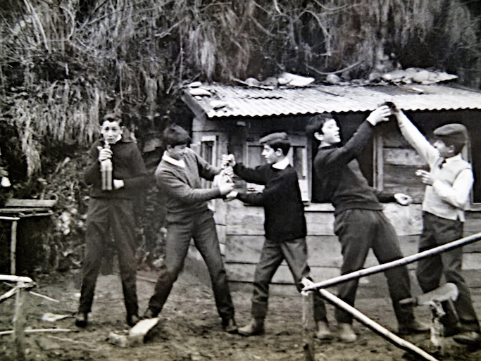
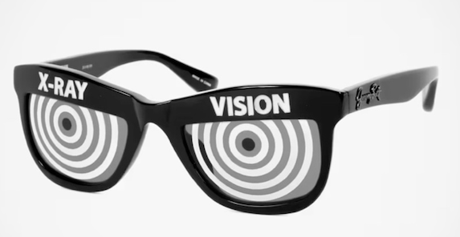

Quànt che gàe plö o mank trèdäs agn, ensämä ä dèi mé compàgn, óm pänsà dé fäbrecà önä bàitä picinìnä, o compèrte lä ciamàäm noàtre, lä “cäzìnä”, dré äl Càfär. Ezägero mìä ’nd’èl definìlä ön’oràcol dé fäntäzìä, enzègn, bräürä, näsì dèlä òä dé reläsiù e dé rìs-cio che äpènä dèi ’lgiài dé chèlä età i pöl ik. Séräm ön pò dé ’lgiai dèlä stèsä età e fàäm töcc lä s-ciölä mediä. Mé, Fernando, Giancarlo, Gianluigi, Gianstefano, Oliviero, Osvaldo, Renzo e Silvano. Ém regòrdo mìä compèrte l’é näsìdä l’edèä e empèrte l’é stà fegörà él progét, ma noàtre späregolé és sum mätì ensèmä én frèsä; töcc éziäm mìä l’ùrä dé scomänsà ä fa lä cäzìnä. Óm tacà ä fa pasà i sìt, ä fa contròi, ä parlà cói padrù dèi tärì. Ä lä fì, él pòst l’é stà desärnì: önä pläsètä sö lä spóndä dälè dèl Càfär, mìä tròp dälùns dèlä rìä, ma che lä egnìä mìä tócadä dé l’àcquä poà én càzo dèle sòlete plìne én sèrte stägiù.

L’érä giöst poà sé ghérä dä träärsà él Càfär e tochè l’érä mìä lädì réak. Ma chèst él gàäm consedrà ön mèret pärché èl pödìä reàk dömè quàk pascädùr e ’l fàä cresì él nòs spìret dé na cùträ él rìs-cio. Góm tacà ä stäbilì i còmpiti dé ognü e dé töcc dé ma én ma che i vegnìä mätì-zö schis e dezègn, lìste dèi mäteriài che i ocorìä. Giancarlo, dé segiür, èl gà dàt él plö gròs contribùto pèr lä progetäsiù, vist che él sò bobà èl gàä önä emprézä dé morädür e tochè èl pödìä ìk consèi e èl pödìä ak troà dèl mäteriàl ’nd’èi sò cäntér.

## Lä reälezasiù

Óm laorà cón tàntä òä tötä ön’està pèr realezà él nòs progèt. Ön pò ä lä òltä lä cäzìnä lä ciapàä fùrmä: ön löcàl dé sèdäs métär quàdär plö o mank, fat-sö cón traf e as dé lègn, cón pòrte, balcù, él päemént dé ceménto e ön cämì pèr fa i móndoi ’nd’èi dé frècc dèl sanmärtì. Lä mobéliä l’érä fàdä dä ön scafàl tacà äl mür, ön tàol e quàk scagnä. Pèr dorvà lä cäzìnä l’érä mìä necesàrio che noàtre ék fodèsäm töcc. Ognü dé noàtre èl pödìä nak poà cón àtre compàgn. Pèr dà él sègn che séräm gliò, ä lä cäzìnä, e fa sé che àtre compàgn èi vegnìäs-zö, alsàäm-sö önä bändérä biànkä che és podìä idì bé dä pòst dèl päìs che dömè noàtre cognisiäm.

Él pòst l’érä dääntà ön put éndo troàs che èl pläzìä ä tancc, ma poà ciapà dé mìrä dèle ciàcole e lèngue-lùnghe dèlä zét. Én tacc i sé domandàä có fàäm zögliò, che segréti èl scondìäs chèl refùgio. Poà ’l preòst èl gà détä lä sò én önä dèle sò prédöche, e èl gàä petöràdä lä cäzìnä comià ön pòst dé pecà e, chèi che’g nàä-zö, comià dèi pecädùr, sénsä ì mài parlà cón ärgiü dé noàtre.

## Lä tälefèrecä

Träärsà él Càfär l’érä ön gròs entóp. Pèr reà éndo lä gàä dä egnì-sö lä cäzìnä meàä fa ön pärcórs lunk, ä pé. Träsportà töcc i mäteriài necesàri ä fa-sö lä cäzìnä pèr chèl säntér l’érä emposìbel, egliùrä óm pänsà dé terà önä còrdä dé metàl trä lé dò rìe dèl Càfär. Lä còrdä l’é stàdä mätidä-zö e fesàdä e lä podìä èsär dorvàdä pèr träsportà i mäteriài pèr fa-sö lä cäzìnä.

Dòpo ì pröà ä träsferì deärse òlte i mäteriài e costatà che lä còrdä lä tegnìä, óm decedì ch’és pödìä dorvàlä poà pèr él träspòrt dèle pärsùne. Pèr scomänsà óm dorvà ön sestémä gròs ma ch’èl fonsionàä bé: ön bastù dé träèrs äl rämpì dèlä cärùcolä, brancà cón lé dò ma e én pòk säcóncc té sére dälè dèl Càfär. Önä figàdä! Negiünä embragàdürä e l’àquä che lä pasàä sótä dé noàtre. Poà sé èl gàä ìst noàtre ä träärsà ennàcc  e endré tante òlte, Gianluigi l’érä endesìs e èl gàä önä gran pòrä ä dorvà chèl més dé träspòrt. Óm sequetà ä dìgäl sé tant che ä lä fì èl s’é lagà convincì ä pröà. Plegà söi zänöcc, èl gà sarà i öcc e, plötòst dä lagàs na, tacà ä lä còrdä, èl s’é dàt ön puciù én sö cólä consäguènsä che lä cärùcolä lä s’é destacàdä dèlä còrdä e èl l’é dàt-zö drét, ä plómp comià ön balòt. Splash!...Óm säntì él ciàs dé ön tùfo dé bògiä e noàtre ä…sbogiàs dä lé sgregnàde. L’é mìä stà gnént dé gròs fés. Gianluigi èl gà ì dömè dä fa sögà i vistì. Én pòk tèp sum sté bu dé completà lä tälefèrecä cón ön casù e cón chèl és pödìä träsportà poà lé pärsùne, én plö äi mäteriài.

## L’espesiù dèi cäräbeniér

Che gh’érä lä cäzìnä i lé sàä orämài töcc e töcc i gàä ön’edèä: chèi che i lä éziä dé bu öcc, chèi ch’érä cúträ, äl punt che poà él märesiàl dèi cäräbeniér èl à ölì cäpì ärgótä e ’l à desidì dä fam ìzetä. Én quàtär o sik dé noàtre és troàäm ä lä cäzìnä quànt óm vìst compärì dälè dèlä riä él märesiàl e du cäräbeniér. Éi m’à dét che i érä gliò pèr fa ön contròl. Éi m’à ordänà dé mìä möìs, ma éi sàä mìä compèrte fa ä träärsà él Càfär e reà ä lä cäzìnä. Noàtre góm fat cäpì che séräm pärècc ä dak önä ma: iü dé noàtre èl à tacà ä saltà söi plòk e l’é na dä èi, pó èl gà fat idì lä viè pèr tornà ’ndré, cói cäräbeniér dedré dé èl.

Reé ä lä cäzìnä, i cäräbeniér i m’à domandà dä pödì na-tré ä controlà chèl che gh’érä detré. Pó éi m’à fa önä entärögäsiù: nóm, cognóm, fiöi dé chi, chèi che fàä part dèlä compägnìä, sé tignìäm fösìi o s-ciòp ecc. Ä lä fì, él märesiàl èl m’à facc i compleméncc; èl m’à räcomandà dé fa i bràe e pó èl m’à domandà dé èsär compagnà sö lä riä dälè. Lä notìsiä dèl contròl l’à tacà ä gerà én päìs e, empèrte ’l cäpeta spès, lé sérä  fàde dò defärénti corènti: lä zét lä s’érä spärtìdä én dò parcc: chèi che pänsàä che l’espesiù l’érä stàdä fàdä pärché, empèrte i gàä sémpär pänsà, gh’érä sótä ärgót dé sospét e chèi che envése i remarcàä che l’érä mìä stà troà gnént dé proebì o fó dé pòst e che, empèrte poà èi i àä sémpär pänsà, séräm dömè dèi bràe ’lgiài, enzegnécc, cón ön spìret dé reläsiù e ris-cio gaàrt.

## Pàsquätä ä lä cäzìnä

Tö ön vistì nöf o ärgótä dä mätì-sö l’érä ön fat che cäpetàä iöstä äpé ä lé grande fèste, ä Pàsquä e ä Nadàl. Chèl an egliò, lä mé mamä lä m’àä crompà ön vistì nöf. M’él sére mätì-sö él dé dé Pàsquä e mé stemàe töt. M’él su mätì-sö poà él dé Pàsquätä. Ist che l’érä önä bèlä zornàdä, noàtre séräm mätì d’entìs dä fa önä märèndä ä lä cazìnä.

Réä-zö denàcc äl Càfär, óm tacà ä saltà söi balòcc pèr träärsàl. Quànt l’é stàdä lä mé òltä, pròpe ä l’ültem sältärél, su biöscà e su dàt-zö ’nd’él put éndo l’àquä l’érä plö àltä e su ignì-fó cól vistì töt ensöpà. Óm empesà él fök sótä él cämì, ém su caà-fó i vistì e i ò mätì äpé äl fök pèr fai sögà én frèsä.

Ghé ölì ön bèl pò dé tèp e, reàdä l’ùrä dé na ä cä, m’él su mätì-sö, poà sé l’érä mìä söt dèl töt. Lä gambä dèle bràghe e lé mänèghe dèlä zächètä lé s’érä scortàde dé önä spànä). Töcc i mé compagn éi à sgregnà mìä pòk. Mé, envése, sére mók e demorälezà, räsegnà ä ciapà önä bèlä rämänzìnä dèi mé genetùr e sàe za che, pèr ön àtär vistì nöf, ärés signì spetà l’an dòpo.

## Lä ìzetä dèi profesùr

Lä cäzìnä l’érä mìä plö ön segréto pèr negiü. Él sò nóm èl geràä én päìs e l’encoriozìä töcc, fenämài i nòs profesùr. Ärgiü dèi profesùr dé III mediä i sérä facc idì sé entäräsé dé chèl che gàäm ciöntà-sö che góm proponì dé ignì ä idìlä. I à dét dé sé defàt, ontérä. Ön bèl dé, és sum mätì d’entìs e óm fesàdä lä ìzetä. Noàtre séräm töcc närvùs. Àäm paracià töt polìto pèr resiì chèi envedé che gàä tantä emportànsä pèr noàtre. Lä tälefèrecä l’érä stàdä pröàdä bé e controlàdä én töcc i pärtecolàr e lä fonsiunàä ä lä perfesiù. Dèlä spóndä dälè dèl Càfär, és pödìä äpènä fegöràs lä cäzìnä, pärché l’érä scondìdä dèlä plòpä e i profesùr i àä scomänsà ä fas idì märäè. Gàäm dä portài dälè cón lä tälefèrecä, iü ä lä òltä. Quànt i óm envedé ä na-sö söl casù tacà ä lä còrdä, óm notà söl mostàs ön pò dé endesisiù, ma és cäpìä che negiü i ärés renöncià ä träärsà pèr idì lä cäzìnä. Fórse chèlä träärsàdä res-ciùsä lä fàä säntì i profesùr ön pò ’lgiài pò ä èi.

Él profesùr dé tènicä, fìsek spòrtif, l’é stà él pröm. Äl ghé nà-dré él profesùr dé fräncés, dé äretmétecä, dé dezègn. Lä profesorèsä dé italiàno, che lä gàä önä sèrtä età, l’àä renöncià.

Reé ä lä cäzìnä i profesùr i m’à fat idì totä lä sò märäèä. I-érä resté dé stök. L’érä ciàr che i sé spetàä mìä dä troàs denàcc argótä dé fat sé bé e cörà. Én pòke paròle i l’àä troàdä bèlä fés. I m’à fat ön sak dé domande, compèrte àäm fat ä fàlä e comià pänsàäm dé dorvàlä ecc. Óm empesà él cämì pèr fa él tè, g’óm dat ärgót dä bìär e cón i compleméncc dé töcc l’é finìdä lä ìzetä. Óm träärsà amó él Càfär e óm compagnà i profesùr én päìs. Dòpo ön pò dé tèp ghè sté i ezàm dé III médiä e, quànt i-é sté mätì-fó i vóti, noàtre dèlä cäzìnä, góm ì ön bèl DÉS én tènicä. Önä recompènsä che lä gàä él sagùr dé önä vitòriä cùträ chèi che i mé cretecàä.

Chèl DÉS l’érä lä  pröä dèl NÖF dé quàt l’érä bù él nòs progét. Gràsie fés, profesùr!

## I öciài äi ràgi X

Stó cäpìtol äl vé ä fa part dé chèst löbär dömè pèr önä grasiùzä coensedènsä. Él 6 (sés) dé setèmbär 2025 (dumelävintisìk), mé, él mé fiöl Filippo, lä mé nörä Silvia, e i du nägùcc Camilla e Giacomo, óm stäbilì dé fa önä scävräzàdä ä lä cezìnä dé San Gervàs, rämpagàdä söl mut denàcc äl päìs, Bagolì, e che lä dà önä vìstä söl päìs bèlä fés. Önä òltä i ardà polìto él panoràmä e i pröàdä lä sodesfäsiù dé sunà quàk botì dèlä campànä dèlä cezìnä és sum anvié pèr na ä ignì.

End’èlä ocäziù, pödìe mìä fermàm ä sälödà él mé camaràdä e compàgn dé s-ciölä Giorgio che, ’nd’èi mis d’està, èl sé träsferés ’nd’èlä bèlä tézä che èl gà mätì ä pòst pròpe bé e che lä sé troä sö lä viè. Sum sté töcc du contécc dä re-idìs, ìst che lé ocäziù dé encontràs i-é dääntàde pòche fés. ’Nd’èl parlà dèl plö e dèl mank, sum finì söl descórs dèlä cäzìnä e, én pärtecolàr, dèle gus che geràä én päìs sö “chèi dèlä cäzìnä”.

Giorgio ’l à mài fa part dèlä combrìcolä, ma èl m’à dét che èl sé regordàä bé fés dé chèl tèp e che lä questiù, én päìs, l’érä sö lä bócä dé töcc. Én plö èl sé regordàä ä lä perfesiú comià lä zét lä parlàä dé “chèi dèlä cäzìnä” che i gàä äderetürä fat reà dèi öciài pärtecolàr che i pärmätìä dé idì sótä i vistì dèle pärsùne. L’érä mìä ìrä. E, che mé ’m regòrde, chèi öciài speciài i-é mìä mài sté crompé.

L’é ìrä plötòst che, cón él sfòi dèlä Postal Market, óm crompàde dèle màscäre pèr na sót’àquä e àtre ärtìcoi pèr na ä ogà ’nd’èl Càfär. Comià èl càpetä despès, lä fäntäzìä lä sorpàsä chèl che i-é i facc däbù: chèle màscäre, säcónt lé gus, ì-érä dääntàde öciài äi ràgi X che, “chèi dèlä cäzìnä” i dorvàä pèr ardà sótä i guärnèi dèle ’lgiàle! Sé poà Giorgio, che ’l fàä mìä part dèlä “bàndä”, èl gà amó ön régort sé vif dé stó fat, èl völ dì che èl gàä ì emportànsä e tochè l’é älì lä penä regordàl.

Ä pänsàk bé, quàt séräm ennàcc, noàtre dèlä cäzìnä? Gh’érä mìä INTERNET, gh’érä mìä AMAZON, ma séräm reé ä ìk lä ròbä consegnàdä ’nd’èl nòs päìs, despärdì trä i mucc. Ön meràcol picinì che ’m stémo amó äl dé d’enciö.

Lä äretà sö chèi öciài, che i àä fat parlà tat, l’é che l’érä stàdä önä gròsä embroàdä. Pèr bunä pas dé chèi che i àä ceciarà-sö “chèi dèlä cäzìnä”.

