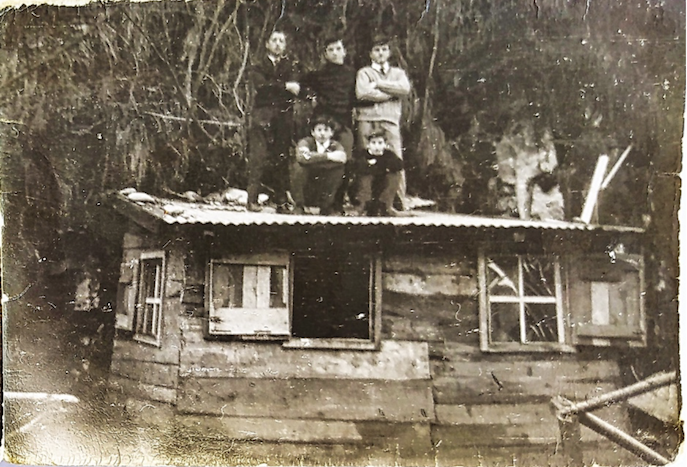
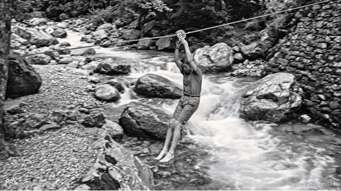
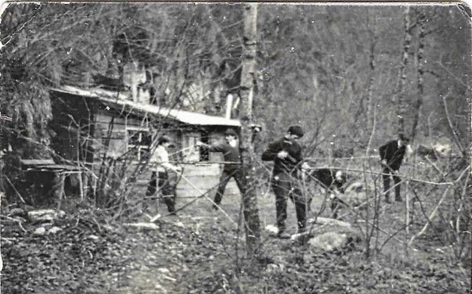
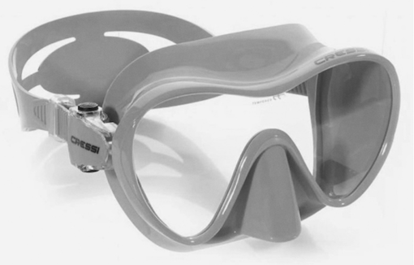

Quànt che gàe plö o mank trèdäs agn, ensämä ä dèi mé compàgn, óm pänsà dé fäbrecà önä bàitä picinìnä, o compèrte lä ciamàäm noàtre, lä “cäzìnä”, dré äl Càfär. Ezägero mìä ‘nd’èl defìnìlä ön’oràcol dé fäntäzìä, enzègn, bräūrä, näsì dèlä òä dé reläsiù e dé rìs-cio che äpènä dèi ‘lgiài dé chèlä età i pöl ik. Séräm ön pò dé ‘lgiai délä stèsä età e fàäm töcc lä s-ciölä mediä. Mé, Fernando, Giancarlo, Gianluigi, Gianstefano, Oliviero, Osvaldo, Renzo e Silvano. Ém regórdo mìä compèrte l’é näsìdä l’idéä e empèrte l’è stà fegörà él progét, ma noàtre späregolè és sum mätì ensèmä én frèsä; töcc éziäm mìä l’ùrä dé scomänsà ä fa lä cäzìnä. Óm tacà ä fa pasà i sìt, ä fa contròi, ä parlà cói padrù dèi tärì. Ä lä fì, él pòst l’é stà desärnì: öna pläsètä sö lä spóndä dälè dèl Cafär, mìä tròp dälùns dèlä rìä, ma che lä egnìä mìä tócadä dé l’àcquä poà én càzo dèle sòlete plìne én sèrte stägiù.

L’éra giöst poà sé ghérä dä träärsà él Cafär e tochè l’érä mìä lädì réak. Ma chèst él gàäm consedrà ön mèret pärché él pödìä reàk dömè quàk pascädùr e ‘l fàä crésì él nòs spìret dé nà cùträ él rìs-cio. Góm tacà ä stäbilì i còmpiti dé ognū e dé töcc dé ma én ma che i vegnìä mätì zö schis e dezègn, lìste dèi mäteriài che i ocorìä. Giancarlo, dé segiūr, él gà dàt él plö gròs contribùto pèr lä progétäsiù, vist che él sò bobà èl gàä önä emprézä dé morädūr e tochè él pödìä ìk consèi e él pödìä ak troà dèl mäteriàl ‘nd’èi sò cäntér.

## Lä reälezasiù

Óm laorà cón tàntä òä tötä ön’està pèr realezà él nòs progèt. Ön pò ä lä òltä lä cäzìnä lä ciapàä fùrmä: ön löcàl dé sèdäs métär quàdär plö o mank, fat sö cón traf e as dé lègn, cón pòrte, balcù, él päemént dé ceménto e ön cämì pér fa i móndoi ‘nd’èi dé frècc dél sanmärtì. Lä mobéliä l’érä fadä dä ön scafàl tacà äl mūr, ön tàol e quàk scagnä. Pèr dorvà lä cäzìnä l’érä mìä necesàrio che noàtre ék fodèsäm töcc. Ognū dé noàtre él pödìä nak poà cón àtre compàgn. Pèr dà él sègn che séräm gliò, ä lä cäzìnä, e fa sé che àtre compàgn èi vegnìäs zö, alsàäm-sö önä bändérä biànkä che és podìä idì bè dä pòst dèl päìs che dömè noàtre cognisiäm.

Él pòst l’érä dääntà ön put endó troàs che èl pläsìä ä tancc, ma poà ciapà dé mìrä dèle ciàcole e lèngue-lùnghe dèlä zèt. Én tacc i sé dómandàä có fàäm zögliò, ché segréti èl scondìäs chèl refùgio. Poà ‘l preòst él gà détä lä sò én önä dèle sò prédöche, e él gàä petöràdä lä cäzìnä comià ön pòst dé pecà e, chèi che’g nàä zö, comià dèi pecädùr, sénsä ì mài parlà cón ärgiū dé noàtre.

## Lä tälefèrecä

Träärsà él Cafär l’érä ön gròs entóp. Pèr reà èndó lä gàä dä egnì sö lä cäzìnä méaä fa ön pärcórs lunk, à pé. Träsportà töcc i mäteriài necesàri à fa sö lä cäsinä pèr chèl säntér l’érä emposìbel, egliùrä óm pänsà dé terà önä còrdä dé metàl trä lè dò rìe dèl Cafär. Lä còrdä l’é stàdä mätidä-zö e fesàdä e lä podìä èsär dorvàdä pèr träsportà i mäteriài pèr fa sö lä cäzìnä.

Dòpo ì pröà a träsferì deärse òlte i mäteriài e costatà che lä còrdä lä tegnìä, óm decedì ch’és pödìä dorvàlä poà pèr él träspòrt dèle pärsùne. Pèr scomänsà óm dorvà ön sestémä gròs ma ch’èl fonsionàä bé: ön bastù dé träèrs äl rämpì dèlä cärùcolä, brancà cón lé dò ma e én pòk säcóncc tè sére dälè dèl Cafär. Önä figàdä! Negiūnä embragàdūrä e l’àquä che lä pasàä sótä dé noàtre. Poà sé él gàä ìst noàtre ä träärsà ennàcc  e endré tante òlte, Gianluigi l’érä endesìs e èl gàä önä gran pòrä ä dorvà chèl més dé träspòrt. Öm sequetà à dìgäl sé tant che ä lä fì él s’é lagà convincì ä pröà. Plegà söi zänöcc, él gà sarà i öcc e, plötòst dä lagàs nà, tacà ä lä còrdä, él s’é dàt ön puciù én sö cólä consäguènsä che lä cärùcolä lä s’é destacàdä dèlä còrdä e èl l’é dàt-zö drét, ä plómp comià ön balòt. Splash!...Öm säntì él ciàs dé ön tùfo dé bògiä e noàtre ä…sbogiàs dä lé sgregnàde. L’é miä stà gnént dé gròs fés. Gianluigi él gà ì dömè dä fa sögà i vistì. Én pòk tep sum stä bu dé completà lä tälefèrecä cón ön casù e cón chèl és pödìä träsportà poà lé pärsùne, én plö äi mäteriài.

## L’espesiù dèi cäräbeniér

Che gh’érä lä cäzìnä i lé sàä orämài töcc e töcc i gàä ön’edèä: chèi ch’érä propèns (i lä idìä dé bu öcc/cón piäzer), chèi ch’érä cúträ, äl punt che poà él märesiàl dèi cäräbeniér èl à ölì cäpì ärgótä e ‘l à desìdì dä fam ìzetä. Én quàtär o sik dé noàtre és troàäm ä lä cäzìnä quànt óm vìst compärì dälè dèlä riä él märesiàl e du cäräbeniér. Éi m’à dét che i érä gliò pèr fa ön contròl. Éi m’à ordänà dé mìä möìs, ma éi sàä mìä compèrte fa ä träärsà él Càfär e reà ä lä cäzìnä. Noàtre góm fat cäpì che séräm pärècc ä dak önä ma: iù dé noàtre él à tacà ä saltà söi plòk e l’é nà dä èi, pó él gà fat idì lä viè pèr tornà ‘ndré, cói cäräbeniér dedré dé él.

Reè ä lä cäzìnä, i cäräbeniér i m’à domandà dä pödì na-tré ä controlà chèl che gh’érä detré. Pó éi m’à fa önä entärögäsiù: nóm, cognóm, fiöi dé chi, chèi che faä part dèlä compägnìä, se tignìäm fösìi o s-ciòp ecc. Ä lä fì, él märesiàl él m’à facc i complemèncc; él m’à räcomandà dé fa i bràe e pó él m’à domandà dé èsär compagnà sö lä riä dälè. Lä notìsiä dèl contròl l’à tacà ä gerà én päìs e, empèrte ‘l cäpeta spès, lé sérä  fàde dò defärénti corènti: la zèt lä s’érä spärtidä én dò parcc: chèi che pänsàä che l’espesiù l’érä stàdä fadä pärché, empèrte i gàä sémpär pänsà, gh’érä sótä ärgót dé sospét e chèi che envése i remarcàä che l’érä mìä stà troà gnént dé proebì o fó dè pòst e che, empèrte poà èi i àä sèmpär pänsà, séräm dömè dèi bràe ‘lgiài, enzegnécc, cón ön spìret de reläsiù e ris-cio gaàrt.

## Pàsquätä ä lä cäzìnä

Tö ön vistì nöf o ärgótä dä mätì sö l’érä ön fat che cäpetàä iöstä äpé ä lé grande fèste, ä Pàsquä e ä Nadàl. Chèl an egliò, lä mé mamä lä m’àä crompà ön vistì nöf. M’él sére mätì sö él dé dé Pàsquä e mé stemàe töt. M’él su mätì sö poà él dé Pasquètä. Ist che l’érä önä bèlä zornàdä, noàtre séräm mätì d’entìs dä fa önä märèndä ä lä cazìnä.

Réä-zö denàcc äl Cafär, óm tacà ä saltà söi balòcc pèr träärsàl. Quànt l’é stàdä lä mé òltä, pròpe ä l’ūltem sältärél, su biöscà e su dàt-zö ‘nd’él put éndo l’àquä l’érä plö àltä e su ignì fó col vistì töt ensöpà. Óm empesà él fök sótä él cämì, ém su caà fó i vistì e i ò mätì äpé äl fök pèr fai sögà én frèsä.

Ghé ölì ön bèl pò dé tép e, réàdä l’ùrä dé nà ä cä, m’él su mätì sö, poà sé l’érä mìä söt dèl töt. Lä gambä dèle bràghe e lé mänèghe dèlä zächètä lé s’érä scortàde dé önä spànä). Töcc i mé compagn éi à sgrégnà mìä pòk. Mé, envése, sére mók e demorälezà, räsegnà ä ciapà önä bèlä rämänzìnä dèi mé genetùr e sàe za che, pèr ön àtär vistì nöf, ärés signì spetà l’an dòpo.

## Lä ìsetä dèi profesùr

Lä cäzìnä l’érä mìä plö ön segréto pèr negiū. Él sò nóm él geràä én päìs e l’encoriozìä töcc, fenämài i nòs profesùr. Ärgiū dèi profesùr dé III mediä i sérä facc idì sé entäräsè dé chèl che gàäm ciöntà-sö che góm proponì dé ignì ä idìlä. I à dét dé sé defàt, ontérä. Ön bèl dé, és sum mätì d’entìs e óm fesàdä lä ìsetä. Noàtre séräm töcc närvùs. Àäm paracià töt polìto pèr resiì chèi envedè che gàä tantä emportànsä pèr noàtre. Lä tälefèrecä l’érä stàdä pröàdä bé e controlàdä én töcc i pärtecolàr e lä fonsiùnàä ä lä perfesiù. Dèlä spóndä dälè dèl Càfär, és pödìä äpènä fegöràs lä cäzìnä, pärchè l’érä scondìdä dèlä plòpä e i profesùr i àä scomänsà ä fas idì märäè. Gàäm dä portài dälè cón lä tälefèrecä, iū ä lä òltä. Quànt i òm envedè ä nà sö söl casù tacà ä lä còrdä, óm notà söl mostàs ön pò dé endesìsiù, ma és cäpìä che negiū i ärés renöncià ä träärsà pèr idì lä cäzìnä. Fórse chèlä träärsàdä res-ciùsä lä fàä säntì i profesùr ön po' ‘lgiài po' ä èi.

Él profesùr dé tènicä, fìsek spòrtif, l’é stà él pröm. Äl ghé nà-dré él profesùr dé fräncés, dé äretmétecä, dé dezègn. Lä profesorèsä dé italiàno, che lä gàä önä sèrtä età, l’àä renöncià.

Reè ä lä cäzìnä i profesùr i m’à fat idì totä lä sò märäèä. I-érä restè dé stök. L’érä ciàr che i sé spetàä mìä dä troàs denàcc argótä dé fat sé bé e cörà. Én pòke paròle i l’àä troàdä bèlä fés. I m’à fat ön sak dé domande, compèrte àäm fat ä fàlä e comià pänsàäm dé dorvàlä ecc. Óm empesà él cämì pèr fa él tè, g’óm dat ärgót dä bìär e cón i compleméncc dé töcc l’é finidä lä ìsetä. Óm träärsà amò él Càfär e óm compagnà i profesùr én päìs. Dòpo ön pò dé tép ghè sté i ezàm dé III médiä e, quant i-è sté mätì-fó i vóti, noàtre délä cäzìnä, góm ì ön bèl DÉS én tènicä. Önä recompènsä che lä gàä él sagùr dé önä vitòriä cùträ chèi che i mé cretecàä.

Chèl DÉS l’érä lä  pröä dèl NÖF dé quàt l’érä bù él nòs progét. Gràsie fés, profesùr!

## I öciài äi ràgi X

Stó cäpìtol äl vé ä fa part dé chèst löbär dömè pèr önä grasiùsä coensedènsä. Él 6 dé setèmbär 2025, mé, él mé fiöl Filippo, lä mé nörä Silvia, e i du nägùcc Camilla e Giacomo, óm stäbilì dé fa önä scävräzàdä ä lä cezìnä dé San Gervàs, rämpagàdä söl mut denàcc äl päìs, Bagolì, e che lä dà önä vìstä söl päìs bèlä fés. Önä òltä i ardà pólito él panoràmä e i pröàdä lä sodesfäsiù dè sunà quak botì dèlä campànä dèlä cezìnä és sum anvié pèr na ä ignì.

End’èlä ocäziù, pödìe mìä fermàm ä sälödà él mé camaràdä e compàgn dé s-ciölä Giorgio che, ‘nd’èi mis d’està, él sé träsferés ‘nd’èlä bèlä tézä che él gà mätì ä pòst pròpe bé e che lä se troä sö lä viè. Sum sté töcc du contècc dä re-idìs, ìst che lé ocàsiù dé encontràs i-è dääntàde pòche fés. ‘Nd’èl parlà dèl plö e dèl mank, sum finì söl descórs dèlä cäzìnä e, én pärtecolàr, dèle gus che geràä én päìs sö “chèi dèlä cäzìnä”.

Giorgio ‘l à mài fa part dèlä combrìcolä, ma él m’à dét che él sé regordàä bé fés dé chèl tép e che lä questiù, én päìs, l’érä sö lä bócä dé töcc. Én plö él sé regordàä ä lä perfesiú comià lä zét lä parlàä dé “chèi dèlä cäzìnä” che i gàä äderetūrä fat reà dèi öciài pärtecolàr che i pärmätìä dé idì sótä i vistì dèle pärsùne. L’érä mìä ìrä. E, che mé ‘m regòrde, chèi öciài speciài ié mìä mài sté crompé.

L’é ìrä plötòst che, cón él sfòi dèlä Postal Market, óm crompàde dèle màscäre pèr na sót’àquä e àtre ärtìcoi pèr na ä ogà ‘nd’èl Càfär. Comià él càpetä despès, lä fäntäzìä lä sorpàsä chèl che ìé i facc däbù: chèle màscäre, säcónt le gus, ì-érä dääntàde öciài äi ràgi X che, “chèi dèlä cäzìnä” i dorvàä pèr ardà sótä i guärnèi dèle ‘lgiàle! Sé poà Giorgio, che ‘l fàä mìä part dèlä “bàndä”, él gà amò ön régort sé vif dé stó fat, él völ dì che él gàä ì emportànsä e tochè l’é älì lä penä regordàl.

Ä pänsàk bé, quàt séräm ennàcc, noàtre dèlä cäzìnä? Gh’érä mìä INTERNET, gh’érä mìä AMAZON, ma séräm reè ä ìk lä ròbä consegnàdä ‘nd’èl nòs päìs, despärdì trè i mucc. Ön meràcol picinì che ‘m stémo amó äl dé d’enciö.

Lä äretà sö chèi öciài, che i àä fat parlà tat, l’é che l’érä stàdä önä gròsä embroàdä. Pèr bunä pas dé chèi che i àä ceciarà sö “chèi dèlä cäzìnä”.

