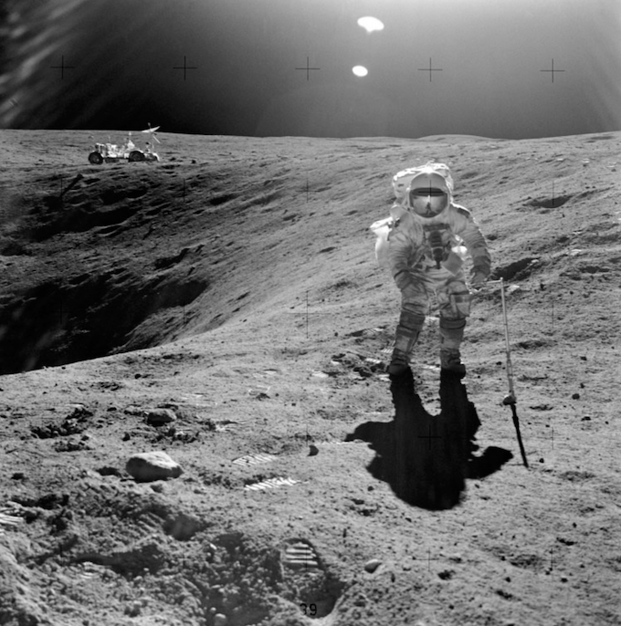

‘V dék defàt che gò ìde quàk endesìziù ä mätì tré stó cäpìtol pärché i facc che ciöntö-sö i va ön po' äl defò dèl spìret ch’èl m’à fat ignì òä dè scrìär stó löbär: camà ä lä memòriä chèi moméncc grasiùs, ūnek e che i m’à deertì, endó su stà personàgio o spetädùr. Ä lä fì però ò pänsà che dòpo töt lä étä l’é mìä fadä dömè dé röze e fiùr e cosétä én stó löbär él pöl stàk poà quàk ävenemént ch’és regòrdä malontérä.

L’Istituto Tecnico Industriale Statale dé Brèsä èl gàä lä fàmä dé èsär tat empegnätìf, i profesùr sevéri e dūr. Pänsàe mìä però che l’empàt cón lé mätérie e cón i profesùr èl pödès èsär sé fòrte e sé dūr.

## Geogräfìä

Tacóm cón geogräfìä. Lä profesorèsä (S. Mariarosa), ä lä fì dèl’ùrä, lè m’àä dét che l’ärés entärögà zà ä pärtì dèlä lesiù dópo e che l’ärés dorvà lé “cärtìne möte” dèl atlànte. Mé e Gianluigi és sum revolgì tìmecc e góm fat präzènt che àäm mìä portà l’atlànte con noàtre. Àäm pänsà che ‘l fós mìä necesàrio e l’àäm lagà äl nòs päìs, Bagolì, e ék särés ölì quak dé pèr fàsäl spedì dèi nòs genetùr e fàsäl consegnà én colégio ‘ndó stàäm. Lä profesorèsä l’àä ciapà nòtä, e lä m’àä dét dä consedràm giöstefechè. Èl sömaàä töt ä pòst.

Lä lesiù dòpo, empèrte l’àä dét, l’à tacà ä entärögà e ch’àlä camà pèr pröm? Quànt ò säntì dì él mé cognóm, ém su säntì pèrs, confondì. Ò pröà ä fak ‘gnì ‘n mènt chèl ché lä màä dét, ma l’é mìä särvì. Ghé stà gnént dé fa. Mé àe mìä stödià pèr gnént geogräfiä, segiūr dèlä sclūzä ché lä m’àä dàt e àe pänsà che l’érä mèi droà él tép pèr àtre mätérie. Consäguènsä: 4! (Quàtär!) Él säcónt entärögà l’é stà Gianluigi. Poà èl ön vóto scars. Töcc du sum rästé mal fés dé chèlä setöäsiù pròpe malfà dä degerì. Però, cón empègn, sum reé ä remedià.

## Dezègn tènico

L’érä e l’é önä mätériä che gà emportànsä pèr önä s-ciöla tènicä. Le pröme lesiù i-éra sö lé régole UNI, lé mezūre dèi fòi dä dezègn, pröe dé scretūrä én stàmpätèl ecc. Ä mé, scrìär én stàmpätèl èl mé plazìä e pänsàe dé caàmlä descrétämènt finä che l’é mìä stàdä fàdä lä pröä én clas.

Él voto? 4! Quàtär! Ön voto pròpe bas, ma che l’é stà iū dèi plö alcc. I-érä golé poà tancc 3 (tri) e äderetūrä dèi 2 (du). Dömè quàk repetènt l’àä ciapà él sés. Dé segiūr l’àä pagà dàsio l’an prömä. Che cólp! Cól tèp però su progredì äl punt che lä miè fómlä, quànt ghé dä scrìär ärgótä, lä m’èl fa fà pärché gò önä bèlä scretūrä… sémpär ä mé.

## Äretmétecä

Él profesùr dé äretmétecä l’érä önä pärsùnä dä l’àriä mälencònecä, ma ciacolétä e, pèr sèrte vèrs, poà sempàtekä. Dé èl gò ön regòrt pozetìf fés én generàl e ön ävenemènt èl m’èl fa regordà poà cón stìmä.

Envèrs ä lä metà dèl pröm an dé s-ciölä 1964/65 (mélenöfsèntsesàntäquàtär/sesàntäsik)    èl m’à dàt dä fa ön còmpito én clas che ‘m regòrdo mìä bé dé che ‘s tratàä. Lä pröä l’érä nàdä mal pèr töcc. Quànt l’à dàt endré i còmpiti cói vóti, seräm töcc mók. Ä lä fì, l’à scomänsà plö o mank cón chèste paròle: “ ’lgiài, él còmpito l’è na mal, ma se negiū dé oàtre l’é stà bu dä resolvì él problémä (o lé opäräsiù), èl mé ègn él sospèt che sìäs stà mé ä ì spiegà mal. Tochè él còmpito èl vé mìä tignì én consedràsiù. Tornaró ä spiegà dé nöf e éf darò ön’àträ ocäsiù. Óm sosperà töcc e és sum säntì soleè. L’érä stàdä önä deceziù che sé spetàäm mìä, ecesiónàl, fórse ūnekä én chèlä s-ciölä.

Tancc agn dòpo, ‘nd’èl 1974 (mélenöfsèntsètantäquàtär), entàt ché sére dré ä na ä laórà, su égnì ä säì cón späènt däi giornài che chèl profesùr, Alberto Trebeschi, che àe sémpär stemà, l’érä trä i mòrcc dèlä stràge dé piàsä dèlä lòzä ä Brèsä.

Èl regòrt dé chèl ävenemént ä s-ciölä e dèl sò comportämént generùs èl mé rästà vif ‘nd’èl tép.

## Eletrotènicä

Èl tèrs an l’érä scomänsà cón le mäterie che lé reguardàä lä specializäsiù che àäm särnì dä ìk. ‘Nd’èlä clas gh’érä ön compàgn che, pèr questiù dé creànsä, camàrò Andrea. Nóm che èl sömèä äl sò cognóm. Iū che, “òä dä stödià saltèm ädòs”. Èl vögliä mìä säìgän dé stà söi löbär e i sò vóti i-érä orèndi. Negiū ‘nd’èlä clas i sé spiegàä empèrte èl fós reà äl tèrs an pärché èl reàä dä önä sesiù defäréntä e ‘l cognisìäm mìä bé. Ön dé, él profesùr dé eletrotènicä, l’enzegnér Valletti, che èl gàä önä “erre tondä” marcàdä fés, l’àä dàcc-è i còmpiti én clas e l’àä lézì i vóti dé ognū dé noàtre ä àltä gùs. Él mancàä él vóto dé Andrea. Dòpo ì fat pasà ön pò dé fòi, l’à lézì él giödìsio che l’àä scriì: ”cómpito sänsä tvòzä dé evùv”. L’à fat ön entärvàl curt entàt ché töcc noàtre dàäm ön’öciàdä sgrésä, defedécc pèr chèl che àäm äpènä säntì. “Pövtòp chèl ché stà scviì l’é ön pò scavs”, l’à sequetà él profesùr. “Vóto: Zévo”. Él còmpito l’érä stà consegnà én biànc.

Él stès profesùr envése, cón Marino, l’érä stà ön pò plö generùs, ma lä setöäsiù l’érä defärèntä. Marino l’érä stà camà ä lä lavàgnä pèr èsär entärögà e l’àä fat én pràtecä sénä mötä. Él profesùr l’à scriì él vóto söl regìstro, èl sé revolgì ä Marino e ‘l gà dét: “t’ò dàt du, iū pèr ignì ä lä lavàgnä e iū pèr tornà ‘ndré äl tò pòst. Ärgiù dé noàtre i sé mätì dré ä sgregnà, Marino no!

## L’ezàm oràl dé perìto

Lä dàtä dèl mé ezàm l’érä fesàdä pèr él 21 (ventū) dé löi dèl 1969 (mélenöfsèntsesàntänöf). Mé gàe l’empresiù dä ì fade bé lé pröe scriìde, tochè sére äsé quét, pèr quàt és pö èsär càlmi lä “Nòt prömä dèi ezàm”.

Chèl dé gliò él restärà stampà ‘nd’èlä miè memòriä poà pärché, él stès dé, ghé stà ön fat dé stòriä fenomenàl: él pröm läùr, l’Eagle, ch’èl s’é postà sö lä lūnä, äegnì ä lé 4:57 (quàtär e sinquantäsèt), ùrä italiànä. Pèr mé, l’érä ön ävenemént dé gròsä emportànsä e öglie mìä pärdìl. Chefà su leà sö ä lé quàtär dèlä domà pèr ardà én derétä lä träsmesiù ä lä televeziù. Sèrt, l’oràrio l’érä mìä él plö adàt pèr iū che gàä dä präzäntàs bèl desädà e svèlt dé cò ä l’ezàm poche ùre dòpo, ma lä mé ätensiù l’érä tötä pèr Neil Armstrong e Buzz Alvin che i mätìä él pé sö lä lūnä. Dömè 8 (òt) agn dòpo él pröm gul dèl óm ‘nd’èl spàsio, cón Yuri Gagarin, l’edèä che l’óm èl fós reà ä pes-cià lä lūnä lä m’àä encantà sé tat dä fa pasà quazi én säcónt pla fenämài l’ezàm che gàe dä ìk.

