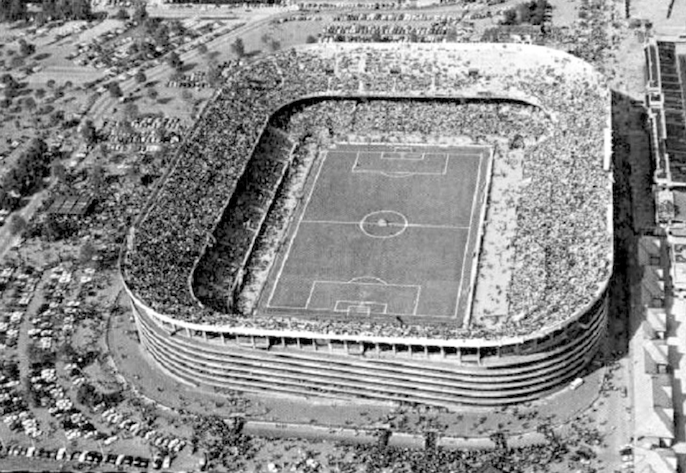
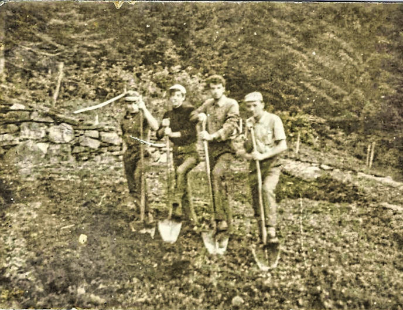

## Lä prömä òltä äl stàdio dé San Siro (Campionato 1964/1965)

Dä ‘lgial sére - e su amó ädès – pasionà dé càlcio. Lä miè squàdrä dèl ciör l’é él Milan. Sò mìä chèl che ärés dàt pèr äsestì ä önä pärtìdä ä San Siro, ma l’érä önä ròbä emposìbel dä reälezà ä chèlä età, ä chèl tép. Mé, ensèmä äi àtre compàgn che i-àä desidì dé na ‘nnàcc ä stödià, és séräm träsferì ä Brèsä pèr na ä lä s-ciölä secondàriä e stàäm al “Convitto Arcivescovile S. Giorgio” pèr mangià e dormì. Él nòs compàgn Fernando envése l’àä desidì dé na ä önä s-ciölä dé cärpentér ä Mélà.

L’érä mìä lädì edìs, ma séräm rästè én contàt e én bu rapòrcc. L’è stà cozétä che Fernando él m’à dét che èl , quàzi töte lé domìniche, él reàä ä idì lé pärtìde dèl Milan e dèl Inter, sénsä pagà él begliét. Sé ölì ignì ä troàm, pòs fa na-tré poà oàtre e ardóm lä pärtidä ensèmä däi pòsti dèi änéi centrài. Lä ròbä lä mé bregàä. Dòpo ì räzonà ön pò, dömè mé e Flaviano sum stè d’entìs e óm desìdì che särésäm né ä idì lä pärtìdä. Lé mìä stà pér gnént lädì. Prömä dé töt meàä ìk él pärmès däl “Pàre càpo sùperiù/deretùr” dé pödì na-lè däl convitto/colégio él sàbät e lä domìnicä e pó cäpì comià orgänezà èl tép ‘nä òltä reè én tréno ä Mélà.

Ém regòrdo mìä cón che sclūsä, ma sum reè ä söperà l’entóp dèi pärmès. Pó, reè ä Mélà e ìst che pögliäm mìä pärmätìs dé dormì én älbèrgo, óm scomänsà ä pänsà comià pasà töte chèle ùre che mancàä ä encontràs cón Fernando, lä dómà dòpo. Dä lä stasiù centràl, óm desìdì dä na vèrs él stàdio, sénsä ciapà més dé träspòrt, dä na ä pé e na-dré äi cärtèi e äi nóm dèle vié dé mòdo dä fa pasà él tèp. És sum rändì ciūnt én frèsä che i-è mìä dömè du pas.

Gò mìä ön regòrt ciàr empèrte óm pasàdä lä nòt, ma ärgiūne ròbe i-ò mìä desmontägàde: ön polesiòt che, quànt èl m’à ìst sö lä viè ä chèl’ùrä dé nòt, èl m’à fat na-tré ‘nd’èi ùfìci pèr domandàm spiegàsiù söl pärché és tróàäm gliò ä chèl’ùrä e ‘ndó séräm dré ä na; ém regòrdo él frèt e él confòrt ch’óm pröà quànt óm troà lä mäniérä dé reparàs ‘nd’èl äbetäcól dé ön forgùnsì “Ape Piaggio” dé colùr virt s-ciūr, parchègià ä làto dèlä viè. Reàdä lä domà, sum reè ä ‘ncontrà Fernando.

Lä domà söl tàrde és sum troè denàcc äl stàdio. Séräm reè prömä fés dèl oràrio dèlä pärtìdä, tochè gh’érä mìä ànemä ìä söl piasàl. Fórse él m’érä mìä stà dét én mäniérä ciàrä compèrte särésäm nè tré pèr ciapà él pòst, ma orämài séräm egliò e sum na-dré ä chèl che ‘l mé déziä Fernando: èl sé tratàä “dömè” dä scäàlcà lä cäncelàdä e l’érä fadä! Èl m’à fati dì empèrte fa e noàtre ék sum nè-dré. Önä òltä tré, sum rästè cólä bócä däèrtä denàcc äl spetàcol dèl stàdio, öt, e dèl cap dé càlcio, irt fés e präsìs. Önä märäèä.

Óm sercà dä mìä fas notà e óm spetà finä che él stàdio l’à scomänsà ä emplenìs. Prömä i tifùs ultràs che i-à anvìà ä sestemà i strìsiù dèle dò squàdre, pó, viä viä, töcc i-àtär spetädùr e l’emosiù lä tacàä ä fas säntì. Fegöràs quant ä l’altoparlànte i-à déte lé formasiù: Maldini (Cesare), Trapattoni, Lodetti, Rivera, Altafini…Ghè stàdä önä grandä gùsadä. Lä pärtìdä l’é mìä stàdä ön grant ché, però l’é finìdä cón lä vitòriä dèl Milan pèr 1 – 0 (iū ä zèro), cón él gòal dél zögädùr bräzéliàno Amarildo e chèst él m’à répagà dèle nòse fädìghe. Tornà ‘ndré ä Brèsä l’è stà plö lädì fés dèl’andàdä. Fernando él m’à compagné ä lä stasiù centràl cón lä metropoletànä M1, nöä nöäntä, che l’érä stàdä enaogoràdä dä pòk mis. Pó én tréno finä ä lä nòsä sosperàdä desténasiù. Önä bèlä reläsiù, pèr ‘lgiài dé 14 (quatòrdäs) agn.

Nòtä pèr lä mé nägúdinä Camilla

Camilla, ädès che t’è iöstä complì 14 (quatòrdäs) agn, pròpe comià él nòno, che l’è stà ön pò mat, öi dat ön consèi dä nòno che ädès él gà ‘n pò plö dé cò. Chèlä córsä ä Melà, cón töte le sò emosiù e ön pò d’éncosiénsä, lä färés mìä plö, poà se lä pasiù pèr él Milan l’érä ìrä e tantä. Tochè, Camillina, sìrcä dè godìt lä tò età (i tò agn), ak-dré ä lé tò sperànse, ma sìrcä dä stà äténtä e àrdä dä èsär e resärvadä, poà sé sò bé che l’é deplö domandàl ä tè.

## L’encedént én vèspä

Mè e él mè compàgn Giuseppe fàäm lä quàrtä I.T.I.S. L’érä dé zöbiä én mas, ūnek dé dé s-ciölä cól dòpo mesdé lìbär, cozétä óm desìdì dé fa önä spasazàdä äl lak. Én sèlä ä lä bèlä vèspä 125 (sentventesìk) biàncä dé Giuseppe, ä Brèsä, séräm dré ä na én deresiù dé Iseo. Mé säntà-zö dedré, sercàe dé empesà önä segärètä. L’érä mìä lädì e, entàt che täntàe, ön pänsér él mé pasà pèr él cò:”Su pròpe stūpet ä desträìm cozétä; töt pèr önä segärètä!”

Ém rändìe ciūnt dèlä stöpedàdä che sére dré ä fa e lä ròbä lä m’à dàt dä pänsà. Äpé äl crozàl, ò sequetà ä pänsà: “Èco, sé lä reès önä vetūrä dä lä viè sö lä drétä, m’én rändärés gna ciūnt e ‘stè dezätensiù  (dezätensiū) lä pödrés costàm carä fés. Önä preveziū che l’é dääntàdä ìrä töt énd’ön cólp. Önä FIAT 500 (siksènt) biànkä l’è réàdä ‘nd’èl crozàl sénsä molà e s’é mìä pödì s-ceà él scóntro. D’istìnto ò alsàdä-sö lä gàmbä pèr s-ceà lä bòtä, ò mätì él pé söl còfän dèlä FIAT 500 e ‘m su troà ä golà ä plö d’ön metär dä tèrä, terà comià ‘nä palòtolä. Én ariä, ém su rändì ciūnt särés dat-zö e pöglie roenàm, cozétä ò desìdì dé tùfàm én tèrä cón i bras deständì én ennàcc pér smorsà l’empàt. Ò poà pänsà bé dé postà-zö lä spàlä én tèrä e geràm sö mé stès. Éntàt che fàe él moemént, ém su rändì ciūnt che ‘m troàe én mès äl crozàl e che gàe dä töm i-è dä gliò pér mìä èsär tö-sót dä ‘nä quàk vetūrä. ‘M su dat ön puciù cón tötä lä mé fòrsä e ò finì lä córsä söi mé pé, cùträ lä cä dä lä bàndä dälè dèl crozàl.

Él guedadùr e l’àtär ‘lgiàl sö lä vetūrä che lä m’àä töt sótä che i m’àä ìst gulà denàcc ä èi, ié ignì-zö defàt e i-è corì vèrs dé mé pèr segiöràs che ‘m fös mìä fat mal sénsä entäräsàs dèl poòr Giuseppe che l’érä deständì-zö én tèrä, äpé ä lä sò vèspä che él s’érä fat plö mal e che l’àä signì na ä l’ospädàl. Önä òltä finì töt, ém su troà ä pänsà-sö ä ärgiūne ròbe che lé m’àä empresionà: l’entöesiù che önä vetūrä l’ärés träärsà él crozàl sènsä lagà ‘l pas ä noàtre, él sànk frèt che gò ì, lä sveltèsä dèl särvél ä procesà lä setöäsiù dé grant pärìgol, ch’él m’à fat ciapà lé deceziù giöste én chèi pòk säcóncc, momènt pèr momént. Pèr fortūnä l’encedént äl gà mìä ìde consäguènse série ä part che mé, pèr ön bèl pò dè tèp, töte lé òlte che gàe dä träärsà ön crozàl, él mé ciapàä lä pòrä dé ìk ön encedént, enfenämài poà quànt sére sö lä coriérä pèr na ä s-ciölä o én cità.

Entàt ché scrif, él mé ègn én mènt chèl fat egliò e l’é amò stampàdä ‘nd’èlä mé mènt lä strìsiä nìgrä lagàdä dä lä mé scarpä söl cofän dèlä 500, ön sègn dé chèl momént ch’èl rästàrà pèr sèmpär.

## Lé acànse d’està

Endó ‘s va én acànsä? Äl mar, no. Én mut ék sere zà, tochè? És va a laorà.

Nèi agn dèle s-ciöle médie, lé mé està lé pasàe dä dèle pärsùne che stàä äpé dé cä e che lé gàä önä ostärìä-restorànt, lä “Locanda del cavallino”. Egliò dàe önä ma ön pò däpärtöt, én cuzìnä, äl beäröl o éndo ‘l’ocorìä e mé säntìe iū dèl pòst. Renöncià ä lé zornàde dé zök cón compàgn l’érä mìä sèmpär lädì, ma mé sére pärsöàs dä rändìm bu e ä fa polìto.

‘Nd’èi agn délä tèrsä e quàrtä I.T.I.S., lä guàrdiä forestàl lä màä dàdä l’ocäsiù dé èsär ciapà dä zögn ä setèmbär pèr dèi laorà proezòri pèr plantà piànte e böschècc dentùrän äl päìs, laorà che i särvìä ä stäbelezà él tärì e fa calà él rìs-cio dé laf. Él pröm an óm laorà äpé ä lä Àl Dóris, entùrän ä 1200 (meleduzènt) métär dé ältèsä.

L’érä ön laorà gréf, pegiorà poà dä lä (defècoltà) fädìgä che meàä fa pèr reà söl pòst. És pärtìä dä Bagolì én bececlétä e, dòpo 8 (òt) chelòmetri dè ràtä, lä zornàdä lä scomänsàä cón bädìl, sàpä e cäriölä. Lä fädìgä lä mancàä mìä, ma lä sodesfäsiù dè guadagnà ärgótä (ärgótìnä) e rändìs bu pér él sìto (pòst) e lä àl l’érä gràndä. Dòpo lé quàtr’ùre dé laorà, lä ràtä vèrs cä l’érä önä leberäsiù: mòrcc dä lä fam, ma contècc és lànciàäm-zö vèrs él paìs.

Él säcónt an él cäntér l’è stà däèrt ä Mönsöèl (Monte Suello), denàcc ä l’osàrio gärebäldì. Dä Bagolì és reàä äl cäntér dòpo 7 (sèt) chelòmetri dé ràtä, ma ä lä fì délä zornàdä lä fädìgä pèr tornà ‘ndré lä ‘s fàä säntì. Pèr fortūnä, él mé compàgn Silvano èl gà ì él pärmès däl sò bobà dä droà lä sò MV Agusta, önä móto che lä gàä i sò agn, ma lä fonsionàä. Turnà ‘ndré däl laorà sénsä ìk dä spedälà l’érä däbù ön’ àträ fòzä dä ìär lä zornàdä.

Ön fat él mé rästà stampà ‘nd’èlä memòriä: önä domà, cón lä viè amò bagnadä dä l’àquä ignìdä-zö, Silvano l’àä desìdì dä smorsà él motùr sö lä ràtä pèr tignì ä ma lä benzìnä e na-zö sensä màrce. L’érä na töt bé fìnä quànt, ciapàdä sveltèsä, én cūrvä, l’à pèrs él contròl. Lä móto l’é biöscàdä e noàtre cón elè; és sum troè én tèrä, terè-dré däl càrgo dél mès, fìnà äl pärfìl dèlä viè, cùträ ‘l mut.

Lä prömä ròbä l’è stàdä domandàs sé stàäm bé e, pèr förtūnä lä respòstä l’è stàdä dé sé. Äpénä leà-sö én pé, però, óm notà söl asfàlt bagnà önä gròsä màciä rósä. Pèr ön momént öm pänsà ch’él fós sank ìst él colùr e lä mezūrä. Ghé sté moméncc dè tensiù, empegnè ä cäpì chi ‘l fös rästà ferì; én äretà, i-érä stàde le bositìne dé Sanbittèr, che àäm portàde ‘nd’èlä tàscä dèl giöbì che lé s’érä róte ‘ndèl dà-zö. Óm ciapàdä lä viè vèrs él cäntér, stäòltä cón él motùr empesà e lé màrce mätìde trè.

I-érä laorà fädegùs, dälùns dä cä e lä pàgä l’érä bàsä. Embé, lä sodesfäsiù e lä compägnìä lé rändìä le nòse està speciàli.

## Äl cìnemä

Èn päìs gh’érä mìä tant podì e él cìnemä l’érä önä dèle pòche ocäziù dé pasätép e dé deärtemént. D’està lä sàlä l’érä sémpär plìnä plenèntä, lé ghé nàä lé pärsùne dèl päìs e poà i tancc forästér che i pasàä lé acànse. Önä sìrä, cón i mé compàgn, óm desìdì dä nàa ä idì él film che i proietàä. Séräm énd’ön bèl rösöl e óm ciapà i pòscc centrài dèle pröme fìle.

Töt end’ön momént, él sìto che gh’érä én sàlä pèr önä sénä dé tensiù l’è stà rót dä ön ciàs fòrte e lunk:”Prrrrrrrrrrrr……!”

Sé, önä fòrte patonàdä, sénsä spetàslä, l’àä rótä tötä lä tensiù càözàdä dèlä sénä e töcc i spetädùr  i-è sciopé ä sgregnà. Flaviano l’érä stà l’äotùr, ma, cón fa dä sgregnàc sö e cón càlmä, él sé gerà äbelàze vèrs lé pärsùne säntàde-zö dedré dé èl comià che él ciàs èl fós ignì dä gliò. Cón chèl sègn, èl èl compärìä comià ch’él ghès mìä cùlpä e, dä balòs, él fàä ì lä cùlpä ä lä pärsùnä säntadä-zö dedrè dé èl. Robertino, ch’èl s’érä säntì ensegnà d’ön detòrt, l’à reägì defàt e èl sé mätì ä ostià cùträ Flaviano. Sum mìä reé ä cäpì bé che parolàse ch’èl gà dét pèr él ciàs dèle sgregnàde che i-à fädegà ä smorsàs. I-è pasé mis prömä che i du i sé parlàäs e i tornàäs ä sälödàs.

## Chèl che l’à stödià (Lä làurä)

Él mé frädèl Graziano, dòpo él lecéo clàsek, èl s’érä notà ä lä facoltà dé “Lètre e Felosofìä” ä l’Oniversità Catòlekä dé Mélà. L’érä reà ä ìk önä bùrsä dè stūdio e, gràsie ä chèlä, l’à pödì na äl colégio Augustinianum, äpé ä lä piàsä S. Ambrogio. Pèr tignì él pòst, meàä dà töcc i ezàm dèl an e tignì önä mediä dé vóti altä. Graziano l’àä stäbilì dä ciapà lä làurä e l’é reà ä iglä sènsä ì mài fälì ön ezàm.

Én fämìä sé stemàäm töcc e ghe n’àäm bé räzù: äl nòs päìs, èl se tratàä dèl pröm fiöl d’ön läorèt ä ciapà lä làurä. Él 6 (sés) dé löi dèl 1965 (melenöfsentsesantäsìk) l’érä lä dàtä fesàdä pèr lä präsäntasiù dèlä tézi. Él bobà Sandro èl sérä mätì d’entìs cón Renzo, ch’èl faä särvìsio dé träspòrt dèle pärsùne, pér él viàs dä Bagolì ä Mélà. Önä bèlä spézä, ma negiū dé noàtre èl pödìä mancà ä chèl ävenemént ch’èl véziä Graziano decorà cón chèlä nòmenä dè mèret. Dömè Flavio l’àä mìä pödì ghv’èsär pärché èl sérä träsferì dä pòk tèp én Svìserä ä laorà.

Renzo èl m’à compagnè ä l’engrès dèlä oniversità e, entàt che töcc i-érä gnì-zö dèlä bèlä FIAT 1400 (melequatärsènt) blö, mé su rästà cón èl sö lä vetūrä pèr cäpì éndo l’ärés parchegià e èsär bu dä reà gliò ä lä fì dèlä funsiù. Dòpo dé che, ém su anvià pò ä mé vèrs l’engrès. Detré, ém su säntì defàt späesà, sàe mìä dä ché bàndä na e, entàt che sercàe dä orientàm, ò ìst ignì äpé ön óm grant én önä tògä nìgrä. Ò pänsà ch’èl fós ön prèit e gò domandà:” Domando sclūzä, padre, pödäresäf dìm compèrte reà ä lä salä magnä?”. Èl l’à sgregnà deertì e cón creànsä él m’à ensegnà lä viè. Con ön po' dé retàrdo ém su rändì ciūnt che, poà sé séräm ä l’oniversità catòlekä, chèl óm l’érä mìä ön prèit, ma ön profesùr.

Ä lä fì, su reà ä lä salä e su reà ä äsestì ä lä präsäntasiùdèlä tézi dé Graziano denàcc ä chèi profesùr cón lé tòghe. Él descórs äl mé sonàä stràmbo, ä dì pòk:”L’infinito esclamativo in latino” (amò enciö l’ò mìä cäpì, pärchèl sirco gna dä trädözìl) ön témä sé ensòlet l’érä za èl dä sùl önä gäränsìä d’ön grant bèl vóto. Graziano èl s’è làureà cón 110 e lode! Ön rezöltà “conquiso”* (cónquestà) cón mèret. Cón chèstä paròlä, su segiūr, farò sgregnà Graziano.

\*Pärticìpio pasà dé “conquidere”, vèrbo dèlä lènguä italiànä rar e che l’encantä, che èl va pròpe bé pèr él temä dèlä tézi e cón chèl che l’à svelöpàdä.

Nòtä

Däl colégio Augustinianum i-è pasàde fegūre destenàde ä dääntà personàgi dèlä sénä polìtecä italiàna, trä èi Amintore Fanfani, Ciriaco De Mita, Romano Prodi, Tiziano Treu e Giovanni Maria Flick. Compàgn dé colegio dé Graziano l’é stà poà Mario Capanna, che za egliùrä èl sé fàä notà pèr lé sò enfiämàde contestasiù tat dä èsär scasà-è dä l’oniversità e oblägà ä na lä däl colégio. Graziano l’à preferì dàs ä ensegnà äl liceo clàsek; l’é stà äsestènt dé lätì ä l’oniversità Catòlekä e äotùr dé deärse löbär, sùrä töt én lätì e anche söl deälèt dé Bagolì. Pèr 15 (quìndäs) agn l’è stà präsede dèl Istituto V. Gàmbara, ä Brèsä, che nèi agn dèlä sò deresiù, l’è dääntàdä lä s-ciölä plö gràndä dèlä Lombärdìä pèr nömär dé stödéncc.

## Él räcomandà

Lä räcomandasiù lä pöl mìä mài èsär consedràdä önä ròbä che lä té fa säntì sodesfà e che lä t’fa stemà. Chèi che n’à caà entärès, i sircä dä tignìl scondì e i né parlä mìä cón negiū, ä meno che…

Quànt che fae él soldà, sótä lä léä, ä lä Cecchignòlä, Romä, l’èrä reà él momènt déle destenäsiù äi repàrti: töcc speràäm dé èsär mandé äpé ä cä, ma dé sòlet chèi dèl nòrd i vegnìä mandé äl cèntro-sud e chèi dèl cèntro-sud äl nòrd. Él tenènt äl m’àä mätì én guàrdiä: negiūnä domàndä o räcomandasiù lä särés stàdä lagàdä pasà, pénä èsär mandé nèlä cäzèrmä plö dälùns.

Pänsàe mìä che él problémä èl pödìäs reguardàm, ma ò resiìdä önä lèträ dä lä miè màmä ché, dé sò edèä, l’àä scriì äl comandànt pèr fam mandà én quak sìto äpé ä Brèsä.

Ém su fegörà defàt él pés. Äl momént dé fa säì lé destenàsiù, ò signì spetà tant, gàe pòrä. Ä lä fì ò säntì dì él mé nóm e, én pärtecolàr, lä destenàsiù: Pàdoä! L’é stà ön grant confòrt! Dömè plö tàrde ò säì che lä lèträ dèlä màmä l’érä stàdä ciapàdä én consedràsiù; él comandànt stès èl gàä räspondì e èl gàä spiegà che l’àä fat él posìbel pèr egnìk encùträ. Pèr lä prömä òltä, önä räcomandasiù lä m’à fat sgregnà e pröà oblägäsiù. Äi mé compàgn dé léä, quànt i mé dezìä che sére stà förtönà, él mé egnìä dä sgregnà e räspondìe che sére stà räcomandà dä lä miè màmä.

