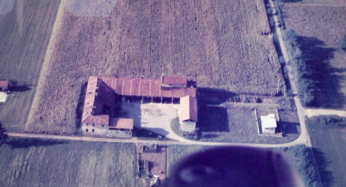
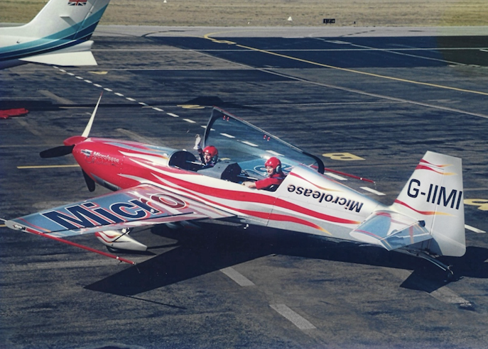

Pòrä dé gulà?Derés dé nò. Mé gò ä lé spàle tancc viàs én reoplàno e tancc chelòmetri e, quant vò sö ön reoplàno, l’ūnec mè scarpäcò l’è dé troà én frèsä él pòst pèr él bagài én gäbìnä. Ma gulà èl pöl ìk ön sénso defärént. Èco du càzi.

## Él gul cól reoplänì legér

Lä miè fómlä, Piera, l’àä säì pèr càzo, fórse ä lä màchenä dèl cäfé, ‘nd’èl entärvàl söl laorà, che ön sòcio ch’èl laoràä nèl ofìcio äpé äl sò l’érä ön pilòtä dé reoplàno e ògne tat, ìst che pèr tignì bu él brevèt, él gàä dä fa töcc i agn ön nömär dé ùre dé gul oblegätòrio, èl dàä el pödì ä compàgn e sòci dé gulà cón èl ä ön cóst bas fés. Piera él mé n’à parlà e mé su stà engolozì defàt dä l’edèä dé idì él nòs päìs, Būrac, dä l’alt.

Óm fesàdä lä dàtä e, él dé stäbilì, mè, Piera e i fänzì, lä nòsä zarmànä Loredana cón le sò fiöle sum né äl areopòrt dé Bress. Pèr töcc, mank che mè, l’érä él “bätès dèl’àriä”. Ä l’entràdä, él controlùr èl m’à domandà schèrsùs s’èl fös ön “gul dèlä tós cägnìnä” pärché egliùrä és crezìä che l’ältäsä lä pödès fa bé ä chèi che pätìä dé chèlä mälätìä. Él pilotä èl gà ì dä fa du gui, consedrà che söl  reoplàno i pógliä stàk dömè quàtär viàzädùr.

Sum né söl reoplàno: mé äpé äl pilòtä, lä miè fämìä dedré e sum pärtì.

Mé ò notà ön trätùr che ‘l taàä l’èrbä äpé ä lä pìstä e pèr slegérì lä tensiù, ò fàdä önä bätìdä äl pilòtä pèr él fat che él trätùr èl sömäàä na plö svélt dèl reoplàno. Èl èl m’à spiegà che chèl reoplàno èl sé destàcä dä tèrä, presäpòk, ä otàntä chelòmetri l’ùrä. E däbù, pòk dòpo, él reoplàno l’à tacà ä alsàs dä tèrä e ä dendolà e és sum troè pròpe sùrä äl camposànto dé Bress! “Speróm dä na lè dé ché ä lä svèltä” ò pänsà trä dé mé. Prèst sum reé ä l’ältèsä giöstä én deresiù dé Būrac, sùrä Monzä e dentùrän. I pòst ié bèi fés e dä l’alt sum reé ä idìi polìto.

Reé ä Būrac, óm gulà sùrä lä Baràgiä, èndo pärèncc e conosèncc i sérä trè ‘nsèmä e i sbätìä i fäsöi cóle ma pèr sälödàm. Él pilòtä èl s’é sbasà fìnä ä 150 (säntcinquàntä) métär däl tärì e l’é stàdä önä gròsä emosiù idìi dä gliò. Óm tacà ä ciapà amó ältèsä e, cón önä geràdä bèlä largä óm gerà sùrä Vimercate e lä Telettra, la socetà ‘ndó laoràäm mé, Piera e él pilòtä pér na ä ignì äl reopòrt, töcc sodesfé dé chèlä bèlä geràdä. Pèr lä màre dèlä miè fómlä, mé e Piera sum sémpär rästé du che i-è mìä responsàbei che i-àä portà poà i fänzì, i sò nägùdì, sö chèl reoplänì.

## Él gul acrobàtek

‘Nd’èl 2006 (dumeläsés) ön fornedùr cognesì bé l’àä orgänezàdä lä präzäntàsiù dé strömèncc dé mezūrä trä i plö ennàcc ‘nd’èle telecomenegàsiù. Mé e él mé compàgn Gianpiero séräm sté envedé ä entràk. Pèr fa sé che lä zornàdä lä pödès entärèsà dé plö i cleéncc, dòpo lä präzäntàsiù, i dàä l’ocäziù dä ìk önä pràtecä dä mìä desmontägà: ön gul acrobàtek. Gianpiero l’à miä döbetà e l’à desìdì dä pröàl. Mé sére endesìs, ma ä lä fì, ìst che Gianpiero e i orgänezädùr ì sequetàä, ém su lagà convincì.  Ém su mätì sö él casco e su na söl reoplàno. Cón miè märäèä, i m’à fat säntà-zö denàcc, envése él pilòtä l’érä dedré dé mé, envezìbel ä lä vìstä, ròbä che lä m’à mätì ön pò dé silìsio.

Él pilòtä äl m’à dàde dèle enformasiù söl gul. Dä chèl momént egliò , mé e él pilòtä särésäm sté taché dömé cól’aràdio. Äl m’à domandà se sére pärècc e dòpo che gò dét dé sé, sum pärtì. Él reoplàno l’à ciapàdä lä córsä e én pòk säcóncc äl sé alsà dä tèrä. Töt énd’ön cólpo l’à tacà ä nà sö empé, cól mūs puntà vèrs él cél. Mé ò pärdì ògne refäremént, dèl töt desorientà, sercondà dömé däl selést dèl cél. Él pilòtä èl m’à ezà dä paraciàm: l’ärés tacà ä fa plèghe, pirli, pärdì ältèsä, na ‘nsö amó, pichiàde, pirli dèlä mòrt. Él sfòrs fisek l’è stà grant e gò ì poà ön sénso dé nàözä. Ògne tat él pilòtä èl mé domandàä empèrte stàe; mé sercàe dä rezistì, ma ézie mìä l’ùrä dä mätì i pé ‘n tèrä. Ä lä fì él pilòtä èl m’à dét che lä nòsä geràdä l’érä reàdä ä conclözìù, ma ìst che i s’érä prenoté én pòk, èl m’à domandà sé öglie na ennàcc amò ön pò. Sò mìä s’èl völès schersà. “No, no, no! Gràsie . L’é stà bèl, mà gh’nò äsé. Lago ontérä él pòst ä ärgiū àtre…” Gh’è ölì ön bèl pò dé tèp prömä che ‘l stomèk äl nàäs ä pòst e che pödés reà ä sgregnà amó. Sé gh’äès dä ciöntà sö én dò paròle empèrte l’è nàdä, derés: “su amò ìf!”.

