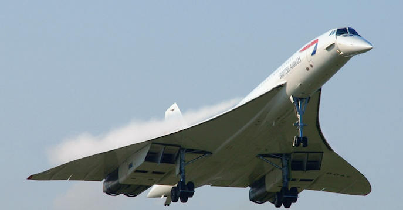
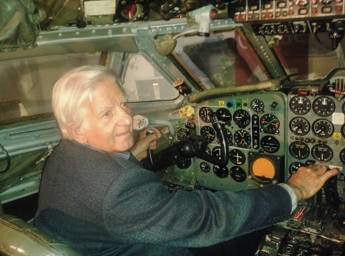

Él Concorde, reoplàno supersònek l’é stà ön’emmàgene pèr lä so sveltèsä dé gul e ön sìmbol dé renoàdä e välùr. Lä consäguènsä dèlä coläborasiù trä Franciä e Gran Bretagnä én ön tèp dé fòrte gàrä tènicä; poà sé l’à desmätì dä gulà, èl sequetä ä encantà pèr èsär ünek.

Trì regòrcc i mé lögä ä chèst reoplàno.

## Él pröm modél

’Ndèl 1972 (melenöfsentsetantädù) gò ìdä lä förtünä dé idì iü dèi pröm modèi dé pröä dé chèst reoplàno endèlä bàze aeronàotecä meletàr dé Farnborough, én Gran Bretagnä. Él mé frädél Flavio èl fàä part dé önä squàdrä dé tènici che gàä dä fa lé pröe e i contròi ä tèrä: sfòrs mecànici, sbàls dé temperädürä, fa därvì e särà parcc, controlà i segnài dé rotüre e ròbe compàgne. L’érä reà, sò mìä compèrte l’àä fat, ä fam ì ön pärmès pèr na-tré ’nd’èl cäpänù grant fés éndo gh’érä tré él Concorde. L’é stàdä ön’emosiù che ’s pöl mìä ciöntà-sö. Denàcc ä mé gh’érä ön läùr ünek äl mónt che s’én parlàä tant, ma che pòk fés i gàä ì él pödì dä idì. Önä càözä bunä pèr stemàm.

## Él dezàstro

’Nd’él löi dèl 2000 (dumelä), ’nd’èl na ä egnì dä ön viàs dé laorà ém troàe ä Pärigi e én chèlä i-à tacà ä gerà dèle gus, prömä confüse e pó sémpär plö präcìse: ön reoplàno Concorde l’àä tacà fök entàt che l’érä dré ä leàs dä tèrä e l’érä dat-zö pòk dälùns. Mé sére rästà stornì e cón tant silìsio ò ciapà él mé gul pèr Melà. Na söl reoplàno dòpo ì säì che ön àtär, äpénä pärtì d’egliò, l’é dat-zö l’é önä setöäsiù che lä té fa mätì én ciünt ògne posìbel rìs-cio. Chèl sénso dé engósä èl m’à compagnà pèr töt él viàs. Cón chèl dezàstro l’é finìdä lä stòriä dèl Concorde.

## Äl mozéo dé Duxford

L’ültem regòrt l’é dèl 2015 (dumeläquìndäs), quànt ò izetà ’l’Imperial War Museum di Duxford, äpé ä Cambridge, én Gran Bretagnä. Ön ex sòcio dèl mé frädél Flavio l’àä orgänezàdä önä ìzetä cón lä guìdä pèr i compàgn, orämài én pensiù, che i-àä laorà pèr agn äl Concorde. Nèl mozéo ghé önä gròsä mósträ dé reoplàni, ma él Concorde l’é lä ìrä stìlä. Lä sò lìniä ä füs, lé àle fìne e ’l “nas” che èl sé sbasä-zö comià él bèk dé ön rapàce i t’èl fa cognisì defàt.

Dòpo önä cùrtä präzäntasiù, lä guìdä lä m’à envedà ä na söl reoplàno. Mätì él pé sö chèl sìmbol l’é stàdä önä emosiù fòrte; amó plö fenomenàl l’é stà pödì säntàs-zö ’nd’èlä gäbìnä äl pòst dé iü dèi du pilòti, ön ävenemént che ’s pöl mìä desmontägà.

Flavio ä lä “guìdä” dèl Concorde
{: .caption}

