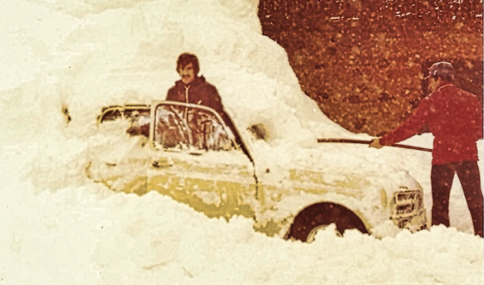

## Lä sätämànä biàncä

’Nd’èi agn 70 (setàntä) dä lé nòse bànde, lä nif lä mancàä mài. Mé e Piera séräm sposé dä pòk tèp e àäm lagà fenälmènt ä lé spàle i empègn dèlä spùzä e sùrä töt lä resestemasiù dèlä cä éndo àäm desidì dä na ä stà. Àäm mätì-è poà ’nä quàk palàncä e pögliäm pärmätìs ön pò dé botép.

Ä mé èl mé pläzìä scheà; tochè, pärché nó mìä concedìs önä sätämànä biànkä én Gàvre, sìto éndo na ä scheà äpé äl mé päìs, Bagolì? Dét, fat! N’óm parlà poà cón dèi compàgn e sòci dèl laorà, che i-m’à dét che i särés ignì ontérä poà èi. Én pòk tèp és sum troé ä èsär ön bèl ròs dé önä dezìnä dé pärsùne.

Ò troà pòst äl Villaggio dèi Cardi, ön vilàgio fäbrecà dä pòk tèp, fat dèl älbèrgo én més cón sàlä restorànt e beäröl, sercondà dä tànte cäzetìne éndo ärésäm lozà noàtre.

Séräm töcc contécc fés e óm prenotà pèr lä säcondä sätämànä dé zänèr 1977 (melenöfsentsetantäsèt). Töt l’é na ä märäèä: sö lé pìste gh’érä tàntä nif, él tèp ciàr e solìf, lä compägnìä grasiùzä e ’s mangiàä bé. Lä sätämànä l’é golàdä-è.

Vändärdé, penültem dé, él cél l’é dääntà nìäl e l’à tacà ä flocà. Tri dé noàtre i-à desidì dé portàs ennàcc e pärtì prömä. Lé badàne lé sé fàde sémpär plö spèse, e lé sé träsformàde én önä flocàdä bèlä cargàdä. “Sé lä va ennàcc cozétä, garóm séri problémi ä fa él viàs”, óm pänsà töcc.

Entàt che senàäm, sé sgregnàä, sé schersàä, ma séräm poà pänsärùs. Francesco Colombo, ’lgiàl speretùs, ma ch’èl sé controlàä mìä tròp, l’à tacà ä dääntà närvùs e èl l’à fat ä lä sò mäniérä, pròpe comiä èl fa iü bu fés dä terà ä bàe, e ’l mé fàä sgregnà töcc. Graziella che èl lé cognisiä bé, l’à domandà ä lä sèrvä dé ignì äl nòs tàol e dé dì, pèr schèrs, che lä viè pèr Bagolì l’érä entärompìdä pärché l’érä gnìdä-zö önä ìldä e ’l särés stà defìsel reà ä pärtì él dé dòpo. Lä falsä notìsiä l’à mandà ’nd’èlä pòrä Colombo. Óm äsestì ä ön cresì dé bätìde, saracù, parolàse che lé m’ fàä sgregnà dé botép.

Óm parlà dé empèrte gestì lä setöäsiù, ma sàäm za che l’ünecä ròbä dä fa l’érä spetà che él tèp èl dääntàäs plö bèl. Entàt èl sequetàä ä flocà.

Chèi che i érä torné ’ndré däle cäzetìne i ciöntàä che i àä fat fädìgä ä troà él säntér, pärché lä nif lä egnìä-zö sé spèsä dä scänselà lé pés-cie dèi scärpù.

Dòpo önä mez’ùrä, lä sèrvä l’é ignìdä dä noàtre cón cérä seriä e lä m’à dét che trìe, fórse quàtär ìlde i-érä ignìde-zö däbù trä Gàvre e lä Àl Dóris.

Pòk dòpo, i ciàr dèl restorànt i s’é smorsé pärché l’érä nadä-zö lä corènte e lä sìnä l’é nàdä ennàcc äl löm dèle cändìle. Lä setöäsiù lä dàä dä pänsà: séräm ezolé, sénsä rescäldämént.

Sum né ä dormì e óm sperà dä ìk plö bèle noetà lä domà dòpo. Pèr förtünä Colombo èl s’érä quetà ön pò.

Él dé dòpo i-é reàde notìsie plö präcìse, pörtròp mìä tròp bune: äderetürä sèt ìlde lé entazàä lä viè trä Gàvre e lä Àl Dóris e s’ék vögliä deärse dé pèr lebäràlä.

Èl rästàä dömè dä ciapàlä cón felosofìä e pänsà comià pasà ’l tèp.

L’älbergadùr èl m’à segiörà: gh’érä scòrte dé mangià äsé fìn ä Pàsquä, lä comenegasiù cól päìs l’érä segiöràdä gràsie äl colegämènt dé radioamadùr e ìst che séräm äpé ä lä centràl elétrekä, èl gàä äfedämént dä pödì ìk amó lä corènte én pòk dé.

Gràsie äl cél, él tèp l’é ignì bèl e l’à desmätì dä flocà. I socoredùr i s’é dàcc dä fa ä lä svèltä e lé rùspe lé àä fat dèi trànzet én més äi moclù dé nif dèle ìlde pèr pödì träärsà i pucc plö crìtek ä pé o cón lä motoslìtä. Gràsie äl träspòrt cón  lä motoslìtä Graziella, Loredana, Mariangela e Piera i-é stàde én grado dä na-lè däl vilàgio e reà én Vàl Dóris. Dä gliò, sö önä dèi cäräbeniér, i-é nàde ä Bagolì e cón lä coriérä i-é nàde ’nnàcc vèrs lä cä ä Bürac. Mé, Colombo, Claudio cón lä sò fómlä e lä fiölä Lisa sum sté obläghé ä rästà e spetà ch’èi lebäràäs lä viè pèr pödì na-lè cón lé vetüre.

Lä domìnicä, ön elicòtero dèi cäräbeniér l’é pasà sùrä l’àreä e, dòpo quàk pirlo, l’à tràt-zö ön sak sciür ’nd’èlä nif frèskä. L’óm töt-sö cón fädìgä e óm troà-tré dèl pà frèsk, önä empröezàdä ciapàdä tat ontérä quàt mìä spetàdä!

Él stès dé, él mé frädél Angiolino, Duilio e él mé càro compàgn Fabio, pärtì dä Vàl Dóris, i-é reé ä pé e i m’à fat säì compèrte i-érä lé condisiù dèlä viè e i m’à spiegà che ék särés ölì ön pò dé dé prömà che lé rùspe lé pödès lebäràlä.

Pèr noàtre che séräm rästé, él problémä plö gròs l’érä compèrte pasà él tèp pärché cón tötä chèlä nif és pögliä mìä möìs; ä ògne pas sé sfondàä fìnä äi fiànk.

I schìlif i-érä mìä én fonsiù, ma él pärsonàl che stàä-dré ä lé pìste i mé träsportàä söi gacc dä lä nif finà én sömä äl mut, cozétä pögliäm godìslä ä gnì-zö cói schi.

I mäèstri dé schi, Gigi e Giacomo, i mé compagnàä entàt che scheàäm e góm ì poà botép.

Entàt lé squàdre dé socoredùr lé laoràä sénsä fermàs pèr sgombrà lä viè dä lä nif.

Lé nòse vetüre i-érä sotràde sótä du métär o plö dé nif e meàä sbädelà ä ma pèr lebäràle. Snätàde lé vetüre dä lä nif, gàäm dömè dä spetà él pärmès dä na-lè.

Ä lä fì, i m’à dét che ’s pögliä pärtì. Dòpo che séräm sbrasà-zö e sälödé, és sum congedé däi mäèstri dé schi e däl pärsonàl dèl vilàgio, che i-érä sté creänsé fés cón noàtre, cón l’empègn dä räidìs, ma…dömè ä lä fì dèl envèrän, dòpo él desglasà.

Cón tàntä prödènsä óm tacà él viàs vèrs cä. Reé äl pröm tranzét, scaà trä mür dé nif alcc comià ché, ä Colombo lä ghé sé sganciàdä lä cädìnä dä nif dälä rödä. Oh Signùr! Ma gh’érä mìä tèp pèr lamantàs. Mé e Claudio óm sestemàdä lä cädìnä e és sum mätì amó én viàs.

Lä sätämànä biàncä, che àäm tat spetàdä, l’érä reàdä ä conclöziù e sére sodesfà; ànsi, ìst che i-érä stàde dò, sére él dóplo sodesfà…

## L’ enfermérä dèlä crus rósä

Ch’èlä l’enfermérä dèlä crus rósä? V’èl dék defàt: l’é lä mé ciögnàdä Mariangela. Lä pögliä mìä mancà dé ségiür ’nd’èl löbär dèi mé regòrcc. Sé ghès dä ciöntà-sö töt chèl che lä entäräsä, ék vörés ön löbär ä part, ma ché ém fermarò ä ön fat che, dé pärsé, èl dà l’edèä dèlä pärsùnä.

Sègn pärtecolàr: “soleàdä, sbadàdä” compèrte èl lä definìä lä màre dèlä mé fómlä che lä gàä mìä töcc i tòrcc. Ä dì lä äretà, Mariangela l’é önä ’lgiàlä mänierùzä fés, sémpär pärèciä ä dà ’nä ma ä töcc chèi che ’s tróä én defecoltà, cón ön spìret dé “crocerosìnâ” s-cét.

Pèr chèst, lä s’é notàdä äl córs ä lä Crus Rósä dé Monzä, éndo lä gà ì lä pätènte dé “crocerosìnâ”. Chèst èl vögliä dì, trä lé àtre ròbe, él doér dé na äi córs dé perfesionamènt.

Egliùrä l’àä desidì dé na ä önä série dé encóntri dé pröm entärvént orgänezé dèlä Crus Rósä ä Monzä. L’érä reàdä ä convincì ä nak poà lä sò särùr, enciö miè fómlä, e önä compàgnä. Chèi che bé éi tàcä…

Za äl pröm encóntro i-é reàde én rétardo. Önä rotürä mecànecä l’àä oblägà Mariangela ä parchegià lä vetürä gliò äpé e ä na ä lä séde ä pé. I-é reàde töte trìe träfelàde, quànt lä reöniù l’érä za anviàdä. Mariangela lä guedàä él tärsèt.

L’à däèrtä lä pòrtä dèl coredùr centràl dèlä sàlä, che l’à sgresà fòrte e l’à terà l’ätensiù dèle sìrcä träzént pärsùne che gh’érä: mäèstri, vigili, pompiér, polesiòcc e àtre.

L’à fat quàk métär én frèsä, l’à fat lä reerènsä, l’é leàdä-sö e l’à fat él sègn dèlä crus. Chèl sègn l’à fat s-ciopà-zö ä sgregnà lä zét ’nd’èlä plätéä che l’à fat fädìgä ä calmàs.

Mariangela l’ärés ölì spärì, l’é deäntàdä rósä comià ön peärù e l’à pröà önä empresiù dé svänemént. Dé segiür, sé lä fös stàdä mal èl särés mìä mancà l’entärvént ä lä svèltä!

Cón gròs empàs, él trio l’à ciapà él sò pòst e èl s’é säntà-zö.

## Él magliù

Laoràe dä sìrcä du agn ä Vimercate. ’Nd’èi pröm sés mis àe ciapàdä ä fét önä càmärä én önä pensiù äpé ä lä stasiù dèi tram pèr Melà. Plö tàrde, ä càözä dèl träsferemènt dèl mé repàrto ä Vemodrù, ò desidì dé na-è dèlä pensiù e ò preferì na ä stà ä Brèsä poà sé chèst äl vögliä dì ìk dä fa él viàs én tréno ògne dé. Dòpo ön an, chèl viàs èl scomänsàä ä pezàm. Trìe ùre dé tréno ä quànt töt äl felàä lìsio; dòpo, però, meàä fa i ciüncc poà cói siòperi e cón bezögn dé fa dèle ùre dé laorà én plö én ocäziù dé scädènse dä respetà. Önä setöäsiù che ’s pögliä mìä sostegnì. Cozétä, lä mé morùzä, ädés lä miè fómlä, e lä miè ciögnàdä, i-érä reàde ä troà önä camerä ä fét, sémpär ä Vimercate. Mé sére contèt fés, ma quànt su na ä stàk, ò troà che lä camerä l’érä dä spärtì cón ön’àträ pärsùnä.

L’é mìä stàdä pròpe ’nä bèlä empröezàdä. Mé àe za pagà lä capàrä, cozétä ém su adatà, entàt che sercàe dä troà ärgót dé mèi. Lä stànsä l’érä dä spärtì cón ön napoletàno, reà dä pòk ch’èl fàä él postì. Önä pärsùnä ciacolétä, grasiùzä, ma ò cäpì én frèsä che l’érä mèi tignì ön pò lé destànse. ’Nd’élä stànsä spärtìäm poà ’l vestàrio. Ön dé, öglie na ä cä dèlä miè moruzä e öglie präzäntàm én ùrdän; ò sercà lä cämizä dä stemäröl, chèlä dèle ocäziù speciài. Gnént, lä cämìzä l’érä spärìdä. L’érä ciàr che ’l l’àä tödä-sö él mé compàgn dé stànsä. Ò notà ’nd’èl vestàrio ön magliù colùr bordò cón dèi dezègn biànk, sestemà polìto, plegà, nöf, cól cärtilì dé ’ndo l’érä stà crompà amó tacà. Sénsä fam tròpe domànde, sénsä endesisiù, m’èl su mätì-sö. Èl mé rästàä dömè dä corì dä Piera è fak lä bèlä empröezàdä. Pò ä mé, che gàe mìä pròpe giöst ä istìm, che magliù èl mé sömäàä däbù “kitsch”, dä cafù, stras.

Reà ä cä dé Piera, su ’gnì-zö dälä miè Dyane cón l’ àriä segiürä dé iü che ’l sà dé stà bé! Piera lä m’à resiì cón lä sòletä bèlä cérä, ma plö ék nae äpé e plö lä bèlä cérä lä sé smorsàä pèr lagà él pòst ä ön’espresiù dé defedénsä, sériä, quàzi dé bölàdä. L’à tacà ä fam domande ä ràfecä: ”éndo l’ét crompà? Quànt l’ét crompà? Quàt l’ét pagà? e vìä sé… Su segiür che lä domandä che lä gàä plö emportànsä, poà sé èl l’àä mìä détä, l’érä stàdä: “Empèrte èt fat ä olsà ä crompàl sénsä él mé pärmès?” Dòpo dé che, lä m’à dat ön ùrdän che pärmätìä mìä dä räspondìk: “Portèl endré defàt!”. Ò sircà dé spiegàk che l’érä stàdä ön’ocäziù, che él magliù l’érä mìä pó sé mal; ò sercà dä enventà  dèle scüze, ma lä ögliä mìä säntì räzù. Dòpo mänücc dé bàle emproezàde e dé bätìde trä mé e Piera che i finìä plö, gò spiegà comià i-érä nàde däbù lé ròbe e èl s’é sestemà töt. Quàt äl napoletàno, quànt gò dét che, ìst che troàe mìä lä miè cämizä, ém sére mätì-sö él sò magliù, äl m’à räspondì deärtì: “ Va-bbuono guaglió!”.

## Ma che bèlä zornàdä!...

L’érä önä bèlä domìnicä dé fì noémbär e, comià töcc i agn, àäm disidì dä fa önä scampàdä äl mé päìs, Bagolì, pèr crompà dèl formài bagòs, che l’é cognisì bé, e àtre ròbe dèl pòsto dä tastà ’nd’èle fèste dé Nadàl.

N’óm profetà pèr dösnà äl restorànt “Al tempo perduto…”, preferì dä Piera, lä mé fómlä. Sàäm za chèl ch’ärésäm särnì-fó: dé pröm ön tris fat dé malfàcc äl botér füs, pène äl bagòs e risòt ä lé regorsèle; dé säcónt, stöà ä lé regorsèle cón lä polèntä. Finì cón dèl bu vì ross l’érä dé doér.

Piera l’à tacà ä braàm-dré: “ezägerä mìä, té ghé dä guedà e sé i té fermä…” (él refäremént äi cäräbeniér e ä lä polesìä l’érä ciàr). Äl säcónt becér lä m’l’à regordà amó.

Óm finì dä dösnà contécc, töt l’érä stà bu fés. Él padrù dèl restorànt, che ’l mé cognés bé, èl m’à ofrì ön degestif, “ofrì dä lä cá”. Pöglie mìä sèrt refödà: pròpe giöst pèr conclödì él past bu fés.

Piera l’à pröà ä mandàm ä träèrs él gräpì: “E sé i té fermä?…” Mé gò mìä räspondì e ’m su biì l’ültemä gósä. Óm rengräsià, ò sälödà él restoràdur e sum né vèrs lä vetürä pèr na ä Bürac.

Reé ä Idär, és sum troé dedré ä ön che èl söperàä mìä i 40 (quarantä) km/h. Lä viè provìncial l’é stritä e pienä dé cürve e l’é emposìbel pasà denàcc. Dòpo òt chelòmetri dé päsiénsä sum reé ä Vestü..

Mé cognés bé lä viè e ’m su tignì pärècc äl sorpàs söl drét vèrs él päìs poà sé sàe che gliò l’é pröibì sorpasà, ma én pöglie plö dä stà dedré ä chèl càmion ch’èl nàä sé belàze. Ò mätì-fó lä frèciä e ò äcelerà.

Ò mìä fat én tèp ä mätim dé fiànc äl càmion ch’èl mé empedìä dä idì denàcc e èco compärì önä pätügliä dèlä polesìä. Orämài l’érä tròp tàrde pèr pentìs. Ò finì dèl töt él sorpàs e ’m su preparà ä fermàm söl làto dèlä viè comià èl mé envedàä ä fa él polesiòt cón lä pälètä rósä én ma.

Ém su fermà e sàe bé che l’àe combenàdä gròsä: l’érä proebì sorpasà, àe söperà lä rigä biànkä, fórse nàe poà tròp svèlt. L’älegrìä pèr lä bèlä mangiàdä e pèr lä bèlä zornàdä l’é svänìdä én ön àmen e ò pänsà ä lé consäguänse.

“Löbärsì e pätènte!”. I-é stàde lé paròle dèl polesiòt. Entàt che spetàe él contròl dèle càrte, ò sercà dé giöstefecàm: òt chelòmetri dé viè, vint mänücc dedré äl càmion, tantä viè amó dä fa.

Lä mé fómlä, nèl edì che lé ròbe lé teràä pèr lé lunghe, l’é ignìdä-zö dälä vetürä e cól él fa dä braàm-dré, lä m’à dét: “Mé ’t l’àe dét! E sé i té fa él balù?

Credo dä ìlä fölmenàdä cón ön’öciàdä. Pó ò ardà él polesiòt, e ò sperà che l’ès mìä säntì lé sò paròle o pés, che ’l desidès dä fam lä pröä dèl àlcol.

Él polesiòt èl pögliä mìä crezìk; l’à ardà prömä lä miè fòmlä, pó mé, dòpo l’à sbasà i öcc söle càrte e l’à möì äbelàze él cò.

Ghé sté dèi momèncc dé grant späént. Él polesiòt èl s’é revolgì amó ä mé e èl m’à dét: “Sal che lä so pätènte l’é scädìdä?”.

“Oh Signùr, èl ghé mancàä poà chèstä! È ädés có fóe?”, ò pänsà. Lä setöäsiù l’érä pròpe brötä.

Dòpo ì spetà mänücc che i finìä plö, él polesiòt èl m’à fa idì él verbàl e ’l m’à domandà dä firmàl, sé sére d’entìs.

L’é stàdä äsé ön’öciàdä ä lä svèltä: i mé contestàä dömè dä guedà cón lä patènte scädìdä. Lä m’érä nàdä bé!

Ém su domandà dé spès pärché èl fös stà sé bu.

Fórse sótä lé fèste dé Nadàl és dääntä plö bu, o fórse l’àä cäpì che ärés signì fa i ciüncc cón lä miè fómlä: ön cästìk plö gréf dèlä mültä äpénä ciapàdä.

Äpénä sänté-zö sö lä vetürä, lé pröme paròle dé Piera i-é stàde: “Mé ’t l’àe dét! Ädés nóm ä Däsensà, ä l’outlet dé Gallo e spänt lä stèsä cìfrä dèlä tò mültä!”.

Credo che l’àbes spändì dé plö ma dòpo önä zornàdä sé bèlä lä pögliä pärmätìsäl…

Mé ò empesä l’aràdio e sö “Radio Italia” èl nàä én óndä lä cansù dé Ugolino, “Ma che bella giornata”. Ön cazo bèl coriùs..

Én bàndä ä chèsto fat, regòrdo che, pèr refàs-sö dé mé, Piera l’à ölì tacà-sö él verbàl dèlä polesiä ä l’albero, comià “troféo-regàl” dé chèl Nadàl, pèr regordàm che poà él “präsizì” èl pöl sbaglià. (Dé rar, dék mé).

