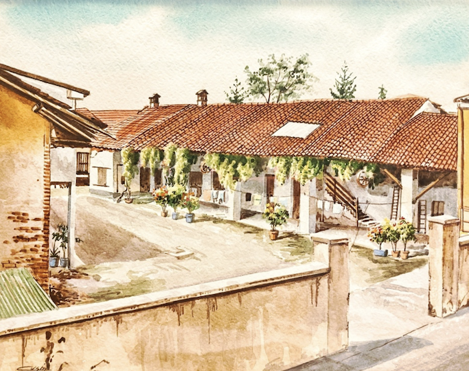

Mé su mìä pasionà dé stròleghe che lé té lés lä ma, che lé ’t fa lé carte e che lé ’t dìs l’äegnì. Sèrt, comià tàncc, èl mé càpetä dé lézär chèl che lé dìs lé stìle sö l’äegnì, ma gnént dé plö. Pèr fàlä lädìnä: sé lé preveziù i-é pozetìve, bé, lé pöl dedà ä na encùträ ä lä zörnàdä; sé i-é contràrie, lé ciàpo mìä én consedräsiù.

## Lé dò fòmle

Entàt che séräm én acànsä ä Lerici, ’nd’èl fa lä spasazàdä sö lä viè äpè äl mar cón Piera, lä mé morùzä, e cón lä sò màmä, che pèr lä prömä òltä ’nd’èlä sò ètä lä sé concedìä önä acànsä äl mar, spasazàäm e tastàäm ön gelàto quànt, trä i defäréncc bänchècc, önä siùrä èciä, cón ön grant fäsöl vistùs én cò, l’à teràdä lä nòsä ätensiù. L’érä önä stròlegä che lä léziä lé càrte, che cón önä sgregnàdä äpénä segnàdä, lä mé envedàä ä fam lézär lé càrte. Mé öglie mìä, ma Piera l’é nadä-dré finä che ä lä fì ò dét dé sé.

Lä siùrä l’à mesc-iàde lé càrte, lé i-à desponìde söl täolì e l’à anvià ä parlà, prömä cón fa genèrek, pó man mà sémpär plö präsezä. L’àä dét, pèr esempio, che ’m lä càäe bé ’nd’èi stüdi e che l’érä ön pacà che i-àäs entärompì; én efécc, ìst che laoràe, àe desidì dä empiantà-gliò dä na ä l’oniversità. L’à parlà dèl rapòrt trä mé e Piera: lä éziä önä relasiù bèlä fés destenàdä ä dörà, cón tante sodesfäsiù. L’à sequetà cozétä, cón deärse ròbe pozetìve, pó, töt énd’ön cólpo, l’à cambià lä gùs; l’à ardà prömä mé e pó Piera e lä m’à dét, cón ön pò dé märäèä e, ’nd’èl stès tèp, dé despiäzér: “Ma… ghé ön’àträ fómlä ’nd’èlä òsä étä…”.

Mé e Piera és sum dàdä ön’öciàdä, óm fat bèlä cérä, ma ön pò teràdä, pó óm fesàdä amó lä siùrä che lä sequetàä ä oltà lé càrte e ä fa sègn cól cò pèr confermà chèl che l’àä äpénä dét. Ghé sté dèi moméncc dé silìsio, fìnä che ghé stàdä önä märäèä dé leberäsiù compagnàdä dä ’nä sgregnàdä:”Ah, töt ä pòst, l’é lä màmä dèlä tò morùzä!”.

Ädés che l’é pasà tant tèp, gò dé recognisì che l’àä ìst giöst. Lä miè suòcerä l’é stàdä önä pärsùnä che gà ì däbù emportànsä ’nd’èlä nòsä étä: önä fómlä sträordänàriä, reservàdä, descrétä, sémpär posetìvä e dé ciör. Finìdä lä ciacolàdä, ò rengrasiàdä e sälödàdä lä stròlägä, pó óm sequetà lä spasazàdä söl mar, mé e “lé mié dò fómle”.

## Él cortìl

Séräm äpé äl mé compleàn, ém regòrdo mìä dé präsìs dé che an, fàsel ch’èl fös äi pröm agn dèl ’90 (novàntä). Lä miè fómlä l’àä desidì dé fam ön’empröezàdä pròpe pärtecolàr e, dé segiür, che ’m spetàe mìä: l’àä fesà ön encóntro cón önä siùrä che lä léziä lé càrte, i déziä che l’érä bràä, tat che lä gàä cleéncc che i vegnìä dä fó dèl päìs ä troàlä despès. I déziä che gh’érä pärsùne consedràde che lä säntìä prömä dä ciapà deceziù che gàä emportànsä.

Quànt Piera lä m’à dét quàl érä él regàl pèr él mé compleàn, sö lé pröme ém su ön pò enrabià: pöglie mìä cäpì compèrte ’s pödès trà-è lé palànche én chèlä mäniérä gliò. Pó ò desidì dä ciapàlä söl redìcol e cozétä sum né ensèmä dèlä siùrä pèr fas lézär lé càrte.

Lä siùrä l’àä parlà bé dèlä nòsä reläsiù, e lä ciöntàä-sö dé önä étä päcìfekä e ön äegnì dé bèle sperànse. Pó lä s’é fermàdä sö lä cä éndo stóm ädés, che lä fa part dél’àlä d’ön vècc cortìl e che l’érä stàdä fäbrecàdä dä pòk. Él progét e lä fàbrecä i m’àä empegnà fés, ma ä lä fì séräm sodesfé e sé stemàäm dé ìlä fàdä.

Lä siùrä però lä sostegnìä che pèr elè él progét l’érä mìä gnamó finì dèl töt: lä éziä ön’òperä plö grandä fés e lä m’àä äderetürä détä önä cìfrä dé frànk che ä mé e ä lä miè fómlä lä sonàä fó dèlä räzù. Ä despét dèlä nòsä ciàrä defedènsä, lä siùrä lä sequetàä ä confermà lä sò viziù dé ön’òperä plö gràndä dé chèlä che gàäm ciöntàdä-sö.

L’encóntro l’é finì cón ön baràt dé bèle cére; noàtre sum né-lè contécc dä ì cognisìdä önä pärsùnä ciacolétä e grasiùzä, poà sé séräm rästé defedécc sö lé sò paròle ä propòzet dèlä cä e dèl cortìl.

Quàck an dòpo però, él mé fiöl, i mé du ciögné e ön capomàistär i-é reé ä crompà él rèst dèl fäbrecà én roìnä, che l’érä lä secóndä àlä dèl cortìl. I-à anvià i contròi söl progét, pärmès dé fäbrecà, volümetrìe, e dòpo mìä pòk entóp i-é pärtì i laorà dé demolisiù e dé fàbrecä dèl nöf cäzämènto.

Enciö él cortìl l’é deäntà ön condomìnio dä siòr, ciamà “Cùrt di Gambìtt”, fat dé dùdäs ché che ’m su ciapà él còmpito dé mänästrà dé pärsùnä.

Egliùrä lä siùrä dèle càrte l’àä ìst giöst? Mé örés robatì che su defedét vèrs stròlek, oròscopi e maghi, ma ògne tat lé mé ègn én mènt lé sò paròle, él sö sequetà, lä sò fränchèsä ’nd’èl ciöntà-sö ärgót ch’èl sömaàä emposìbel dä reälezà. Èl gà mìä emportànsä pödì dà önä respòstä; chèl che ciüntä l’é ì ìst i mé fiöi e ädés i mé nagùcc corì contécc ’nd’èl nòs cortìl e chèst èl mé ’mplenés dé contäntèsä e sodesfäsiù.

Lä èciä Cùrt di Gambìtt
{: .caption}

