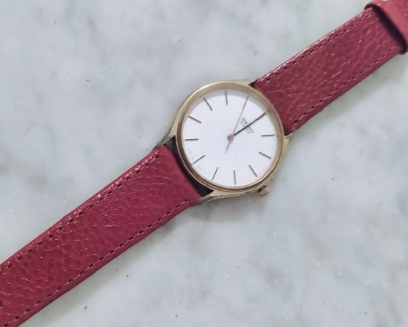

## Napoletàni, speretùs.

L’ufìcio endó laoràe, gràsie ä lé pärsùne che gh’érä tré, töte zùäne, l’érä ön sìto särì e gräsiùs. Trä dé noàtre és nàä d’entìs: ognū él fàä él sò laorà cón empègn, ma ‘s troàä poà él tèp dä schersà, dä scambià bätìde e consèi. Ön dé Ezio, sènsä önä càözä präcìsä, l’é na sö én pé ä lä screvänìä che lä ‘s troàä pròpe én més ä l’ùficio én “spàsio däèrt” (open space). Én chèlä, l’è réà él nòs càpo ch’èl gà ì gnà ‘n pò dé reäsiù. Ezio èl s’é pentì defàt dé chèl che l’àä fat, ma orämài lä fretàdä l’érä fàtä. Èl s’é revolgì ä mé, sconsolà, e ‘l m’à domandà chèl ch’èl gàä dä fa: fa comià sé ‘l fös cäpetà gnént o giöstefecàs cól càpo?

Mé gò conseglià dé parlaghèn, dä sercà él momént giöst, magàre dä dìk ch’èl vögliä controlà l’àriä dèl condesionadùr, che dèle òlte l’érä tròp frèdä e fästödiùsä. Äpé ä noàtre gh’érä poà Maurizio, enzegnér napoletàno, e Ezio l’à ölì domandà poà chè él, pèr ìk magàre ön pärér plö estrùs.

Maurizio l’à sercà dä quetà Ezio e dä mìä dà tròpä emportànsä äl fat e èl gà dét ak che él càpo, ch’èl gàä gròs problémi dé vìstä, fórse èl l’àä gna ìst. Ezio ch’èl gàä pòrä dä pärdì l’aomènt dé pàgä ch’èl spetàä dä tat tèp, l’à desidì dä parlà cól càpo. L’è na-tré ‘nd’èl sò uficìo e l’óm vìst parlà e fa segnàcole sénsä però säntì  chèl che i sé déziä. Dòpo ärgiū mänūcc, Ezio l’é ignì-fó cón àriä plö deständìdä. “Có t’àl dét?” èl gà domandà defàt Maurizio. Ezio cón önä sgregnàdìnä, èl gà räspondì:”Speretùs chèsti napoletàni!”, e èl gà dàt d’entèndär ä Maurizio ché l’àä confondì lä pärsùnä. Nätöràl, che l’érä mìä ìrä, ma Maurizio èl gà ì töt d’ön còlpo önä reäsiù: ” Eh no! Ék stò mìä! Vò ä dìk defàt che sére mìä mé!”. Maurizio l’é stà fermà én tèp e lä stòriä l’é finìdä gliò, trä lé nòse sgregnàde dé deärtemént. Éh sé, ön fat és pöl cäpìl én mänierä defäréntä säcónt che…

## Lä comesiù dèl’ ùrä präcìsä

Dä quàk tèp és scomänsàä ä idì én vèndetä i pröm leròi äl quàrs. Ezio l’érä stà él pröm ‘nd’èl nòs ufìcio ä crompàn iū dèlä màrcä giäponézä Seiko, cognisìdä bè. Mé gò dò pasiù che fò fädìgä ä rezistìk, i leròi e le pène stilogràfeche. Él leròi dè Ezio èl mé pläzìä fés e cól pärmès dèlä miè fómlä e l’äöt dèlä miè suòcerä, n’àe crompà iū präsìs pèr él mè compleàn.

Mè e Ezio cón chèi läùr presiùs äl puls, sé stemàäm töcc cói sòci dé laurà. Él nòs compàgn Marco èl pögliä mìä rästà  ‘ndré e l’à ölì ön modél tälequàl, ma cól quadrànt colùr òr, pèr desärnìs.

I tri leròi i-érä pròpe bèi, räfenà e d’önä preceziù fenomenàl. Töcc i dé controlàäm l’ùrä trä dé noàtre, sodesfé dé ìi crompè.

L’é stà cozétä che dòpo pòk tèp és sum nomäné, dé pèr nòs ciūnt: ”Comesiù dèl’ùrä präcìsä”. Lä comesiù lä gàä mìä negiūnä fonsiù sé non chèlä dä stemàs e fa ignì ön pò d’envìdiä äi nòs sòci dé laorà.

Töcc i dé ä lé 12:00 (dudès) lä comesiù lä sé reönìä, lä bätìä él ciūnt ä l’envèrs: 3, 2, 1 (tri, du, iū) e dàäm l’ùrä töcc ensèmä. Él seremoniàl l’é durà ön pò, finä ché ön dé, él leròi dé Marco l’à tacà ä sbaglià, envése él mé e chèl dé Ezio i-éra sèmpär ensèmä ä lä perfesiù.

Marco l’érä sèmpär sfazà, dèle òlte l’érä ennàcc, dèle òlte én retàrdo, poà sé dé pòk.

Lä càözä? Mé e Ezio s’éräm mätì d’entìs pèr cambià l’ùrä söi nòs leròi, sée dé ìgäi sèmpär ensèmä.

Marco èl dääntàä mat. Noàtre óm sercà dä dà önä spiegäsiù siäntìfecä äl fat: él nòs quadrànt biànk èl riflätìä dé plö él spländùr dèl sul, envése él so, colùr òr e tochè plö s-ciūr, l’äsorbìä plö calùr e ‘l sfalsàä lä dälatäsiù tèrmekä dèle sfére.

É cozétä: “Sé tè öl, té pöl cambià él quadrànt e mätìn iū biànk compàgn dèl nòs”, óm embocà.

Marco l’é na ‘ndré däl reloér che, dòpo ì controlà él leròi quàk dé, èl l’à segiörà ch’él gàä mìä defécc.

Dòpo ön pò, noàtre du góm confäsà él trūk e lä comesiù l’à sequetà ä dì l’ùrä, töcc ensèmä, präsìs.

## Lä scomésä

Marco l’érä na ä ignì dä önä curtä träsfèrtä én Aràbiä Saudìtä, endó lä nòsä socetà lä gàä dèi ufìci. L’érä dré ä ciöntà sö äi sòci dé chèl che l’àä ìst, quànt él descórs l’é na ä finì sö lé sigärète Camel che ön tènico èl fömàä dé sòlet.

Säcónt Marco, söl desègn dèl pächèt gh’érä scriì ärgòt dé scondì, che äpénä öcc spèrcc ì reàä ä lézär.

Mé ém regòrdo mìä che ròbä gàä dä èsär scriìdä-sö, ma ä nöàtre lä ‘m sömäàä önä stöpedàdä. Marco, ch’èl fömä mìä, èl pögliä mìä ì ìst polìto él pächèt.

Él sò sequetà èl fàä cresì lä nòsä märäèä sölä questiù.

“Scomätóm?” èl m’à proponì. Mé e àtre du sòci óm äcetà e óm puntà méle frank (lire) pärū.

Él dé dòpo, Marco l’à ciamà él tènico én Arabiä denàcc ä noàtre pèr fas confermà chèl che èl èl sostegnìä. Éntàt ch’èl tälèfonàä, lä sò espresiù l’érä pasàdä dä segiūrä e spaàldä ä cagolànä e pänsärùzä. L’à mätìdä-zö lä cornètä e l’à confäsà ä bàsä gus: “Gàäf räzù oàtre; ém su sbaglià”. Marco l’à saldàdä lä scomésä, ma negiū l’à ölì ciapà i sòlcc: èl särés stà ön àto picinì.

Dòpo ì parlà trä dé noàtre, óm desìdì  dä crompà dèi getù pèr lä màchenä dèl cäfé, sée che poà i àtre sòci i pödès godì dèlä ìnsetä.

Óm mätì i getù én ön vas träspärént sö d’ön mòbel, én spàsio däèrt, äpé ä lä screvänìä dé Marco, cón ön begliét: “särvìf ak, l’ofrés Marco.”  Chèi che pasàä éi sé säntìä én doér dä rengräsià Marco e domandàk chèl che gh’érä dä fa fèstä.

L’é mìä él càzo dé reportà lé respòste dé Marco e gna i saracù ch’èl m’à revolgì ä noàtre.

Sé ghé önä moràl én ‘stä stòriä, l’é che, dä ‘gliùrä, Marco l’é deäntà contràrio fés ä lé scomése.

## Èl tornéo dé tènis dèl ufìcio

‘Nd’èl més dèi agn 80 (otàntä), ‘nd’èlä miè socetà gò ìdä l’ocäziù dé nà ä laorà ‘nd’èl repàrto che gàä l’encombénsä dä crompà mäteriàl.

I mé nöf sòci dè laorà, ì m’à resiì bé e i-à ölì säì defàt sé sére bu dä zögà ä tènis. Söl momènt àe mìä cäpì él sénso dèlä domandä, ma pó ì m’à spiegà che i-érä dré ä orgänezà, comià i fàä töcc i agn, él tornéo dé tènis, önä gàrä dé dóplo cón còpie mes-ciàde fade dä ön zögädùr dèlä nòsä socetà e ön fornedùr. Él tornéo èl sé conclödìä cón önä sìnä e lä premiäsiù dèle còpie ch’àä ensì.

Lä fórmulä lä pörés fa ignì quàk embaràs én chèi che i vék chèi che crùmpä e chèi che änt comià parcc che lé gà entärès contràri, ma, ä dì lä äretà, l’edèä l’érä dä fa progredì lé reläsiù cói fornedùr e creà ön clìmä dé conveniénsä pèr töte dò le parcc. Chèstä cùrtä entrodösiù lä spiégä lä bèlä àriä che sé räsperàä söl pòst dé laorà. Él tènis èl mé pläzìä e él tornéo èl räpräsäntàä l’ocäziù pèr tornà ä zögà. Su na trè ‘nd’èl consìglio che orgänezàä él tornéo co’ lä òä dä dà önä ma, pärché lä mänefästasiù lä ignìäs polìto. Iū dèi pröm encóntri l’è stà bèl fés, cón setöäsiù quàzi “fantozziane”. Cozétä èl m’é ignì nätöràl scrìär ön sempàtek comènt én rìmä pèr tö én gìro i personàgi zögädùr. Lä soràdä l’è pläzìdä ä töcc, tat che ì m’à domandà dä scrìär önä rìmä pèr ògne encóntro che gàä plö emportànsä.

Sum reé cozétä ä l’encóntro dèl càpo, dèl deretùr e èl pögliä mìä mancà dé segiūr él mé comènt. Èco lä stòriä, tödä fó däle càrte d’egliùrä:

<section class="poesia">

6° Tornéo dé Tènis – Notìsie –

– 11 mas 1988 –

Lä pärtìdä dèl càpo

<blockquote>
Én sprés déi delfì e déi tu s’è zögà söi cap iū e du 
Dèle do pärtide én àto dé önä sùla daróm paròlä 
Cioè dé chèlä cól Geròlä* 
Lä pärtìdä l’é oregenàlä e pèr chèst ölóm ciöntàlä. 
i nòs quatär moschätér i gà tàntä òä dé zögà 
Söl cap du él zögä él càpo, che dä töcc ä l’é antà. 
Ä ardàl ghé a lä sò spùzä, che l’é ignìdä ä idìl, l’é ignìdä ä sostegnìl. 
Èl bàt iū, èl räspónd l’àtär, èl tìrä chèst, èl tirä chèl 
e d’ön bòt äl rìä ‘l bèl. 
Èl tirä Enrico dä drét ä mànk e él centrä ‘l càpo äl fìànk. 
Dòpo ì ciàpà lä bòtä, èl ghe è dä rocolà: 
Ma có fì! Ém tirì ädòs? Ä l’é mìä ortodòs! 
E ‘l fa idì lä só rächètä cón d’ön sègn dé vendètä 
Èl stà féräm él sò compàr ch’èl vörés spärì‘nd’èl mar 
Feräm è sték comià Penöcc, èco, pumm! Centrà ‘nd’èl öcc! 
Dòpo ön po' äl và poà ‘n tèrä, pròpe comià ‘l càpetä én guèrä. 
I äversàri i sé pàrlä ön pò trä i dècc, és cäpés ché i-é contècc. 
E sé sa ch’èl ch’èi gà ‘n mènt: pasóm él tùrno fenälmènt! 
Sötä ön pò dé plöäsnì ä fa lä dòciä i valorùs i và ä fìnì.
</blockquote>
</section>

\* ön fornedùr
{: .note-small}

<section class="poesia">

Poesìä äl poétä

(lä respòstä dèl càpo)

<blockquote>
Él poétä él ciöntä mìä bàle, 
L’è töt ìrä chèl ché ‘l dìs ‘sto säcäbàle 
L’ävenemént dèl encóntro 
Èl s’é resòlf énd’ön scóntro; 
él bèl l’é che äversàri 
i-érä chèi ch’érä compàri. 
Ma él poétä èl stà drét, 
lä sé domandä tantä zét: 
ä ì ciapà én giro él deretùr? 
töcc i gà ön bröt säntùr. 
Töt chèst, dä lä sìrä ä lä domà 
lä cärierä lä pöl costà?
</blockquote>
</section>

Ä chèstä sitìlä bölàdä dèl deretùr ò räspondì còn ön’àträ rìmä. Chéve, mé scrìf dömè i vèrs dèl prensìpio (én cò ä lä rìmä).

<section class="poesia">
<blockquote>
Poà ‘nciö l’è mìä särì e 
poà staòltä ölöm scriì. 
Sé, pärché l’àrt lä pöl mìä èsär fermàdä 
Poà ‘n präsènsä dé ‘nä quàk bölàdä!...
</blockquote>
</section>

Él bòtä-respòstä én rìmä trä dé mé e él deretùr l’é pläzì, comià sèrte tìri e respòste trä i zögädùr söl cap dé tènis.

Èl va dét che lä miè cäriérä l’é mìä stàdä entacàdä pèr ì scriìde dèle rìme, dä säcäbàle ma sempàteke, e pèr ì insì él tornéo proprio cùträ él càpo, che l’é stà bu dä encasà él töt cón grant spìret sportìf.

