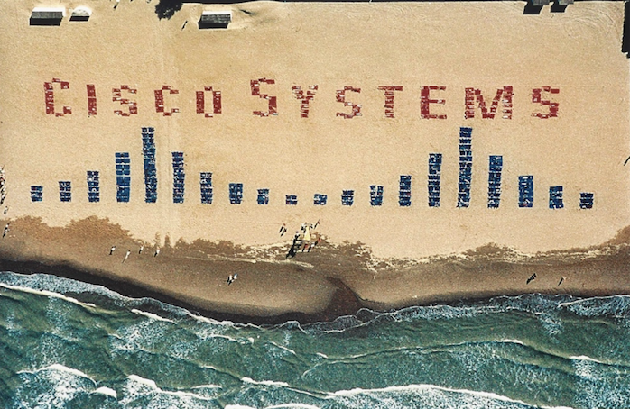

Önä dé chèle ròbe che gna ’nd’èl ensómio lä pöl cäpetà e envése ècom ché ä ciöntàlä-sö. ’Nd’èl 2002 (dumelädu) laoràe pèr lä Cisco Systems, socetà ämerecànä fondàdä ’nd’èl 1984 (melenöfsentotantäquàtär) ä San Francisco, cità dä che lä ciapä él nóm e che l’à esperà él desègn, önä räpresentäsiù dèl “Golden Gate Bridge”.

’Nd’èl mis dé setèmbär dé chèl an egliò, comià töcc i agn, l’érä stà orgänezà l’ävenemént éndo i vegnìä präzänté i resöltà dèl an e lé prevesiù dèl an dòpo. Lä reöniù lä s’é tignìdä ä Reciù. Trä i laorà dä fa én chèi dé gliò, l’érä stàdä mätìdä-tré chèlä che l’érä stàdä ciamàdä “Operäsiù Logo” (fegürä dèlä socetà). Önä pröä dé “team building”, comià i l’é ciàmä i ämerecàni, o dé “fa squadrä” compèrte és derés dä noàtre, éndo töcc i depändéncc i gàä dä entra-k-tré. L’érä önä pröä che, sé lä fös stàdä söperàdä, särésäm sté i pröm äl mónt ä ìlä pasàdä e lä särés stàdä regestràdä ’nd’èl regìstro dèl “Guinness dèi Primati” (i Record dèl Mónt). Èl sé tratàä dä fa l’emmàgene dèlä socetà. Lä gàä dä èsär fàdä dä töcc i depändénc che i gàä dä mätìs én ùrdän e creà lä fegürä dèlä Cisco (él put).

Gh’érä dèi pälècc fesé pèr stäbilì él record che i-érä él nömär dé pärsùne teràde-tré ä fa l’emmàgene e él tèp che s’ék mätìä ä finìlä; ém regòrdo mìä quàcc mänücc. Lé pärsùne lé gh’érä, él problémä èl pögliä èsär él tèp e meàä èsär bràe ä bätìl. Él “logo” èl gàä dä èsär fat sö lä spìagiä dé Reciù dénacc ä l’älbèrgo éndo stàäm.

L’àreä l’érä stàdä ensäràdä e én chèl spàsio ognü èl gàä dä desärnì él pòst éndo na ä mätìs. I orgänezadùr i-à dàde-è önä màgliätä pärü, rósä o seléstä, sècont lä part dèlä fegürä dä fa e ön stramasì dä mar dèl stès colùr dèlä màgliätä dä mätì söl sablù e sö chèl gàäm dä bötàs-zö. Nätöràl che i m’àä dàde ä töcc lé eströsiù pèr troà él pòst éndo mätìs, comià sö ön fòi eletrònek. Mätìde-sö lé magliéte e sgionfé i stramasì, séräm pärècc ä scomänsà lä sfédä. Él nodèr reönì pèr ciärtefecà él regolàr ändämènt dèlä pröä, l’à ciapà pòst sö dèi pucc facc-sö apòstä.

Cón ön altopaelante l’à dàde lé ülteme räcomandasiù e, äl sonà dèlä sirénä, és sum anvié én ùrdän ä na ä ciapà él nòs pòst; óm mätì-zö i strämäsì e és sum bötà-zö sùrä e óm sercà dä fal plö ’n frèsä che pögliäm. Dòpo pòk tèp, él nodèr èl s’é segiörà che l’emmàgene l’érä stàdä completàdä, l’à fermà él leròi è l’à sonà amó lä sirénä pèr dà él segnàl dèlä fì dèlä pröä. Pó, lä dechiäräsiù cón l’altoparlante: “compleméncc ä töcc! Ì Söperàdä lä pröä! Sì ’nd’èl registro dèi récord! ’Nd’èl “Guinnes of World Records”, resiì cón önä lungä bätìdä dé ma e dä ön grant ciäzämènto.

