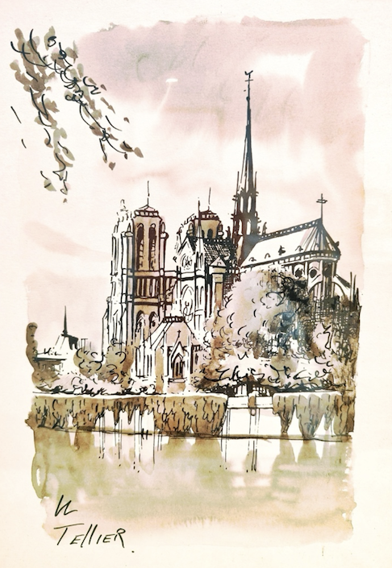

Parigi l’é dé segiūr önä dèle cità plö bèle e entäräsànti äl mónt gràsie ä lä sò stòriä, art, cūltūrä e ä lä sò atmosférä romàntecä che lè té stréä. Lä märetä dä èsär izetàdä, ch’èl sìäs dä nak pèr na ä spas o pèr laorà. Sé pó ä ölì idìlä l’é lä tò fómlä, èl rästä dömè dä fa lé älìs e nak. Sé ’l fa frèt, és gà mìä dä desmontägàs dä portà él paltò. Ädès I du facc ché sotä i s-ciärés bé chèstä cùrtä entrodosiù.

## Sätämànä “biànkä” päregìnä

Mé e Piera séräm spozé dä pòk agn. Comià ò za dét, ä mé èl mé pläzìä scheà, envése ä Piera no. Ä ògne fòzä séräm d’entìs dä pasà önä sätämànä ä Bagolì, ä cä dèi mé e cozétä mé ärés pödì concedìm ‘nä quàk scheàdä én Gavre o sö én Mänìä. ìst che àäm desìdì dä pärtì él vändärdé dé sìrä, àäm paraciàdä lä ròbä dä scheà e pó séräm né ä laorà. Ä fì zornàdä, èl särés sta äsé cargà töt sö lä nòsä Dyane e pärtì pèr Bagolì.

Lä domà dòpo, ön pò söl tàrde, èl sùnä él tälèfono sö lä miè screvänìä: “Ciao, su Piera; come stèt? Örés proponìt ‘nä ròbä: “ có ‘n dezèt sé envése dä na ä Bagolì nèsäm ä Parigi?”. Gnà ‘l tèp dä cäpì chèl che l’érä dré ä dìm che l’é nadä ennàcc sénsä dàm él tèp dä reägì. “Su stàdä ä l’ufìcio viàs. Ék särés ön tréno derét ch’èl part stäsìrä ä lé 11 (ùndäs) e ch’él rìä domà dé domà”. “Ma…” l’é töt chèl che su reà ä dì pärché Piera l’é nadä ennàcc ä ràfecä: ”ò za parlà cón Mariangela (lä sò sarùr) e lä pöl compagnàm én stasiù”. Lä pöl ak procörà dèi frank fräncés én bankä, äpé äl sò ufìcio”. Su pròpe mìä reà ä parlà, talmènt sére rästà stornì. Piera lä nàä ennàcc: “ Pödöm stà ä l’Hotel Chevreuse, äpé ä lä Tour Eiffel. Rosaria - önä nòsä compàgnä – lä m’à dét che l’älbèrgo l’é bèl fés e ‘l cóstä pòk. L’ufìcio viàs l’à za controlà e gh’é dèle càmäre lìbäre, ma mìä prenotà én frèsä”.

Pèr mé l’àä za prenotà l’älbèrgo, él tréno e poà i frank fräncés, ma l’à sercà dä fam crizì che töt l’érä stà fat dòpo che àäm desidì ensèmä!.. S’ék völ mìä tat ä cäpì che l’àä insì elè. Ignì fó dä l’ufìcio, sum né ä cä e óm refàde dèl töt lé älìs. Él dé dòpo, ä lä stasiù - gare de Lyon – óm säntì ä l’altoparlante: “Bienvenue à Parìs”. Sum né fó dèlä stasiù e ‘l flokàä fés. Ä Parigi, ärés fat ontérä ä mank dèlä nìf. Ò säì che ä Bagolì, él tèp l’érä bèl fés, ä bólä pèr scheà…

## Él paltò

Èl mé cäpetàä despès dä nà ä Parigi én träsfèrtä dé laorà. Dèle òlte nàe e nàe ä ignì ‘nd’èlä stèsä zornàdä pèr no mìä pasà lä nòt dälúns dèlä fämìä. Na ä Parigi l’érä pèr mé dé régolä. ‘Nd’önä ocäsiù lä träsfèrtä lä s’é slongàdä pèr trì o quàtär dé. Gàe dä ciapà èl reoplàno lä domà söl prèst e él tàxi l’érä reà fó dèlä cä ön pò prömä dèl necesàrio. Pèr no mìä fa spetà tròp él taxìstä ò sercà dä satà-è lé ūlteme ròbe ön pò én frèsä e su na sö lä vetūrä cón lä bùrsä én ma, sènsä gnà mätìm-sö él paltò. Reà ä l’aeropòrt, ém su anvià äl contròl bagài e pó ä embarcàm. Ò ciapà pòst söl reoplàno e ò sestemàdä lä bùrsä e ‘l paltò ‘nd’èl scompàrt sùrä dé mé. Reà ä Parigi, ò faT él pärcórs plö o mank envèrs: aeropòrto, tàxi, ufìcio, sàlä reöniù.

Dòpo lä zornàdä dé laorà empegnätìf, ghé stàdä lä märetàdä sìnä cói sòci. Él restorànt l’érä äpé äi ufìci, chefà és pögliä nak ä pé. Ò mätì sö él paltò bleu e äpénä mätìde lé ma én tàscä, ém su rändì ciūnt che ärgótä él quadràä mìä: lé tàsche i-érä pòk fónde e ò cäpì che l’érä mìä él mé lòden. Ò sercà dä cäpì sé l’àe scambìà cón chèl dé ärgiū dèi mé sòci, ma töcc i gàä sö él sò. Dòpo ön ūltem contròl, ém su näcorzì ch’èl finìä ä rödä; ön vestì dä fómlä! Àe portà él paltò dé Pierä! Enprömä ò sercà dä tignì scondìdä lä ròbä äi mé compàgn, ma l’érä mìä lädì e, prömä o dòpo i sé särés näcorzì e res-ciàe dä fa önä fegūràsä. Ém su sforsà dä ìnsär l’empàs e ò desìdì dé confäsà él scambio dé paltò e dä mätìlä söl sgregnà. Compèrte àe pänsà, gò ì l’efét che àe ölì: i compàgn i s’é mätì ä sgregnà deertì e i-à tacà ä fam önä série dé bätìde: “Monsieur, quel manteau!..c’est très chic sur vous! La coupe italienne!” (Siùr, che paltò! Él tè stà pròpe bé! Ché bèl tài italiàno!) e viä cozétä, pèr tötä lä sìrä e ‘nd’èi dé dòpo.

‘Nd’èl na vèrs él restorànt èl teràä ön bèl véntäsèl ch’èl mé soleàä lä “rödä” dèl paltò che ‘m sforsàe dà tignì bèl strit pèr no fa sgregnà poà lä zét che pasàä. Finìdä lä träsfèrtä su na ä ignì én Italiä. Ém su ardà bé dä mätìm sö él lòden che ò portà söl bràs cón fa desenvòlt. ‘Nd’èl fàm ignì ‘n mènt chèsto fat, ém su fàdä önä domàndä che ‘m sére mìa fàdä älùrä: “Mé, poà se cón ön bèl pò d’encòmot, àe mätì sö él sò paltò, ma elè, empèrte àälä fat ä mätìs él mé lòden dé mezūrä “slim”. Lä respòstä? Gh’l’ò mài domandä…Fórse l’é mèi cozétä.

