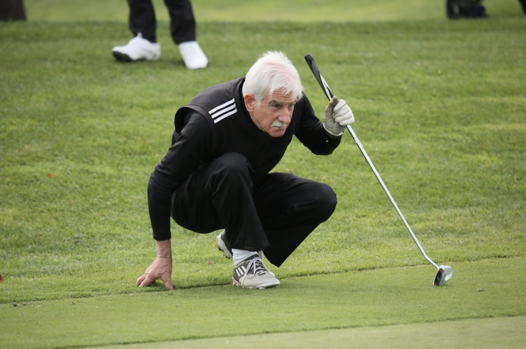

L’érä empänsàbel che mé pödès dedecàm äl gòlf e che èn rästàäs äderetürä encantà. Pèr agn sàe gna che ’l ghé fös e quànt ò tacà ä säntìn parlà, äl consedràe ön spòrt tròp  dä stemäröi. Pó, önä òltä na én pensiù, önä pärsùnä, che ’mcognisìä, lä m’à envedà ä pröà. L’à ensestì tant e ’m su lagà convincì ä na äl cap dé pràtecä äl “Golf Club Borgo di Camuzzago”.

Ò tacà cón dèi cólp dé pröä e önä descrétä pärcentöàl l’é nàdä ä sègn. Za däi pröm cólp su reà ä fa gulà lä bälìnä e ò finìdä lä pröä sodesfà äsé. Egliùrä ò desidì dä nak amó él dé dòpo e lä sätämànä dòpo amó e amó… e amó, fìnä quànt ém su troà ciapà dä önä ìrä pasiù pèr chèsto spòrt. Cól pasà dèl tèp t’ét rände ciünt che él gòlf èl t’à streà, èl té ränd schiàvo e té pöl mìä plö fa sénsä. I alcc e i bas i fa part dèl zök e, fórse, l’é pròpe chèst ch’èl fa encantà. Ön dé t’ét sänt brào comià Tiger Woods, él gràn campiù, ’l dé dòpo té örés spacà töte lé màse. Ma t’él färé mìä, pärché té pöl mìä plö desmätì dä zögà. Ò fàde dèle gàre e su reà poà ä insìn ärgiüne, ma i regòrcc plö bèi i-é mìä löghé ä chèste, plötòst i-é pèr dèi cólp che i mé ignì-fó pärtecolarmènt bé, ecesionài e, pèr èsär onèst, förtöné.

Parlo dèle mé quàtär “büsä ’nd’ön cólp” – che ’l völ dì fa na lä bälìnä ’nd’èlä büsä cón ön cólp sul, pròpe centrà lä büsä dé 10,9 (dés vìrgolä nöf) säntémetär che lä sé troä ä plö dé 100 (sènt) métär dé destànsä. Önä ròbä encredìbel, cón probabeletà stätìstecä che lä capetädä ògne mòrt dé pàpä.

Fìn’ ädés lä m’é cäpetàdä quàtär òlte.

## Prömä büsä ’nd’ön cólp. 29-05-2012 (ventenöf mas dumelädùdäs)

Zögàe dä du agn e més e sére deäntà braolì.  Chèl dòpo mesdé, ä Camuzzago, cón Patrizia, Gino e Mirko, zögàäm lä büsä 2 (du) cón lä bändérä mätìdä ä 120 (sentvìnt) métär. Dòpo che du zögädùr i-àä terà, èl tocàä ä mé. Su na sölä pläsètä, ò mätì-zö él “T” (Tee: él ciòt che ’s piantä ’nd’èl tärì pèr tignì soleàdä lä bälìnä) e, dòpo ön pèr dé tir dé pröä ò terà. Segiür dä ì fat ön bèl cólp, ò gna ardà lä bälìnä ä äterà, convincì dä troälä söl “green” (l’àreä éndo l’é mätìdä lä bändérä). Ém su sbasà-zö pèr terà-sö él tee e ò dàdä ön’öciàdä ä lä bänderä, ma cón märäèä idìe mìä lä bälìnä sö l’èrbä. Egliùrä ò domandà äi mé sòci sé i l’àä ìstä. Mirko äl m’à räspondì: “Säcónt mé l’é nàdä én büsä”; ék crezìe mìä. Dòpo che töcc i-àä terà, és sum anvié vèrs lä bändérä. Én frèsä su reà ä lä büsä e ò troàdä-tré lä bälìnä. “Büsä én d’ön cólp”. Mé stàe plö ’nd’èlä pèl. Ò ciapà i compleméncc e ’m su anvià vèrs lä büsä 3 (tri) cón ön pò dé despiäzér pèr mìä ì godì én piéno él momént che lä bälìnä l’é nàdä-tré ’nd’èlä büsä. L’é rästà él gran cólpo che ò mài plö desmontägà.

## Säcóndä büsä ’nd’ön cólp. 19-01-2016 (desnöf zänèr dumeläsèdäs)

L’an golfìstek l’érä scomänsà defàt én belèsä: él 19 (desnöf) dé zänèr, dòpo gnak 4 (quàtär) agn ò repetìdä lä büsä én d’ön cólp, sémpär ä Camuzzago, sémpär ä lä büsä 2 (du). I dìs che lä prömä òltä lä sìäs förtünä, lä säcondä lä sìäs bräürä. Ò ciapà él complemént. Staòltä i sòci i-érä Alberto, cón èl àe scomänsà ä zögà, Moreno e Gino, él dotùr. Ò preparà él tiro e ’m su rändì ciünt defàt dä ì fat ön gran bèl cólp e ò mìä pärdì dé ìstä lä bälìnä. Ék su na-dré ä ardàlä sö l’èrbä, na envèrs lä bändérä, mätìdä ön pò én ràtä, rotolà…”Va! Va!”, ò guzà. L’ò ìstä spärì. L’érä én büsä! “Seeee!”.

## Tèrsä büsä ’nd’ön cólp. 17-10-2017 (deresét otùär dumeläderesét)

Dé sòlet zögo él dòpo mesdé, ma chèl dé gliò gàe ön empègn e su na ä zögà lä domà. Entàt che spetàe che i zögädùr i lebäràäs él green dèlä büsä, Antonio, ön golfìstä che cognisìe mìä, èl m’à domandà dä zögà ensèmä. Él golf l’é bèl zögàl poà dä sùi, ma én compägnìä l’é plö bèl e egliùrä óm gerà ensèmä. Antonio èl s’é präzäntà pärsùnä descrétä, èl parlàä pòk e ’l dàä mìä consèi. Mé sére càlmo, quét e él zök èl n’à godì. Ò fat defàt dèi bèi cólp. Ä lä büsä 5 (sik), lä plö lùngä, presäpòk 190 (sentnovàntä) métär, ò särnì él lègn 3 (tri). Dòpo ön pèr dé cólp dé pröä, ò terà. Antonio èl m’à facc i compleméncc. Reàe mìä ä idì lä bälìnä, pänsàe che lä fös nàdä ä finì énd’önä ciönètä. Antonio envése èl sostegnìä che lä fös nàdä ’nd’èlä büsä. “Emposìbel”, gò räspondì. Dòpo che poà èl l’àä terà, és sum anvié envèrs él green. Mé puciàe él cärél cón pas spedì, coriùs. Idìe gnamò lä bälìnä, ma Antonio èl sequetàä. ”L’é ’n büsä!”. Reà ä lä büsä, l’ó istä: l’érä tré! Büsä énd’ön cólp! Ròbä dä macc! Antonio l’à sgregnà e ’l m’à dàdä önä pàcä sö lä spàlä. Ä lä fì dèl giro óm fàdä scatà önä fotogräfìä pèr regordà él fat.

## Quàrtä büsä ’nd’ön cólp. 07-05-2018 (sèt mas dumelädesdòt)

Él cél l’érä nìäl e, pèr èsär önä zornàdä dé mas, l’érä mìä ön granché. Ma sé té fé lä büsä énd’ön cólp, lä zornàdä lä däèntä bèlä fés. Séräm mé, Luciano, Gianpiero e Giorgio. Èl cäpetàä spès dé zögà ensèmä e séräm töcc, plö o mank, äl stès leél dé zök. Lä bùnä compägnìä lä fa progredì lä prästäsiù dé töcc. Chèl dé gliò, zögàäm töcc plötòst bé e sum reé ä lä 5 büsä 5 (sik), lä plö lungä, éndo és dorvä él “driver” (lä màsä plö gròsä) o él lègn 3 (tri). Ém säntìe én fùrmä e tochè ò särnì-fó él lègn 3 (tri). Ò Facc du cólp dé pröä e ò terà ön cólp che ’l mé sömäàä ignì bé. Lä bälìnä l’à gulà, l’é äteràdä söl green, l’à scomänsà ä rödälà e l’é spärìdä. “L’é én büsä, l’é én büsä!” i-à guzà i mé sòci ’nd’èl fam i compleméncc. Poà mé àe ardà él gul e gò ìdä l’empresiù che lä fös nàdä-tré. Su mìä reà ä tignì ön vèrs dé contäntèsä. Ò bätì sik cón töcc e su na ä tö-sö én frèsä chèlä benedètä bälìnä. Lä ròbä fenomenàl l’é che àe fàdä büsa ’nd’ön cólp poà l’an prömä, sö lä stèsä büsä. Encredìbel, ma ìrä. Cól telefonì ò scatàdä lä fotogräfìä äi mé tästämòni. Iü dé èi èl l’à scatàdä ä mé entàt che töglie-sö lä bälìnä dälä büsä pèr fesà l’emprézä. És dìs che lä prömä l’é förtünä, lä secondä l’é bräürä, lä tèrsä l’é clas e lä quartä?..

