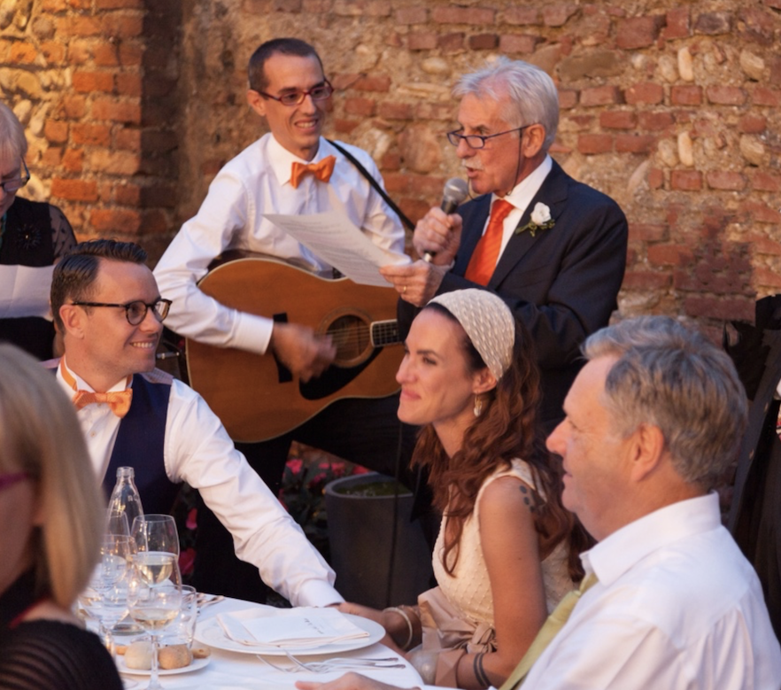

Chèi che l’ärés mài dét? Poà ä 65 (sesantäsik) agn és pöl dääntà cantäotùr.

Linda e Paul i s’érä spozé dä pòk, én mas 2014 (dumeläquatòrdäs), ä Richmond, én Engheltèrä, cón rìto civìl e önä fonsiù resärvàdä äi pärèncc plö stricc. Lä fonsiù che gàä plö emportànsä, slargàdä äi tancc compàgn e äi pärèncc, lä sé särés tignìdä dòpo, én Italiä, ’nd’èlä césä dèl nòs päìs, Buràc, én ägóst, cól bänchèt dé spùzä ä Oreno.

Entàt che séräm ciäpé ä orgänezà, Linda lä m’à dét önä ròbä che ’m spätàe mìä: “Só mìä sé ’t l’ò za dét, ma comià bobà dèlä spùzä, i englés i sé spètä che té té tegne él descórs äi envedé, säcónt lä trädesiù che i gà èi.

No, lä m’àä dét gnént, ma orämài l’àä terà él balòt e ärés mìä pödì teràm endré. Ön descórs, én englés, denàcc ä presäpòk 250 (duzentsinquàntä) envedé! Sére ön pò pänsärùs. Dä ’ndo ’s tàcä ä paracià ön descórs dé spùzä?

Ö desidì dä pröà ä troà ’nä quàk edèä én internet, ma ò troà gnént che pödès fa äl mé cazo. L’érä plì dé spécc dé frasi fàde, sgionfàde, ezägerasiù. Plö sercàe e plö èl cresìä él mé silìsio.

Töt énd’ön cólpo, lä mé ignìdä ’n mènt ön’edéä: pärché nó mìä droà chèl’àriä che àe emproezàdä e träsformàdä én önä cänsunsìnä pèr fa endormäntà lä nägudìnä Camilla? L’edèä lä m’érä pläzìdä e gh’érä ak lé condisiù: pöglie ciöntà söl mé fiöl Filippo e söl mé nagùt Riccardo, enzegnér dé äcüstekä, che i sonàä za cón àtre compàgn.

Ò ciapà l’àriä e ò tacà ä mätìk lé paròle, én englés. Ön pò ä lä òltä lä cansù lä ciapàä fùrmä.

Lä cantàe ä altä gùs poà quànt nae äl golf “cón lä miè Vèspä Spécial che lä töl-iè i problémi…” (C. Cremonini), tat sótä él casko i mé säntìä negiü.

Fenälmènt lä cänsù lä mé sömäàä prontä. Filippo e Riccardo i-à cöràdä lä müzecä e i ströméncc e i mé compàgn äpè dé cä, che i stà ’nd’èl mé cortìl, i-é sté contécc dä fa part dèl còro e dé cantàlä ensèmä.

Dò òlte ä lä sätämànä és troàäm töcc ensèmä pèr lé pröe. Ä chèi che sàä ön pò l’englés ghé stàde dàde lé paròle oregenài, äi àtre lä trädösiù fonétekä én italiano. Lä miè nörä Silvia lä comandàä él còro. Lé pröe i-é nàde bé e lä cänsù l’é rezöltàdä amàbel.

Él dé dèlä fonsiù, él “Casino de Caccia” (cäzì dé càsä) dé Villa Borromeo l’érä stà paracià ä lä perfesiù pèr él bänchèt. I envedé i-à ciapà ’l pòst e l’é stà särvì l’äperetìf, pó ghé stà ön entärvàl dedecà äi descórs.

Dòpo Ròss, frädél dé Paul, che l’à fat ön bèl descórs én englés, l’é tocà ä mé. Èl m’érä mài cäpetà dä troàm ä parlà denàcc ä sé tate pärsùne. Sére emosionà fés.

Ò ciapà él micròfono e ò dét äi envedé che, envése dä fa él descórs trädesionàl, àe fàdä önä cansù dé augùri äi spus che ärés cantàdä cón chèi che stàä äpé dé cä.

Ò ardà Linda e Paul pèr idì che reäsiù ch’èi gàä: Paul e i só genetùr èl sömäàä ch’èi àäs ciapàdä bé l’empröezàdä, envése Linda, che l’érä äl s-ciür dé töt, lä gà ìdä ön’espresiù che pödrò mài desmontägà, ön mes-ciolòt, prömä trä empröezàdä e defedénsä, che pó i-é deänté embaràs e späént. Èl sömäàä che lä dezès: “ Ch’èl dré ä dì pó? Có m’àl combenà?”.

Dòpo ì fàdä chèlä pòkä entrodosiù, ò domandà äi sonädùr e äi cantùr dä ignì ä ciapà pòst. Lé nòte dèlä chetàrä i-à dat él vìä e él còro l’à tacà ä cantà: “Love is in the air, love is everywhere…” (l’amùr l’é ’nd’èl’àriä, l’amùr l’é däpärtöt…)

Linda l’é mìä reàdä ä tignì só lé làgreme dé emosiù. Lä cänsù l’é finìdä söle paròle “All together we wish you happiness” (Töcc ensèmä év dezóm dä ìk tantä contäntèsä) e gh’é stàdä önä calurùzä bätìdä dé ma dèi envedé.

L’é pròpe él cazo dé dì: Bùnä lä prömä! Che lä rästarà poà l’ünekä.

Él mé säntì rengräsiämént ä töcc chèi che à contribüì ä cantà lä cansù: Riccardo e Filippo pèr lä müzecä; pèr él còro, Anna, Chiara, Marco, Mario, Paola, Martina, Penny, Graziella, Riccardo, Antonio, Mariangela, Piera, Silvia, Filippo, Camilla e Giacomo.

