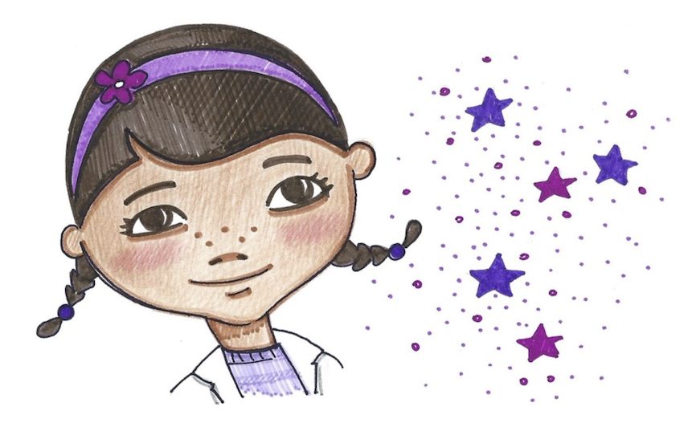
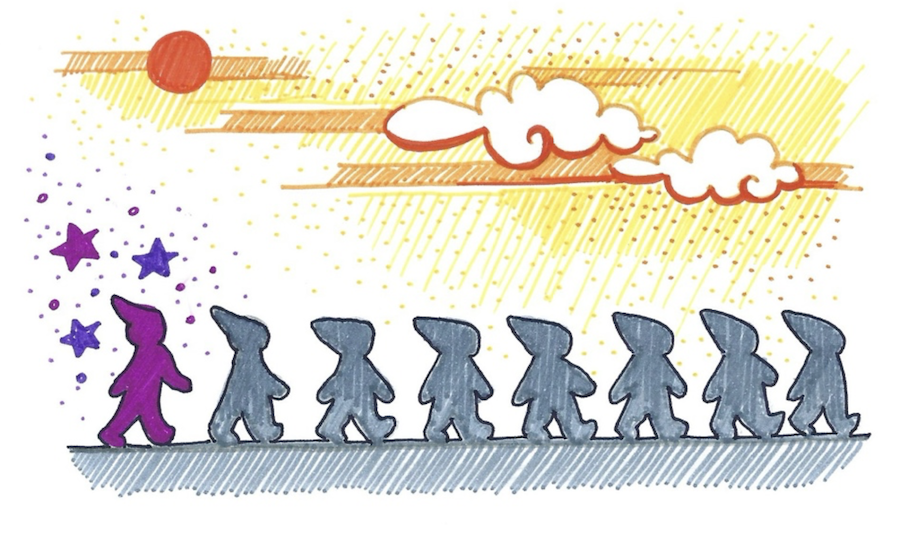

Cón chèsto cäpìtol mé fenés él mé löbär, ma l’é mìä dé chèst che öl parlà. L’é ön fat tròp frèsk pèr fa part dèi regòrcc. Magàre trä sik, dés…vint agn èl pöl das, chèi ch’èl sà?...

Pèr ädés öl ciöntà-sö lä miè espäriènsä dä äotùr: él löbär che ò scriì pèr lä miè “stréä picinìnä”, bèlä fés, Camilla, quànt lä gàä tri agn. L’é stàdä elè ä esperà töte lé stòrie dé chèl löbär. Él titól: ”Giacomilla & la Strega Burlona” (Giacomilla e lä Stréä Matòlä”).

“Giacomilla” l’é lä combenäsiù dèl so nóm cón chèl dèl frädelì Giacomo dé ön an. Lä stréä Matòlä l’é önä stréä despetùzä che lä sé deèrt ä sträolgì lé stòrie che i fänzì i cognés za e ä creà confoziù.

Él löbär èl ciüntä lé stòrie dé Peppa Pig, Dotorèsä Peluche,Biancaneve e i sèt nani, Mago Merlino.

Pèr iü comià mé, che èl scärsäzä dé fäntäzìä, enventà chèle stòrie l’é stàdä ön’ emprézä empegnätìä. Ma ä lä fì, él mé sfòrs l’é stà repagà dä lä contäntèsä dé Camilla quànt lä s’é troàdä trä lé ma chèl löbär egliò, dezegnà bé fés dä lä ziä Linda e cörà  pèr lä gräfekä dä lä nònä Piera.

Empèrte ém stemàe quànt, pèr dé e dé, lä mé fàä sémpär lä stèsä domàndä: “Nòno, ém lezèt lä stòriä dèlä Stréä Matòlä?”. Có ’s pöl ölì deplö?

