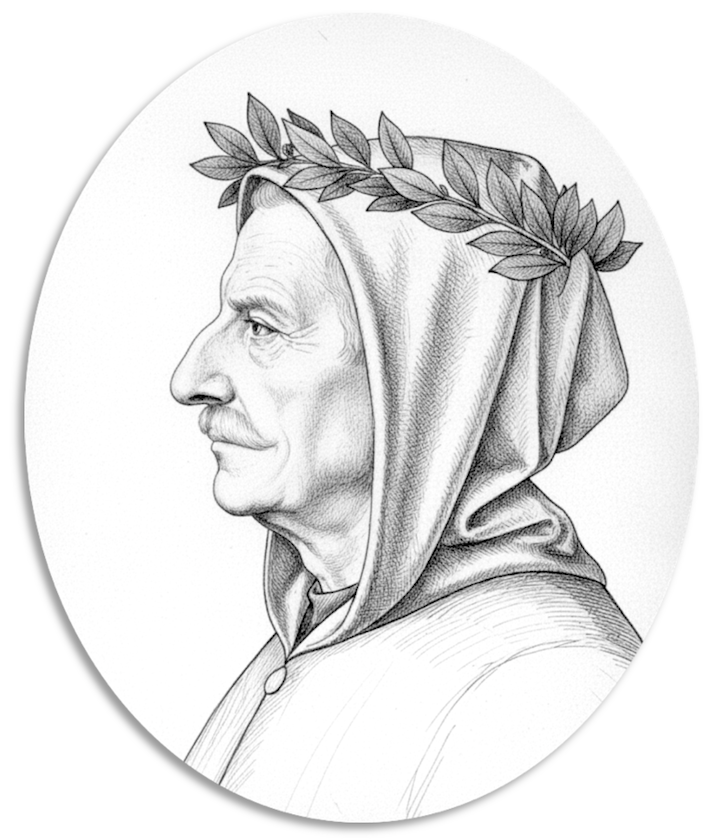

Él mé rengräsiämènt plö säntì èl va ä töcc i pärsonàgi nomäné én chèsto löbär che, én mäniérä derétä o enderétä, oläntariämènt o nò, i gà ì önä part ’nd’èi facc ciönté-sö. Sénsä dé èi, tancc regòrcc i särés mài deenté tai.

Ön grasie speciàl ä lä miè fomlä Piera. Chèst’an, 2025 (dumelävintisìk) óm festegià él nòs sinquantésäm encolàn dé spùzä: ön träguàrt che àl fés, fat dé alcc e bas e dé tante sodesfäsiù. Cón elè ò spärtì ì regòrcc plö bèi e che gà tàntä emportansä dé chèsti sinquànt’agn: lä spùzä, i fiöi e i sò träguàrcc ä s-ciölä e ä laorà, i nägùcc che i m’emplenés dé contäntèsä.

Regòrcc tròp presiùs pèr chèsto löbär, ma insì ’nd’èl mé ciör.

L’é mèret sò lä òä e lä fòrsä dä ì scriì dèi mé regòrcc, dé ardà äl pasà cón contäntèsä e ön pò dé schèrs. Té pöde fal äpénä sé té si särì, én pàce cón té stès e cói tò. Ä Piera lä va tötä lä mé profóndä oblägäsiù pèr ìm dedà ä deäntà lä pärsùnä che su enciö.

Ön gràsie èl va poà ä lä miè fiölä Linda, äl mé fiöl Filippo, äi nägùcc Camilla e Giacomo, che i m’à dàt sopòrt pèr lä part tènicä, enformàtekä e gràfekä dé chèsto laorà.

Ä lä fì dé chèsto mé laorà, ömel ma fat cón tàntä pasiù, öi dì tötä lä miè oblägäsiù ä Fiorino Bazzani e Graziano Melzani, äotùr dèl “Nuovo vocabolario del dialetto di Bagolino”, stampà ’nd’èl 2002 (dumelädu) dä Grafo Edizioni dé Brèsä, che l’é stà ön strömènt presiùs e necesàrio pèr lä trädösiù ’nd’èl deälèt bagòs: lä “lènguä” cón che su ignì grant, chèlä dèlä miè tèrä, ön dèi Borghi plö bèi d’Italiä.

Ä mé frädél Graziano, én plö, ön rengräsiämént speciàl pèr i sò consèi dé välùr e pèr lä ma che èl m’à dàt, comià grant entändedùr dèl deälèt dé Bagolì.

Pierluigi

Noàtre fiöi, Linda e Filippo, és sum concedì ön ciäpelì dé endependénsä: prömä dèlä stampä, óm ölì mätì chèsto rengräsiämènt ä l’äotùr. Pèr noàtre l’é ön bobà modèl e, ä stemà dèlä contäntèsä dèi nagùcc, dä nòno l’é äderetürä mèi.

Gràsie bobà. Cón tötä lä nòsä sempätìä.

Linda e Filippo

