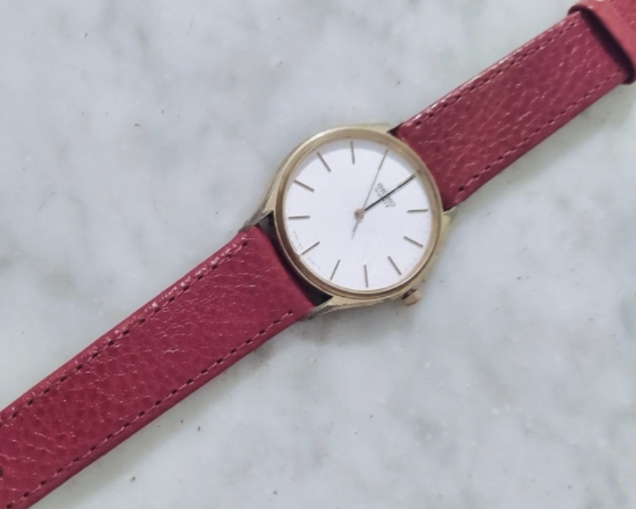
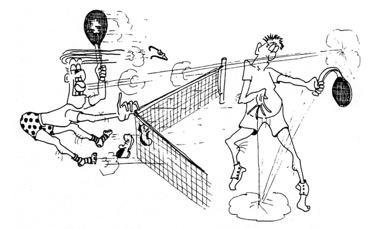

## Neapolitans, so exuberant

In the office where I worked, thanks to the fact that everyone was young, the atmosphere was pleasant and relaxed. We were a close-knit team: each of us did our job with commitment, yet we always found time to joke, exchange comments, and offer advice.

One day, for no particular reason, Ezio climbed onto a desk in the middle of the open-space office. At that very moment, our boss walked in and showed no reaction whatsoever. Ezio immediately regretted what he had done, but the damage was done. Feeling discouraged, he turned to me and asked what he should do: pretend nothing had happened, or justify himself to the boss?

I advised him to talk about it, choosing the right moment, perhaps by saying that he had wanted to check the airflow from the air conditioner, which was sometimes too cold and annoying. Nearby was Maurizio, a Neapolitan engineer, and Ezio asked him too, hoping for a more imaginative suggestion.

Maurizio tried to reassure him by downplaying the whole thing and adding that our boss—who had serious eyesight problems—might not even have noticed. Still worried about losing the salary raise he had been expecting for quite some time, Ezio decided to talk to the boss. He walked into his office, and we could see him talking and gesturing, though we couldn’t hear what was being said.

A few minutes later, Ezio came out looking more relaxed. “What did he say?” Maurizio asked immediately. Ezio, with a faint smile, replied: “These Neapolitans are so exuberant!” — implying that the boss had mistaken Maurizio for the culprit. Of course, it wasn’t true, but Maurizio reacted instantly: “Eh no! I won’t have it! I’m going straight in there to say it wasn’t me!” We stopped him just in time, and that was the end of it — amid our loud laughter. Yes, perceptions can change depending on who…

## The exact time committee

At the time, the first quartz watches had just appeared on the market. Ezio was the first in our office to buy one, a Seiko from the renowned Japanese brand. I have two passions I can hardly resist: watches and fountain pens. I liked Ezio’s watch a lot and, with my wife’s permission and my mother-in-law’s help, I bought the same model for my birthday. Ezio and I, proudly wearing those precious timepieces on our wrists, showed them off no small amount to our colleagues. Our friend Marco didn’t want to be left behind and bought the same model, but with a gold-coloured dial, just to stand out.

The three watches were beautiful, elegant, and extraordinarily precise. Every day we checked the time together, delighted with our purchase. After a while, we proclaimed ourselves the “Exact Time Committee.” The committee served no purpose whatsoever except letting us flaunt a little and generate just a tiny bit of envy among our coworkers. Every day at 12:00, the committee would meet, count down — 3, 2, 1 — and announce the time in unison.

The ritual continued until one day Marco’s watch started showing the wrong time, while mine and Ezio’s remained perfectly synchronized.

Marco was always off — sometimes ahead, sometimes behind, though only by a little. The reason? Ezio and I had secretly agreed to change the time on our watches so that we would always match each other. Marco was going crazy. We tried to justify it scientifically: our white dials reflected a lot of sunlight, whereas his gold-coloured dial absorbed more heat, causing thermal expansion in the hands. So we suggested: “If you want, you can change the dial and put on a white one like ours.”

Marco went to the watchmaker, who after observing the watch for several days assured him there was nothing wrong with it. Eventually, we confessed our trick, and the committee resumed announcing the time — perfectly synchronized.

## The bet

Marco came back from a short business trip to Saudi Arabia, where our company had offices. He was telling us about what he had seen, when the conversation shifted to Camel cigarettes, which a local technician smoked regularly.

According to Marco, the cigarette logo contained a hidden message, visible only to expert eyes.

I don’t remember what the supposed message was, but it sounded like nonsense to us. Marco, who didn’t smoke, couldn’t possibly have had time to look at the packet carefully.

Still, he insisted. “Shall we bet?” he challenged. I and two colleagues accepted, betting 1,000 lire each.

The next day, Marco called the technician in Saudi Arabia while we listened. During the call, his expression shifted from confident and smug to concerned. He hung up and timidly admitted: “You were right; I was mistaken.”

Marco paid the bet, but none of us wanted to take his money — it would have been petty. After a quick discussion, we decided to buy tokens for the office coffee machine so that everyone could benefit from the “winnings.”

We put the tokens in a glass jar on a cabinet in the open space, near Marco’s desk, with a sign: “Help yourselves — Marco is treating.” Whoever passed by felt obliged to thank Marco and ask what the celebration was about.

It’s better not to repeat Marco’s answers — nor the curses he directed at us.

If there’s a moral to this story, it’s that from that day onward, Marco became strongly opposed to any kind of bet.

## Procurement tennis tournament

In the mid-Eighties, a new professional opportunity opened up for me in the company: I joined the procurement department.

My new colleagues, while welcoming me, immediately wanted to know whether I could play tennis. At first, I didn’t understand the meaning of the question, but they explained that they were organizing the annual tennis tournament — a mixed-doubles event pairing one employee from our company with one supplier.

The tournament concluded with a dinner and an awards ceremony for the winning pairs.

The format might raise eyebrows among those who see buyers and vendors as having opposing interests, but in reality the idea had been created to strengthen relationships with suppliers and build a climate of mutual benefit. This little preface explains the pleasant atmosphere that reigned in our workplace.

I’d always enjoyed tennis, and the tournament was the perfect chance to pick it up again. I joined the organizing committee, eager to contribute to the success of the event.

One of our first meetings was hilarious, with scenes worthy of a Fantozzi film. It inspired me to write a playful rhyming commentary poking fun at the protagonists.

Everyone loved it so much that they asked me to write a rhyme for every “Big Match.”

Eventually, the turn came for the match involving the boss and the director — and of course my commentary couldn’t be missing.

Here is the story, taken from the original 1988 “archives”:

<section class="poesia">

6th Tennis Tournament News

– May 11, 1988 –

The Boss’s Match

<blockquote>
“Despite the thunder and the lightning, both courts carried on fighting. 
Of the two matches underway, we’ll tell you ’bout just one today, 
the one with Gerola on the side — a supplier, our trusted guide. 
The contest was a curious sight, so here’s the tale, in black and white. 
Four musketeers stride in with pride, on Court Two the boss’s side. 
His spouse attends, serene and steady; the boss is fit, his forehand ready! 
He serves, they rally, shot by shot, ’til suddenly — the funny part! 
Enrico swings from right to left and hits the boss square in the chest. 
Shocked by the blow, the boss cries out: ‘Hey! What’s that? What’s this about? 
You aim at me? That’s not okay! That’s not the proper way to play!’ 
He waves his racket in the air, a clear intent of vengeance there. 
His partner stands there, stiff and stuck, not knowing what to do — poor luck. 
Like Pinocchio, frozen tight… then whack! he’s hit right in the sight! 
Down he falls, upon the ground, just like soldiers battle-bound. 
The rivals laugh in sheer delight, thinking, ‘We’ll win this match tonight!’ 
Then raindrops fall from heaven’s door 
our heroes hit the showers once more.”*
</blockquote>
</section>

\* Gerola: a supplier (author’s note)
{: .note-small}

<section class="poesia">

A Poem to the Poet – Second Act

(The boss’s response)

<blockquote>
“The poet never twists the tale, 
It’s all quite true — without fail. 
The match, in all its wild commotion, 
ended more in clash than motion. 
And the best part of this story? 
Those who fought were friends — no glory! 
Yet the poet, sly and keen, 
many wonder if he’s been 
just a bit too bold, perhaps… 
teasing so his boss, with jabs? 
Could such daring, seen all day, 
make his career fade away?”
</blockquote>
</section>

To this subtle threat from the director I replied with another rhyme, of which I quote only the opening lines:

<section class="poesia">
<blockquote>
“Today again the sky’s not clear, 
and yes — a comment you shall hear. 
For art must follow its own path, 
even when threats come with a laugh…”
</blockquote>
</section>

The exchange of rhymes was greatly appreciated — just like some of the rallies on the court.

And yes, my career survived completely unscathed despite my cheeky verses — and despite the fact that I even won the tournament, beating the boss himself, who took it all with admirable sportsmanship.
